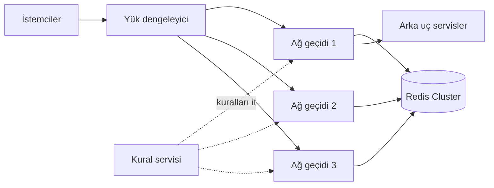

"Bir hız sınırlayıcı (rate limiter) tasarlayın" sorusu küçük görünür ama algoritma seçimi, dağıtık sayaçlarda yarış durumu, gecikme bütçesi ve "sınırlayıcı çökerse ne olur?" gibi derin konulara iner. Stripe, Cloudflare, GitHub gibi her büyük API'nin önünde bir hız sınırlayıcı vardır.

## 1. Gereksinimler

**İşlevsel:**

- İstemciyi bir **anahtara** göre sınırla: kullanıcı kimliği, API anahtarı ya da IP adresi.
- Kurallar yapılandırılabilir olsun: "ücretsiz plan: dakikada 100 istek", "giriş uç noktası: IP başına dakikada 5 deneme".
- Sınır aşılınca `429 Too Many Requests` döndür ve istemciye ne zaman yeniden deneyebileceğini söyle.

**İşlevsel olmayan:**

- **Düşük gecikme:** her isteğin yolunda olduğu için ~1 ms'den az eklemeli.
- **Yüksek erişilebilirlik:** sınırlayıcı çökerse API çökmemeli.
- **Dağıtık doğruluk:** istekler onlarca sunucuya dağılsa da sınır küresel olarak uygulanmalı. Küçük bir aşım (%1–2) kabul edilebilir.
- Ölçek: saniyede 1 milyon istek, 100 milyon farklı anahtar.

## 2. Nereye konur

| Yer | Artı | Eksi |
| --- | --- | --- |
| İstemci | Ucuz | Güvenilmez; kötü niyetli istemci uymaz |
| **API ağ geçidi / ara katman** | Merkezi, servislerden bağımsız, tek yerde yapılandırma | Ek bir bileşen |
| Servis içi | İş mantığına göre ince ayar (ör. "ayda 10 dışa aktarma") | Her serviste tekrar |

Genel kural: kaba sınırlar (IP, API anahtarı) ağ geçidinde; iş kuralı olan kotalar servis içinde. DDoS gibi hacimsel saldırılar ise daha önce, ağ kenarında (CDN/WAF) karşılanır.

## 3. Algoritmalar

### Token bucket (jeton kovası)

Kovanın kapasitesi `b` jetondur ve saniyede `r` jetonla dolar. Her istek bir jeton harcar; jeton yoksa reddedilir.

- **Ani yüke (burst) izin verir:** kova doluysa `b` istek hemen geçer, uzun vadede ortalama `r`'de kalır.
- Anahtar başına yalnızca iki değer saklanır: jeton sayısı ve son doldurma zamanı. Jetonlar her istekte **tembel** hesaplanır; arka planda dolduran bir zamanlayıcı gerekmez.
- Amazon ve Stripe'ın kullandığı yöntemdir; mülakatta güvenli varsayılan.

```typescript
interface Bucket { tokens: number; updatedAt: number }

function tryConsume(bucket: Bucket, capacity: number, ratePerSec: number, now: number): boolean {
  const elapsedSec = (now - bucket.updatedAt) / 1000;
  bucket.tokens = Math.min(capacity, bucket.tokens + elapsedSec * ratePerSec);
  bucket.updatedAt = now;

  if (bucket.tokens < 1) return false;

  bucket.tokens -= 1;
  return true;
}
```

### Sızdıran kova (leaky bucket)

İstekler bir kuyruğa girer ve kuyruk **sabit hızla** boşaltılır. Çıkış hızı pürüzsüzdür; ani yük kuyrukta bekler, kuyruk doluysa reddedilir. Arkadaki sistemin sabit hız istediği durumlar (ör. üçüncü taraf bir API'ye çağrı) için uygundur. Dezavantajı: ani yükte yeni istekler eskilerin arkasında bekler.

### Sabit pencere sayacı

Her dakika için bir sayaç: `sayac:{anahtar}:{dakika}`. Basit ve ucuzdur. Sorunu **pencere sınırı**dır: dakikada 100 sınırında, 12:00:59'da 100 ve 12:01:00'da 100 istek gelirse iki saniyede 200 istek geçer.

### Kayan pencere günlüğü

Her isteğin zaman damgası sıralı bir kümede saklanır; son 60 saniyedeki kayıt sayısı sınırla karşılaştırılır. **Kesin** sonuç verir ama anahtar başına istek sayısı kadar bellek harcar.

### Kayan pencere sayacı

Sabit pencerenin ucuzluğu ile kayan pencerenin doğruluğu arasında bir uzlaşma: önceki pencerenin sayısı, mevcut pencereye ne kadar örtüştüğüne göre ağırlıklandırılır.

```text
tahmin = mevcut_pencere_sayısı + önceki_pencere_sayısı × (önceki pencerenin örtüşen oranı)

Örnek: sınır 100/dk; 12:01:15'teyiz. Önceki dakika 80, bu dakika 30 istek.
Kayan pencere 12:00:15–12:01:15; önceki dakikanın %75'i içeride.
tahmin = 30 + 80 × 0,75 = 90 → istek kabul edilir.
```

Anahtar başına iki sayaç; trafiğin pencere içinde eşit dağıldığı varsayımıyla küçük bir hata yapar. Cloudflare bu yöntemi kullandığını ve hatanın çok küçük olduğunu yayımlamıştır.

| Algoritma | Bellek | Doğruluk | Ani yüke izin | Not |
| --- | --- | --- | --- | --- |
| Token bucket | 2 değer | İyi | Evet (kontrollü) | Varsayılan seçim |
| Sızdıran kova | Kuyruk | İyi | Hayır | Sabit çıkış hızı |
| Sabit pencere | 1 sayaç | Sınırda 2 kat aşım | Sınırda | En basiti |
| Kayan pencere günlüğü | İstek başına | Kesin | Hayır | Pahalı |
| Kayan pencere sayacı | 2 sayaç | Yaklaşık | Hayır | İyi ödünleşim |

## 4. API

İstemciye durumunu başlıklarla bildirin:

```http
HTTP/1.1 429 Too Many Requests
Retry-After: 12
RateLimit-Limit: 100
RateLimit-Remaining: 0
RateLimit-Reset: 12
```

Kural yapılandırması (ör. YAML, bir yapılandırma servisinde saklanır ve sunuculara itilir):

```yaml
- match: { plan: free }
  limit: { requests: 100, per: minute }
- match: { path: /v1/login, by: ip }
  limit: { requests: 5, per: minute }
```

## 5. Dağıtık tasarım

Onlarca API sunucusu var. Her sunucu kendi belleğinde sayarsa, istekler dağıldığı için gerçek sınır `sınır × sunucu sayısı` olur. Sayacın **paylaşılan** bir yerde tutulması gerekir: Redis.



### Yarış durumu

"Oku, kontrol et, yaz" üç ayrı Redis komutuyla yapılırsa iki sunucu aynı anda `99` okur, ikisi de kabul eder ve sınır aşılır. Çözüm, işlemi **atomik** yapmaktır. En basit yol sabit pencere için `INCR` + `EXPIRE`; token bucket ve kayan pencere için ise **Lua betiği** (Redis betiği tek seferde, kesintisiz çalıştırır):

```lua
-- KEYS[1] = kova anahtarı; ARGV = kapasite, saniyedeki hız, şimdiki zaman (ms)
local capacity = tonumber(ARGV[1])
local rate     = tonumber(ARGV[2])
local now      = tonumber(ARGV[3])

local bucket  = redis.call('HMGET', KEYS[1], 'tokens', 'ts')
local tokens  = tonumber(bucket[1]) or capacity
local ts      = tonumber(bucket[2]) or now

tokens = math.min(capacity, tokens + (now - ts) / 1000 * rate)

local allowed = 0
if tokens >= 1 then
  tokens = tokens - 1
  allowed = 1
end

redis.call('HSET', KEYS[1], 'tokens', tokens, 'ts', now)
redis.call('PEXPIRE', KEYS[1], math.ceil(capacity / rate * 1000))
return allowed
```

Zamanı sunucunun saati yerine Redis'in `TIME` komutundan almak, sunucular arası saat kaymasının etkisini ortadan kaldırır.

### Ölçek ve bellek

- 100 milyon anahtar × ~100 bayt ≈ 10 GB: birkaç Redis düğümüne rahatça sığar. Anahtarlar TTL ile kendiliğinden düşer.
- Saniyede 1 milyon kontrol: Redis Cluster'da anahtar hash'ine göre dağılır; düğüm başına ~100.000 işlem ile ~10 birincil düğüm.
- Gecikme: aynı erişilebilirlik bölgesinde Redis gidiş dönüşü ~0,5 ms. Daha da düşürmek için:
  - **Yerel ön sayaç:** her sunucu küçük bir jeton payını yerelde harcar ve Redis ile toplu eşitler (doğruluktan biraz feda, gecikme ve yük ciddi azalır).
  - Açıkça engellenmiş anahtarları (`Retry-After` süresince) yerel bellekte tutup Redis'e hiç sormamak.

### Çok bölgeli dağıtım

Küresel tek bir Redis, kıtalar arası gecikme ekler. Seçenekler:

- Her bölge kendi sınırını uygular (sınırın bölge sayısına bölünmesi ya da bölge başına ayrı kota).
- Bölgeler arası eşzamansız eşitleme: yaklaşık küresel sınır; kısa süreli aşım kabul edilir.

Çoğu ürün için "bölge başına doğru, küresel olarak yaklaşık" yeterlidir; bunu açıkça söyleyin.

## 6. Hata durumları

**Redis erişilemezse ne olur?** Bu, mülakatın en önemli sorusudur.

- **Açık başarısızlık (fail open):** sınırlama yapmadan isteği geçir. Erişilebilirliği korur; kısa süre korumasız kalınır. Çoğu genel API için doğru seçim.
- **Kapalı başarısızlık (fail closed):** isteği reddet. Giriş denemesi, SMS gönderimi, ödeme gibi kötüye kullanımın pahalı olduğu uç noktalar için.
- Her iki durumda da kısa bir zaman aşımı (~5–10 ms) ve devre kesici; Redis'i beklerken API'yi kilitlemeyin. Redis düşükken sunucu içi yerel sınırlayıcıya geri düşmek iyi bir orta yoldur.

**Kural güncellemeleri:** kurallar her istekte okunmaz; sunucular bellekte tutar ve yapılandırma servisi değişiklikleri iter (ya da sunucular periyodik çeker).

## 7. Derinleşme soruları

- **Hangi anahtar?** Kimliği doğrulanmış kullanıcılar için kullanıcı/API anahtarı; anonim trafik için IP (NAT arkasındaki binlerce kullanıcı aynı IP'yi paylaşır; bunu söyleyin).
- **Birden çok kural:** saniyede 10 **ve** dakikada 300 **ve** günde 10.000; her biri ayrı kova, hepsi aynı Lua çağrısında denetlenir.
- **Maliyet temelli sınırlama:** her istek bir jeton değil, maliyeti kadar jeton harcar (pahalı arama 10, basit okuma 1).
- **Adil paylaşım:** sistem genel olarak aşırı yüklendiğinde öncelikli müşterilere kapasite ayırmak (yük atma ile birlikte).

## Bu sorudan çıkarılacak genel dersler

- Algoritma seçimi bir ödünleşimdir: token bucket ani yüke izin verir, kayan pencere sayacı ucuz ve yeterince doğrudur.
- Dağıtık sayaçta "oku–kontrol et–yaz" atomik olmalıdır: Redis + Lua.
- Kritik yoldaki her bileşen için "bu çökerse açık mı kapalı mı başarısız olmalı?" sorusunu sorun.

**Daha fazlası:** [Stripe: Scaling your API with rate limiters](https://stripe.com/blog/rate-limiters); [Cloudflare: How we built rate limiting capable of scaling to millions of domains](https://blog.cloudflare.com/counting-things-a-lot-of-different-things/); Alex Xu, *System Design Interview* Cilt 1, Bölüm 4.
