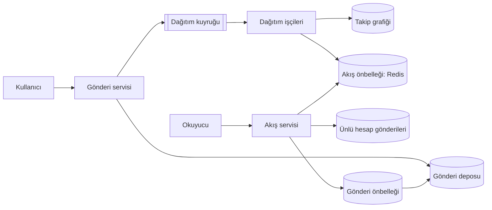

Haber akışı (news feed) sorusu, sistem tasarımının en klasik ödünleşimini içerir: işi **yazarken mi** yoksa **okurken mi** yapacaksınız? Twitter/X ana sayfası, Instagram akışı, Facebook haber kaynağı ve LinkedIn akışı aynı problemin çeşitleridir.

## 1. Gereksinimler

**İşlevsel:**

- Kullanıcı gönderi paylaşır (metin + isteğe bağlı görsel).
- Kullanıcı başka kullanıcıları takip eder.
- Kullanıcı, takip ettiklerinin gönderilerinden oluşan akışını **ters kronolojik** sırayla, sayfalı olarak görür.
- Kapsam dışı (söyleyerek): arama, öneri algoritması, reklam, doğrudan mesaj.

**İşlevsel olmayan:**

- Akış yüklemesi hızlı: p99 < 500 ms.
- Yüksek erişilebilirlik; **nihai tutarlılık kabul edilebilir**: bir gönderinin takipçilerin akışına birkaç saniye geç düşmesi sorun değil.
- Ölçek: 500 milyon günlük etkin kullanıcı, ortalama 200 takip edilen, bazı hesapların 100 milyondan fazla takipçisi var.

## 2. Kapasite

- Gönderi: günde 500 milyon gönderi → **~6.000 / saniye** (zirvede ~20.000).
- Akış okuma: kullanıcı başına günde 10 akış açılışı → 5 milyar / gün → **~60.000 / saniye** (zirvede ~200.000).
- Okuma ağırlıklı (10:1) ve okumanın gecikme hedefi sıkı. **Sonuç:** akışı okuma anında hesaplamak pahalı olacak; önceden hazırlamak cazip.
- Gönderi meta verisi: 500 milyon × 1 KB = 500 GB / gün. **Sonuç:** gönderiler parçalanmış bir depoda; medya nesne deposunda.

## 3. API

```http
POST /v1/posts                      { "text": "...", "mediaIds": ["..."] }   -> 201 { "postId": "..." }
POST /v1/users/{id}/follow                                                    -> 204
GET  /v1/feed?cursor=...&limit=20                                             -> { "items": [...], "nextCursor": "..." }
```

Akış sonsuz kaydırmadır: **imleçle sayfalama** (son görülen gönderinin kimliği), ofset değil. Gönderi kimlikleri Snowflake gibi zamana göre sıralı olursa imleç doğrudan kimliktir.

## 4. Veri modeli

| Tablo | Anahtar | Not |
| --- | --- | --- |
| `users` | `user_id` | Profil |
| `posts` | `post_id` (Snowflake) | `author_id`, metin, medya anahtarları, zaman; `author_id`'ye göre parçalı |
| `follows` | `(follower_id, followee_id)` | İki yönlü sorgu gerekir: "kimi takip ediyorum" ve "beni kim takip ediyor"; iki ayrı tablo/indeks |
| `feed` (önbellek) | `user_id` → gönderi kimlikleri listesi | Redis'te, kullanıcı başına son ~800 gönderi kimliği |

## 5. Temel karar: akış ne zaman hesaplanır?

### Okuma anında birleştirme (fan-out on read / pull)

Akış açılınca: takip edilen 200 kişiyi bul, her birinin son gönderilerini getir, birleştir, sırala.

- Artı: yazma ucuzdur; ünlü hesap sorunu yoktur.
- Eksi: her akış açılışında 200 parçaya sorgu (scatter-gather). Saniyede 60.000 akış × 200 = 12 milyon sorgu/saniye. Okuma yavaş ve pahalı.

### Yazma anında dağıtım (fan-out on write / push)

Gönderi paylaşılınca, gönderi kimliği **her takipçinin** akış listesinin başına eklenir. Akış açılışı tek bir listeyi okumaktır.

- Artı: okuma çok hızlı ve ucuz (tek Redis okuması).
- Eksi: yazma büyütülür. Ortalama 200 takipçi ile 6.000 gönderi/saniye → 1,2 milyon akış yazması/saniye. Ve **ünlü hesap sorunu:** 100 milyon takipçili bir hesabın tek gönderisi 100 milyon yazma demektir; dağıtım dakikalar sürer.
- Hiç giriş yapmayan kullanıcıların akışlarını da güncellemek israftır.

### Melez model

Twitter'ın kullandığı yaklaşım:

- **Sıradan hesaplar** (ör. < 10.000 takipçi): yazma anında dağıt.
- **Ünlü hesaplar:** dağıtma. Takipçi akışını açtığında, önceden hesaplanmış akış listesi ile takip ettiği (az sayıdaki) ünlü hesapların son gönderileri **okuma anında birleştirilir**.
- Son 30 günde giriş yapmamış kullanıcılara dağıtım yapılmaz; geri döndüklerinde akışları okuma anında yeniden kurulur.



### Akış okuma adımları

1. Akış önbelleğinden kullanıcının gönderi kimliklerini al (imleçten sonraki 20 + biraz fazlası).
2. Kullanıcının takip ettiği ünlü hesapların son gönderilerini al ve birleştir (kimlikler zamana göre sıralı olduğu için birleştirme ucuz).
3. Kimlikleri gönderi önbelleğinden **toplu** (`MGET`) çözümle: metin, yazar, medya URL'leri, sayaçlar.
4. Silinmiş gönderileri, engellenmiş kullanıcıları süz.
5. Yanıtı ve sonraki imleci döndür.

Akış önbelleğinde yalnızca **kimlikler** tutulur, gönderinin kendisi değil: bir gönderi milyonlarca listede geçer; içeriği bir kez, gönderi önbelleğinde saklanır. Düzenleme ve silme de böylece tek yerde yapılır.

## 6. Derinleşme

**Dağıtım işçileri.** Gönderi servisi yalnızca gönderiyi kaydedip kuyruğa olay bırakır; kullanıcı beklemez. İşçiler takipçi listesini sayfalar halinde okuyup Redis'e toplu (`pipeline`) yazar. Akış listesi sınırlı tutulur (`LPUSH` + `LTRIM` ile son 800). Çok takipçili gönderiler parçalara bölünüp paralel işlenir.

**Sayaçlar (beğeni, yorum, görüntülenme).** Viral bir gönderiye saniyede on binlerce beğeni gelir; tek bir veritabanı satırını güncellemek sıcak nokta yaratır. Beğeni olayları kuyruğa yazılır; sayaç Redis'te `INCR` ile tutulur ve periyodik olarak kalıcı depoya toplu yazılır. Gerekirse sayaç anahtarı tuzlanır (`likes:42:0..9`) ve okumada toplanır. Görünen sayının birkaç saniye geride olması kabul edilebilir. "Bu kullanıcı beğendi mi?" ise ayrı bir `(post_id, user_id)` kaydıdır.

**Sıralama.** Ters kronolojik sıradan alaka sıralamasına geçmek: aday gönderiler (akış önbelleği + ünlüler + öneriler) toplanır, bir puanlama modeli (etkileşim olasılığı) ile sıralanır. Mülakatta mimariyi "aday üretimi → puanlama → yeniden sıralama (çeşitlilik, kurallar)" olarak çizmek yeterlidir.

**Medya.** Görseller ön imzalı URL ile doğrudan nesne deposuna yüklenir, farklı boyutları eşzamansız üretilir, CDN'den sunulur. Akış yanıtı yalnızca CDN URL'lerini içerir.

**Yeni takip / takipten çıkma.** Takip edilince yeni hesabın son birkaç gönderisi akışa eklenebilir (ya da sonraki okumada birleştirilir); takipten çıkınca akış listesini temizlemek yerine okuma anında süzmek daha ucuzdur.

**Akış önbelleği kaybı.** Redis düğümü giderse akışlar takip grafiği ve gönderi deposundan yeniden kurulabilir: akış önbelleği **türetilmiş veridir**. Soğuk başlangıçta okuma anında birleştirmeye geri düşülür.

**Kendi gönderini görmek.** Dağıtım eşzamansız olduğu için kullanıcı kendi gönderisini akışında hemen görmeyebilir. İstemci, paylaşılan gönderiyi yerel olarak akışın başına ekler (iyimser arayüz); sunucu da yazarın kendi gönderilerini okuma anında birleştirir.

## Bu sorudan çıkarılacak genel dersler

- Okuma ağırlıklı sistemlerde işi yazma anına taşıyın (önceden hesaplama), ama dağıtım maliyetinin uçlarını (ünlü hesaplar, pasif kullanıcılar) ayrı ele alın.
- Önbellekte kimlik listesi, içerik ayrı: büyük kopyalamaları önler, güncellemeyi tek yerde tutar.
- Sayaçlar sıcak noktadır: biriktir, toplu yaz, gerekirse anahtarı parçala.
- Nihai tutarlılığın kullanıcıya görünen yüzünü (kendi gönderisini görememe) ayrıca çözün.

**Daha fazlası:** [Twitter'ın zaman akışı mimarisi (Raffi Krikorian, InfoQ)](https://www.infoq.com/presentations/Twitter-Timeline-Scalability/); [Scaling Memcache at Facebook (NSDI 2013)](https://www.usenix.org/conference/nsdi13/technical-sessions/presentation/nishtala); Alex Xu, *System Design Interview* Cilt 1, Bölüm 11.
