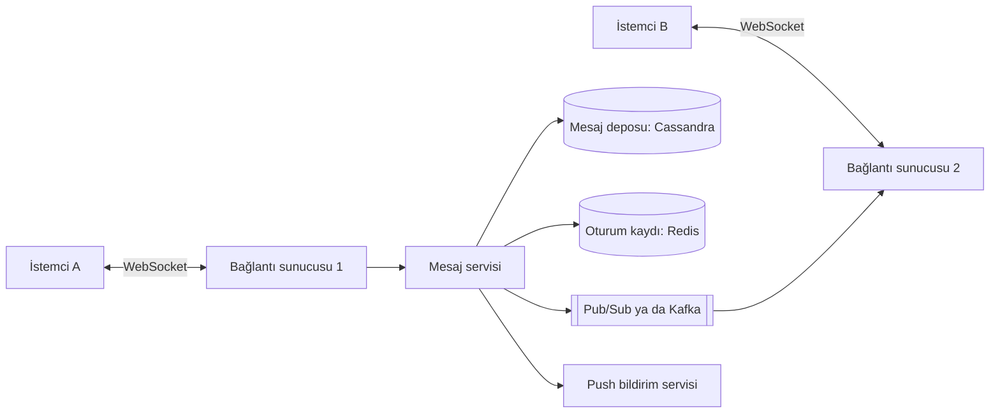

Sohbet uygulaması, **gerçek zamanlı iletişim** ile **yüksek yazma hacmini** birleştirir. Asıl zorluklar: milyonlarca açık bağlantıyı yönetmek, mesajı alıcının bağlı olduğu sunucuya ulaştırmak, hiçbir mesajı kaybetmemek ve sırayı korumak.

## 1. Gereksinimler

**İşlevsel:**

- Birebir sohbet ve grup sohbeti (en fazla 500 kişi).
- Mesajlar gerçek zamanlı iletilir; alıcı çevrimdışıysa bağlandığında alır.
- İletildi ve okundu bilgisi (✓ / ✓✓).
- Çevrimiçi durumu ve "son görülme".
- Birden çok cihaz (telefon + web).
- Kapsam dışı: sesli/görüntülü arama, uçtan uca şifrelemenin ayrıntıları (yalnızca değinilecek).

**İşlevsel olmayan:**

- Düşük gecikme: aynı bölgede < 200 ms.
- **Mesaj kaybı olmamalı**; sohbet içinde sıra korunmalı.
- Ölçek: 500 milyon günlük etkin kullanıcı, kişi başı günde 40 mesaj, aynı anda ~100 milyon açık bağlantı.

## 2. Kapasite

- Mesaj: 500 milyon × 40 = 20 milyar / gün → **~230.000 / saniye**, zirvede ~1 milyon.
- Depolama: mesaj başına ~200 bayt → 4 TB / gün; 3 kopyayla yılda ~4,5 PB (medya hariç). **Sonuç:** yazma ağırlıklı, yatay ölçeklenen bir depo.
- Bağlantı: bir bağlantı sunucusu (iyi ayarlanmış) ~500.000–1 milyon boşta WebSocket tutabilir; 100 milyon bağlantı için güvenlik payıyla **birkaç yüz** bağlantı sunucusu.

## 3. Bağlantı protokolü

Sunucunun istemciye anında mesaj itmesi ve istemcinin sık mesaj göndermesi gerekir: **WebSocket** (mobilde uygulama arka plandayken bağlantı kapanır; o zaman **push bildirimi**: APNs, FCM). Kalıcı bağlantı her iki yönde de kullanılır: mesaj gönderme, mesaj alma, iletildi/okundu bilgisi, yazıyor... göstergesi.

## 4. API (WebSocket üzerindeki olaylar)

```json
// İstemci → sunucu
{ "type": "send", "clientMsgId": "c-7f3a", "chatId": "ch-91", "text": "Merhaba" }
{ "type": "ack", "chatId": "ch-91", "upToSeq": 1042 }
{ "type": "read", "chatId": "ch-91", "upToSeq": 1042 }

// Sunucu → istemci
{ "type": "sent", "clientMsgId": "c-7f3a", "msgId": "m-88121", "seq": 1043 }
{ "type": "message", "chatId": "ch-91", "seq": 1043, "from": "u-12", "text": "Merhaba", "ts": 1763650000000 }
```

`clientMsgId` istemcinin ürettiği benzersiz kimliktir; ağ kopup istemci mesajı yeniden gönderirse sunucu aynı mesajı ikinci kez kaydetmez (**idempotency**).

Geçmiş mesajlar ve sohbet listesi gibi istek–yanıt işlemleri sıradan HTTP ile yapılır:

```http
GET /v1/chats/ch-91/messages?beforeSeq=1000&limit=50
```

## 5. Üst düzey tasarım



**Bağlantı sunucuları** yalnızca bağlantıları tutar ve mesajları taşır; iş mantığı içermez. Böylece sürüm güncellemeleri ve çökmeler bağlantı katmanını minimum etkiler. **Oturum kaydı**, hangi kullanıcının (ve cihazının) hangi bağlantı sunucusuna bağlı olduğunu tutar.

### Mesaj gönderme akışı

1. A, `send` olayını bağlantı sunucusu 1'e gönderir.
2. Mesaj servisi sohbet için bir sonraki **sıra numarasını** alır, mesajı depoya yazar.
3. Yazma başarılıysa A'ya `sent` (✓) döner. **Önce kalıcı depo, sonra onay:** sunucu çökerse onaylanmış mesaj kaybolmaz.
4. Servis, B'nin hangi sunucuda olduğunu oturum kaydından bulur ve mesajı o sunucunun kanalına yayınlar (ya da B'nin kişisel kanalına; bağlantı sunucusu bağlı kullanıcılarının kanallarına abonedir).
5. Bağlantı sunucusu 2, mesajı B'ye iter. B `ack` gönderir; A'ya iletildi (✓✓) bilgisi aynı yoldan gider.
6. B çevrimdışıysa push bildirimi gönderilir; mesaj depoda bekler.

## 6. Sıralama ve teslim garantileri

**Sıra.** İstemci saatleri güvenilmezdir; sunucu saatleri de birbirinden kayar. Sıralama, **sohbet başına artan sıra numarasıyla** (`seq`) yapılır. Sıra numarasını tek bir yer verir: sohbet bölümünün sahibi (ör. `chat_id`'ye göre Redis `INCR`, ya da bir sohbetin bütün mesajlarını sırayla işleyen tek bir bölüm/işçi). Kafka'da sohbet kimliğini bölüm anahtarı yapmak, bir sohbetin mesajlarının sırayla işlenmesini sağlar.

**Teslim.** Ağ, mesajı kaybedebilir ya da çoğaltabilir. Model: **en az bir kez teslim + istemcide tekilleştirme**.

- Sunucu, istemci `ack` göndermeyene kadar mesajı "teslim edilmemiş" sayar.
- İstemci her sohbet için **aldığı en son sıra numarasını** bilir. Yeniden bağlandığında "ch-91 için 1042'ye kadar aldım" der; sunucu 1043'ten itibaren gönderir. Aynı `seq` iki kez gelirse istemci yok sayar.
- Sıra numarasında boşluk görürse (1043'ten sonra 1045) istemci eksik aralığı ister.

Bu tasarımda çevrimdışı teslim için ayrı bir "gelen kutusu" gerekmez: **senkronizasyon, son görülen sıra numarasından sonrasını çekmektir**. Birden çok cihaz da aynı mekanizmayla, her cihaz kendi konumunu tutarak eşitlenir.

## 7. Mesaj deposu

Erişim deseni: "bir sohbetin, belirli bir noktadan önceki/sonraki N mesajı". Yazma hacmi çok yüksek, güncelleme yok denecek kadar az, son mesajlar çok sık okunur.

Bu, geniş sütunlu bir depo (Cassandra, ScyllaDB, HBase) için ideal bir yüktür:

```sql
CREATE TABLE messages (
  chat_id    text,
  bucket     int,       -- ör. aylık ya da sıra numarası aralığı; bölümün sınırsız büyümesini önler
  seq        bigint,
  sender_id  text,
  body       text,
  created_at timestamp,
  PRIMARY KEY ((chat_id, bucket), seq)
) WITH CLUSTERING ORDER BY (seq DESC);
```

Bölüm anahtarı `(chat_id, bucket)`: bir sohbetin mesajları birlikte, sıra numarasına göre sıralı durur; "son 50 mesaj" tek bölümden sıralı bir okumadır. `bucket`, çok aktif bir sohbetin bölümünün sınırsız büyümesini engeller. Discord ve Facebook Messenger (HBase) benzer modeller kullanır.

## 8. Grup sohbeti

Mesaj gruptaki her üyenin bağlantısına iletilmelidir. 500 kişilik grupta tek mesaj 500 teslimdir.

- Mesaj **bir kez** saklanır (sohbet bölümüne); her üyeye kopyalanmaz.
- Dağıtım: grup üyelerinin bağlı olduğu sunucular bulunur ve mesaj **sunucu başına bir kez** gönderilir; sunucu kendi bağlı üyelerine dağıtır.
- Grup boyutu sınırı (WhatsApp'ta yüzlerce, Discord sunucularında milyonlar) tasarımı değiştirir: çok büyük kanallarda okuma anında çekme modeli ve "yalnızca etkin olanlara it" stratejisi kullanılır.
- Okundu bilgisi büyük gruplarda üye başına `(chat_id, user_id) → son okunan seq` olarak tutulur; her mesaj için ayrı okundu kaydı tutulmaz.

## 9. Çevrimiçi durumu (presence)

- Bağlantı açıkken istemci periyodik **kalp atışı** (ör. 30 saniyede bir) gönderir; durum Redis'te TTL'li bir anahtar olarak tutulur. Kalp atışı kesilince anahtar düşer: "son görülme" = son kalp atışı.
- Durum değişikliğini bütün arkadaşlara anında yaymak pahalıdır (bir kullanıcının binlerce kişisi olabilir). Yalnızca **o an sohbet ekranı açık olan** ya da listeyi görüntüleyen kişilere yayılır; diğerleri ekranı açınca çeker.
- Kısa kopmalarda (tünel) durumun "çevrimdışı ↔ çevrimiçi" titremesini önlemek için birkaç saniyelik gecikmeyle yayınlanır.

## 10. Derinleşme

- **Bağlantı sunucusu çökerse:** istemciler yeniden bağlanır (rastgele gecikmeyle, yoksa bütün istemciler aynı anda saldırır), son sıra numarasından eşitlenir. Mesaj kaybı olmaz; çünkü mesajlar onaydan önce kalıcı depoya yazılmıştır.
- **Medya:** fotoğraf ve video ön imzalı URL ile nesne deposuna yüklenir; mesaj yalnızca medya anahtarını taşır.
- **Uçtan uca şifreleme:** Signal protokolüyle mesajlar istemcide şifrelenir; sunucu içeriği göremez, yalnızca şifreli yükü taşır. Sunucu tarafı arama ve içerik denetimi bu yüzden yapılamaz; bu bir ödünleşimdir.
- **Çok bölgeli:** kullanıcı en yakın bölgeye bağlanır; farklı bölgelerdeki kullanıcılar arasındaki mesajlar bölgeler arası kuyrukla taşınır. Sohbetin sıra numarasını tek bir "ev bölgesi" verir.

## Bu sorudan çıkarılacak genel dersler

- Bağlantıyı tutan katmanı iş mantığından ayırın; kullanıcı → sunucu eşlemesini kayıt defterinde tutun.
- Önce kalıcı depo, sonra onay; teslimi en az bir kez yapıp istemcide tekilleştirin.
- Sırayı saatle değil, sohbet başına sıra numarasıyla kurun; senkronizasyon "son gördüğümden sonrası"dır.
- Yazma ağırlıklı, bölüm içinde sıralı okunan veri için geniş sütunlu depo.

**Daha fazlası:** [Discord: How Discord stores trillions of messages](https://discord.com/blog/how-discord-stores-trillions-of-messages); [Slack: Real-time messaging](https://slack.engineering/real-time-messaging/); Alex Xu, *System Design Interview* Cilt 1, Bölüm 12.
