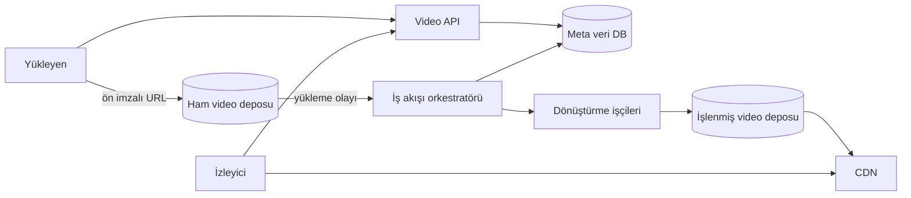

Video platformu sorusu üç farklı alt sistemi birleştirir: **büyük dosya yükleme**, **uzun süren işleme** ve **devasa okuma trafiği**. Maliyetin çoğu bant genişliğindedir; bu yüzden tasarımın merkezinde CDN vardır.

## 1. Gereksinimler

**İşlevsel:**

- Kullanıcı video yükler (birkaç GB'a kadar).
- Kullanıcı videoyu farklı cihazlarda ve ağ koşullarında izler.
- Video başlığı, açıklaması, küçük resmi; görüntülenme sayısı.
- Kapsam dışı: öneri, yorum, canlı yayın, reklam.

**İşlevsel olmayan:**

- İzleme başlangıcı hızlı (< 2 saniye), takılma az.
- Yükleme güvenilir; zayıf ağda kopsa da devam edebilmeli.
- Yüklenen video dakikalar içinde izlenebilir olmalı (anında olması gerekmez).
- Ölçek: günde 1 milyar izlenme, günde 500.000 yükleme.

## 2. Kapasite

- Yükleme: 500.000 × ortalama 300 MB = 150 TB / gün ham video. Her video ~5 çözünürlükte ve birkaç biçimde saklanır → kabaca ham boyutun birkaç katı. **Sonuç:** günde petabayta yaklaşan nesne deposu büyümesi.
- İzleme: 10⁹ izlenme / 10⁵ saniye = **~10.000 izleme başlangıcı / saniye**. Ortalama 5 Mbit/s akışla aynı anda ~2 milyon izleyici → ~10 Tbit/s çıkış. **Sonuç:** kaynak sunucudan verilemez; CDN zorunlu ve maliyetin büyük kısmı.

## 3. Üst düzey tasarım



İki ayrı yol vardır: **yükleme ve işleme yolu** (yazma, yavaş, eşzamansız) ve **izleme yolu** (okuma, hızlı, CDN'den).

## 4. Yükleme

1. İstemci `POST /v1/videos` ile meta veri kaydı oluşturur (durum = `yukleniyor`) ve **parçalı yükleme** için ön imzalı URL'ler alır.
2. İstemci dosyayı 5–100 MB'lık parçalar halinde, paralel olarak **doğrudan nesne deposuna** yükler; uygulama sunucusu veriye hiç dokunmaz.
3. Bağlantı koparsa istemci hangi parçaların tamamlandığını sorar ve yalnızca eksikleri yükler.
4. Bütün parçalar bitince yükleme tamamlanır; nesne deposu bir olay yayınlar ve işleme başlar.

## 5. Dönüştürme hattı

Ham video doğrudan oynatılamaz: farklı cihazlar farklı çözünürlük, kodek ve bit hızı ister. Hat şu adımlardan oluşur:

1. **Doğrulama ve tarama:** biçim, süre, zararlı içerik.
2. **Parçalara bölme:** video birkaç saniyelik **segmentlere** bölünür. Segmentler bağımsız olarak, **paralel** dönüştürülebilir; 2 saatlik bir film yüzlerce işçide dakikalar içinde işlenir.
3. **Dönüştürme:** her segment birden çok çözünürlük ve bit hızına (240p … 4K) ve kodeğe (H.264, VP9, AV1) çevrilir.
4. **Paketleme:** HLS/DASH bildirim dosyaları (manifest) üretilir.
5. **Küçük resim, altyazı, ses parçaları.**
6. Meta veri güncellenir: durum = `hazir`.

Bu bir **yönlendirilmiş döngüsüz graf** (DAG) iş akışıdır: bazı adımlar paralel, bazıları sırayla. Bir orkestratör (Temporal, Step Functions ya da kuyruklar + durum tablosu) adımların durumunu tutar; bir işçi çökerse yalnızca o adım yeniden denenir. Her adım **idempotent** olmalıdır: aynı segmenti iki kez dönüştürmek aynı çıktıyı üretir. Dönüştürme CPU/GPU yoğun bir iştir; işçiler kuyruk uzunluğuna göre otomatik ölçeklenir ve ucuz kesintili (spot) makinelerde çalıştırılabilir, çünkü işler yeniden denenebilir.

## 6. İzleme: uyarlanabilir bit hızı

Video tek bir dosya olarak indirilmez. **HLS** ya da **MPEG-DASH** ile:

```text
manifest.m3u8                 → hangi çözünürlükler var
  1080p/playlist.m3u8         → 1080p segmentlerinin listesi
    1080p/seg_00001.ts  (4 sn)
    1080p/seg_00002.ts
  480p/playlist.m3u8
    480p/seg_00001.ts
```

Oynatıcı önce manifest'i, sonra segmentleri sırayla indirir. Her segmentten sonra ağ hızını ölçer ve bir sonraki segmentin **kalitesini seçer**: hız düşerse 480p'ye iner, artarsa 1080p'ye çıkar. Sonuç: takılma yerine kısa süreli kalite düşüşü. Segmentler sıradan HTTP dosyaları olduğu için **CDN'de mükemmel önbelleğe alınır**.

## 7. CDN ve maliyet

- Popüler videolar (küçük bir yüzde, trafiğin büyük kısmı) kenar sunucularında önbellekte durur; isabet oranı çok yüksektir.
- **Uzun kuyruk:** az izlenen milyonlarca video kenar önbelleğinde tutulmaya değmez; bölgesel önbellekten ya da kaynaktan verilir. Bazı platformlar az izlenen videoları daha az çözünürlükte saklar ya da talep geldikçe dönüştürür.
- Netflix gibi kataloğu sınırlı ve izlenmesi öngörülebilir servisler, içeriği gece boyunca internet servis sağlayıcılarının içindeki kendi önbellek sunucularına (Open Connect) **önceden yükler**.
- Videonun ilk segmentleri daha agresif önbelleğe alınır; çünkü izleyicilerin önemli bir kısmı ilk saniyelerde çıkar ve izleme başlangıcı süresi en önemli metriktir.

## 8. Meta veri ve görüntülenme sayısı

- **Meta veri** (başlık, sahip, durum, süre, manifest konumu): okuma ağırlıklı, önbellekli bir veritabanı (PostgreSQL/MySQL, video kimliğine göre parçalı). YouTube, MySQL'i Vitess ile parçalayarak ölçeklemiştir.
- **Görüntülenme sayısı:** saniyede on binlerce artış. İzleme olayları kuyruğa yazılır, akış işleyici video başına toplar ve sayacı periyodik olarak günceller. Görünen sayının dakikalar gecikmesi kabul edilebilir; sahte izlenmeleri ayıklamak da bu hatta yapılır.
- **İzleme konumu** ("kaldığın yerden devam et"): kullanıcı başına birkaç saniyede bir yazılan küçük kayıt; anahtar–değer deposu.

## 9. Derinleşme

- **Yinelenen yüklemeler:** dosyanın özeti (hash) alınarak aynı video ikinci kez işlenmez.
- **Telif hakkı:** ses/görüntü parmak izi çıkarılıp bilinen içerik veritabanıyla karşılaştırılır (hattın bir adımı).
- **Canlı yayın:** aynı segment mantığı, ama segmentler gerçek zamanlı üretilir; gecikme hedefi segment süresini kısaltır (düşük gecikmeli HLS).
- **Erişim denetimi:** özel videolar için imzalı CDN URL'leri ya da imzalı çerezler; DRM ücretli içerik için.

## Bu sorudan çıkarılacak genel dersler

- Büyük dosyalar uygulama sunucusundan geçmez: ön imzalı URL, parçalı yükleme, nesne deposu.
- Uzun süren işleri paralelleştirilebilir küçük parçalara bölün ve dayanıklı bir iş akışıyla yönetin.
- Uyarlanabilir bit hızı, videoyu CDN dostu küçük HTTP dosyalarına dönüştürür.
- Okuma ağırlıklı ve büyük çıkışlı sistemlerde tasarımın merkezi CDN ve maliyettir.

**Daha fazlası:** [Netflix Tech Blog](https://netflixtechblog.com/) (dönüştürme ve Open Connect yazıları); [Vitess](https://vitess.io/) (YouTube'un MySQL ölçekleme katmanı); Alex Xu, *System Design Interview* Cilt 1, Bölüm 14.
