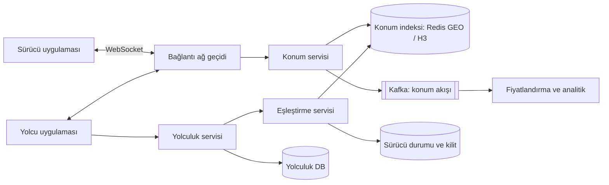
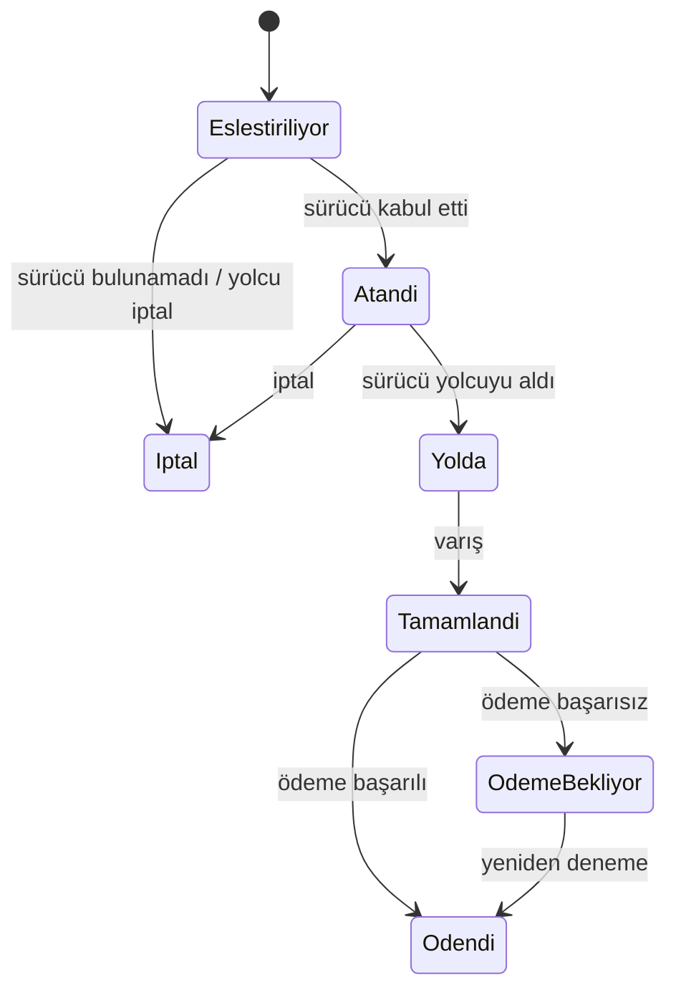

Uber/Lyft/BiTaksi tarzı bir servis; **yazma ağırlıklı konum verisi**, **coğrafi sorgu**, **çekişme** (aynı sürücüye iki yolcu atanmamalı) ve **çok adımlı bir süreci** tek soruda birleştirir.

## 1. Gereksinimler

**İşlevsel:**

- Yolcu, alış ve varış noktası girip fiyat tahmini görür ve yolculuk ister.
- Sistem yakındaki uygun bir sürücüyü bulur ve teklif gönderir; sürücü kabul eder ya da reddeder.
- Yolcu, sürücünün konumunu haritada gerçek zamanlı izler.
- Yolculuk bitince ödeme alınır.
- Kapsam dışı: puanlama, havuzlu yolculuk, sürücü kaydı.

**İşlevsel olmayan:**

- Eşleştirme hızlı: istek → sürücü teklifi birkaç saniye.
- **Güçlü tutarlılık eşleştirmede:** bir sürücüye aynı anda iki yolculuk atanmamalı.
- Konum takibinde **nihai tutarlılık** yeterli; birkaç saniyelik konum gecikmesi sorun değil.
- Ölçek: 10 milyon sürücü (aynı anda 2 milyonu çevrimiçi), günde 20 milyon yolculuk.

## 2. Kapasite

- Konum güncellemesi: 2 milyon çevrimiçi sürücü, 4 saniyede bir → **~500.000 yazma / saniye**. Bu sistemin baskın yüküdür.
- Yolculuk isteği: 20 milyon / gün → ~230 / saniye, zirvede (cuma akşamı, yağmur) birkaç bin.
- Konum verisinin kendisi küçüktür: sürücü başına ~100 bayt × 2 milyon = 200 MB. **Sonuç:** anlık konumların tamamı belleğe sığar; sorun boyut değil, **yazma hızı**.

## 3. API

```http
POST /v1/fare-estimates   { "pickup": {...}, "dropoff": {...} }          -> { "estimateId": "...", "price": 145.0 }
POST /v1/rides            { "estimateId": "..." }                        -> 202 { "rideId": "...", "status": "matching" }
POST /v1/drivers/location { "lat": 41.04, "lng": 29.00, "ts": ... }      -> 204   (ya da WebSocket üzerinden)
POST /v1/rides/{id}/accept                                               -> 200 | 409 (başkası aldı)
```

Fiyat tahmini sunucuda saklanır ve kimlikle istenir; istemci fiyatı kendisi göndermez (değiştirilemez, süresi dolar). Sürücü uygulaması konumu kalıcı bir bağlantı (WebSocket/gRPC akışı) üzerinden gönderir; her güncelleme için yeni HTTP isteği açmak pahalıdır.

## 4. Üst düzey tasarım



## 5. Konum güncellemeleri ve yakındaki sürücüler

Saniyede 500.000 yazmayı ilişkisel bir veritabanına yazıp üstüne coğrafi indeks güncellemek gereksiz pahalıdır. Konumun yalnızca **en güncel değeri** önemlidir ve kaybolan bir güncelleme 4 saniye sonra yenisiyle düzelir. Bu yüzden:

- Anlık konumlar **bellekte** tutulur: Redis GEO (`GEOADD drivers:ist 29.00 41.04 d-881`) ya da H3/geohash hücresi → sürücü kümesi eşlemesi.
- Bellekteki indeks şehir/bölgeye göre parçalanır; İstanbul'un sürücüleri ile Ankara'nınkiler aynı düğümde olmak zorunda değildir.
- Ham konum akışı ayrıca Kafka'ya yazılır: yolculuk rotasının kaydı, varış süresi tahmini modelleri, fiyatlandırma ve analitik bu akışı tüketir.
- Bir sürücüden belirli süredir güncelleme gelmezse (TTL) uygun sürücüler listesinden düşer.

**Yakındaki sürücüleri bulmak:** yolcunun bulunduğu hücre ve komşu hücreler (geohash'te 8 komşu, H3'te halka) taranır, sürücüler **durumu "boşta" olanlar** olarak süzülür ve mesafeye göre değil **tahmini varış süresine** göre sıralanır (nehrin karşı yakasındaki 500 m'lik sürücü 20 dakika uzakta olabilir). Yeterli sürücü yoksa arama yarıçapı genişletilir.

## 6. Eşleştirme ve çifte atamanın önlenmesi

Yolculuk isteği eşleştirme servisine gelir:

1. En uygun aday sürücüler seçilir.
2. Seçilen sürücü **kilitlenir**: durumu atomik olarak `bosta` → `teklif_bekliyor` yapılır. Koşullu atomik güncelleme bunu sağlar:

```text
SET driver:d-881:offer ride-77 NX PX 15000
```

`NX` sayesinde aynı sürücüye eşzamanlı ikinci bir teklif yapılamaz; `PX 15000` sürücü yanıt vermezse kilidin 15 saniye sonra kendiliğinden düşmesini sağlar.

3. Sürücüye teklif itilir. Kabul ederse yolculuk kaydı `atandi` olur ve sürücü durumu `yolculukta`. Reddeder ya da süre dolarsa kilit bırakılır ve sıradaki adaya geçilir.

Eşleştirmenin kendisi bir **çok adımlı süreçtir** (teklif → bekle → zaman aşımı → sonraki aday); en sağlam uygulaması dayanıklı bir iş akışı ya da her adımı kalıcı duruma yazan bir durum makinesidir. Eşleştirme servisi çökerse süreç kaldığı adımdan devam etmelidir; aksi halde yolcu sonsuza kadar "aranıyor" ekranında kalır.

**Ölçekte eşleştirme:** her isteği tek tek en yakın sürücüye vermek yerine, kısa aralıklarla (ör. 2 saniye) birikmiş istekler ve sürücüler arasında **toplu eşleştirme** (atama problemi) yapmak, şehir genelinde toplam bekleme süresini düşürür. Uber bunu bölge (hücre) bazında yapar.

**Çekişme yönetimi:** eşleştirme işi şehir/bölge bazında parçalanır; aynı bölgenin istekleri aynı eşleştirme örneğine gider. Böylece bir sürücü üzerindeki yarış, dağıtık kilitten çok tek bir sahibin sıralı işlemesiyle çözülür.

## 7. Yolculuk durum makinesi



Yolculuk kaydı güçlü tutarlılık ister (para ve iptal kuralları): ilişkisel bir veritabanı, `ride_id` ya da şehir bazında parçalı. Geçişler koşullu güncellemeyle yapılır (`UPDATE rides SET status = 'yolda' WHERE id = ... AND status = 'atandi'`); geçersiz geçişler reddedilir. Ödeme, idempotency anahtarıyla ve yolculuktan ayrı bir adımda alınır.

## 8. Gerçek zamanlı takip

Yolculuk sırasında sürücünün konumu yolcuya itilir: konum servisi, aktif yolculuğu olan sürücünün güncellemesini yolcunun bağlantısına (pub/sub kanalı `ride:77`) yayınlar. Güncellemeler 4 saniyede bir gelir; istemci aradaki hareketi **ara değerleme** ile pürüzsüz gösterir.

## 9. Dinamik fiyatlandırma

Konum ve istek akışından H3 hücreleri bazında arz (boştaki sürücü) ve talep (son dakikalardaki istek) sayılır. Talep/arz oranı yüksek hücrelerde çarpan artar. Hesap akış işleme ile her birkaç dakikada bir yapılır ve sonuç fiyat tahmini servisine önbellek olarak verilir. Altıgen hücreler, komşulukların eşit uzaklıkta olması nedeniyle bu tür bölgesel toplamalar için tercih edilir.

## 10. Derinleşme

- **Bölge kesintisi:** şehirler bölgelere (veri merkezlerine) eşlenir; bir bölge düşerse şehir başka bölgeye taşınır. Anlık konumlar kaybolsa bile sürücüler birkaç saniye içinde yeniden gönderir; kalıcı veri (yolculuklar) kopyalıdır.
- **Sürücü uygulaması bağlantısı koparsa:** konum güncellemeleri durur, TTL ile uygun sürücülerden düşer; aktif yolculuk etkilenmez, uygulama yeniden bağlanınca durumu eşitler.
- **Varış süresi tahmini:** yol grafiği + gerçek zamanlı trafik; önceden hesaplanmış yol parçaları ve makine öğrenmesi modeli.

## Bu sorudan çıkarılacak genel dersler

- Yalnızca son değerin önemli olduğu, çok sık güncellenen veriyi bellekte tutun; ham akışı ayrıca günlüğe yazın.
- Coğrafi arama için hücreler (geohash, H3) ve komşu hücre taraması; sıralamada mesafe değil varış süresi.
- Çekişmeyi koşullu atomik güncelleme, TTL'li kilit ve bölge bazında tek sahiplikle çözün.
- Çok adımlı ve zaman aşımlı süreçleri kalıcı bir durum makinesine bağlayın.

**Daha fazlası:** [Uber H3](https://www.uber.com/blog/h3/); [Uber Engineering Blog](https://www.uber.com/blog/engineering/); Alex Xu ve Sahn Lam, *System Design Interview* Cilt 2, Bölüm 1–3 (yakınlık servisi, yakındaki arkadaşlar, Google Maps).
