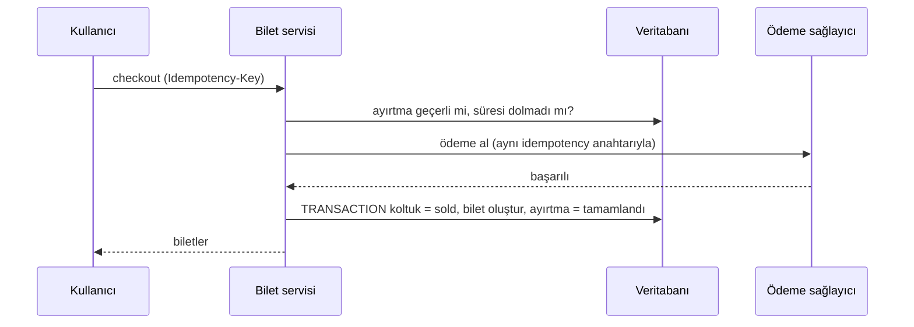
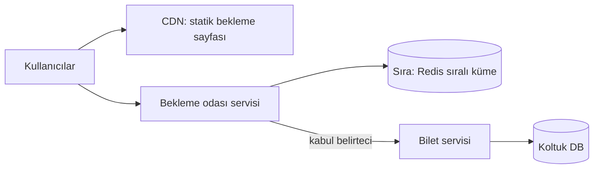

Popüler bir konserin biletleri satışa çıktığında milyonlarca kişi aynı saniyede aynı birkaç bin koltuğu ister. Bu soru, **çekişme** (contention) kalıbının en saf halidir: aynı koltuk iki kişiye satılmamalı, sistem de yük altında çökmemelidir.

## 1. Gereksinimler

**İşlevsel:**

- Etkinlikleri görüntüle ve ara.
- Etkinliğin koltuk haritasını ve uygun koltukları gör.
- Koltuk seç, kısa süre (ör. 10 dakika) **ayırt** ve ödeme yap.
- Kapsam dışı: bilet transferi, ikinci el satış, dinamik fiyat.

**İşlevsel olmayan:**

- **Çift satış olmamalı:** koltuk ataması için güçlü tutarlılık.
- Göz atma ve arama için yüksek erişilebilirlik; nihai tutarlılık yeterli (koltuk haritası birkaç saniye geride olabilir).
- Ani yük: popüler etkinlikte birkaç dakika içinde milyonlarca kullanıcı.
- Okuma ağırlıklı: göz atma, satın almadan kat kat fazla.

## 2. API

```http
GET  /v1/events?query=...&city=...&date=...          -> etkinlik listesi
GET  /v1/events/{id}                                  -> etkinlik ayrıntısı
GET  /v1/events/{id}/seats                            -> koltuk durumları
POST /v1/reservations   { "eventId": "...", "seatIds": ["A-12", "A-13"] }
                                                      -> 201 { "reservationId": "...", "expiresAt": "..." } | 409
POST /v1/reservations/{id}/checkout
     Idempotency-Key: ...
                                                      -> 200 { "ticketIds": [...] } | 402 | 410 (süre doldu)
```

## 3. Veri modeli

| Tablo | Alanlar |
| --- | --- |
| `events` | `id`, `venue_id`, `name`, `starts_at`, ... |
| `seats` | `event_id`, `seat_id`, `status` (`available` / `reserved` / `sold`), `reservation_id`, `reserved_until`, `version` |
| `reservations` | `id`, `user_id`, `event_id`, `status`, `expires_at` |
| `tickets` | `id`, `event_id`, `seat_id`, `user_id`, `order_id` |

Koltuk ve bilet verisi, para ve çift satış söz konusu olduğundan **ilişkisel bir veritabanında** (transaction ve kısıtlarla) tutulur. `tickets (event_id, seat_id)` üzerindeki **benzersizlik kısıtı**, her şey ters gitse bile çift satışı engelleyen son savunma hattıdır.

## 4. Çekirdek sorun: koltuğu ayırtmak

Kullanıcı koltuğu seçer, ödeme ekranında birkaç dakika geçirir. Bu sürede koltuk başkasına görünmemeli, ama kullanıcı vazgeçerse koltuk geri dönmeli.

### Seçenek A: uzun süren veritabanı kilidi

`SELECT ... FOR UPDATE` ile koltuğu kilitleyip ödeme bitene kadar transaction'ı açık tutmak. **Kötü fikir:** transaction'lar dakikalarca açık kalır, bağlantı havuzu tükenir, kullanıcı sekmeyi kapatırsa kilit ne zaman bırakılacak belli değildir.

### Seçenek B: durum + süre ile ayırtma (önerilen)

Koltuk durumu **koşullu atomik güncellemeyle** değiştirilir:

```sql
UPDATE seats
SET status = 'reserved', reservation_id = :rid, reserved_until = now() + interval '10 minutes'
WHERE event_id = :eid
  AND seat_id = ANY(:seat_ids)
  AND (status = 'available' OR (status = 'reserved' AND reserved_until < now()));
-- Etkilenen satır sayısı istenen koltuk sayısına eşit değilse transaction geri alınır -> 409
```

- Kısa bir transaction; kilit yalnızca bu satır güncellenirken tutulur.
- Süresi dolmuş ayırtmalar ayrı bir temizleme işine gerek kalmadan, **sorguda** boş sayılır; bir arka plan işi yine de durumu düzenli olarak `available`'a çevirir (koltuk haritasının doğru görünmesi için).
- Birden çok koltuk aynı transaction'da: ya hepsi ya hiçbiri.

### Seçenek C: Redis'te TTL'li kilit

```text
SET seat:{event}:{A-12} {reservationId} NX EX 600
```

Çok hızlıdır ve süre dolunca kendiliğinden düşer. Ama Redis ile veritabanı arasında iki doğru kaynağı oluşur; Redis kilidi kaybolursa (yük devri) çift ayırtma olabilir. Bu yüzden Redis kilidi **ön filtre** olarak kullanılır, kesin karar yine veritabanındaki koşullu güncelleme ve benzersizlik kısıtıyla verilir.

## 5. Ödeme



- Ödeme sağlayıcısına **idempotency anahtarıyla** gidilir; kullanıcı düğmeye iki kez basarsa ya da ağ koparsa iki kez ödeme alınmaz.
- Ödeme alındı ama tam o anda ayırtmanın süresi doldu ve koltuk başkasına geçtiyse? Ödemeden önce ayırtma süresi kısa bir pay kadar uzatılır; yine de yarış olursa **otomatik iade** (telafi işlemi). Bu nadir durumu açıkça söylemek kıdem gösterir.
- Ödeme sonucu bilinmiyorsa (zaman aşımı) sağlayıcıya durum sorgusuyla mutabakat yapılır; kullanıcıya "işleniyor" gösterilir.

## 6. Ani yük: sanal bekleme odası

Popüler bir satışta 2 milyon kişi 20.000 koltuk için aynı anda gelir. Herkesi doğrudan koltuk seçimine bırakmak:

- Veritabanında aynı satırlar üzerinde devasa çekişme yaratır,
- Kullanıcıların çoğu seçtiği koltuğun "az önce alındı" olduğunu görür (kötü deneyim),
- Sistemi çökertir.

Çözüm **sanal bekleme odası:** kullanıcılar satış başlamadan bir kuyruğa alınır, sıraları (ya da rastgele bir sıra) belirlenir. Kapasite kadar kullanıcı (ör. aynı anda 5.000) satın alma alanına **kabul belirteci** ile alınır; biri çıktıkça ya da süresi doldukça sıradaki içeri girer. Kullanıcılara sıradaki konumları ve tahmini bekleme süresi gerçek zamanlı (SSE/WebSocket ya da yoklama) gösterilir.



Bekleme odası, arkadaki sistemin kaldırabileceği yükü sabit tutar; bir tür **giriş kontrolü** (admission control) ve hız sınırlamadır. Botlara karşı CAPTCHA, hesap başına bilet sınırı ve doğrulanmış hayran programları aynı katmanda uygulanır.

## 7. Okuma yolunu ölçeklemek

- **Etkinlik sayfaları:** neredeyse statik; CDN ve önbellek. Satış anında yüz binlerce kişi aynı sayfayı yeniler.
- **Koltuk haritası:** çok okunur, sık değişir. Haritanın kendisi (salon düzeni) statik ve CDN'de; koltuk **durumları** kısa TTL'li önbellekte (1–2 saniye) ya da yalnızca bekleme odasından içeri alınmış kullanıcılara gerçek zamanlı akışla. Haritanın birkaç saniye geride olması kabul edilebilir; kesin karar ayırtma anında verilir.
- **Arama:** etkinlikler Elasticsearch'te (ad, sanatçı, şehir, tarih, kategori); CDC ile birincil veritabanından beslenir. Popüler aramalar önbelleğe alınır.

## 8. Derinleşme

- **Parçalama:** koltuk verisi `event_id`'ye göre parçalanır; bir etkinliğin bütün koltukları tek parçada olduğu için ayırtma tek parçalı bir transaction'dır. Tek bir dev etkinlik yine de tek parçayı ısıtır; bekleme odası bu yükü sınırlar.
- **Genel kabul (koltuksuz) biletler:** koltuk yerine sayaç: `UPDATE inventory SET remaining = remaining - :n WHERE event_id = :e AND remaining >= :n`. Çok sıcak sayaçlarda stok parçalara bölünebilir (10 alt sayaç, her biri stoğun onda biri).
- **Bildirim:** satın alma sonrası e-posta ve bilet PDF'i kuyruktan eşzamansız; kritik yolu yavaşlatmaz.

## Bu sorudan çıkarılacak genel dersler

- Uzun süren kullanıcı işlemlerinde veritabanı kilidi değil, **süreli durum** (ayırtma) kullanın.
- Kesin kararı veritabanında koşullu güncelleme ve benzersizlik kısıtı verir; Redis gibi hızlı katmanlar ön filtredir.
- Talep kapasitenin çok üstündeyse sorunu kuyrukla **sisteme girmeden** çözün: sanal bekleme odası.
- Ödeme: idempotency anahtarı, belirsiz sonuçta mutabakat, yarışta telafi (iade).

**Daha fazlası:** Hello Interview, [Design Ticketmaster](https://www.hellointerview.com/learn/system-design/problem-breakdowns/ticketmaster); [Stripe: Designing robust and predictable APIs with idempotency](https://stripe.com/blog/idempotency).
