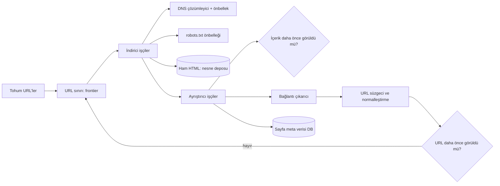

Web tarayıcı, arama motorlarının ve büyük dil modeli veri hatlarının temelidir. Soru; **büyük ölçekli toplu işleme**, **kuyruk tasarımı**, **tekilleştirme** ve **hata toleransı** üzerine kuruludur. Kullanıcıya dönük gecikme yoktur; önemli olan iş hacmi, nezaket ve doğruluktur.

## 1. Gereksinimler

**İşlevsel:**

- Tohum (seed) URL'lerden başlayarak sayfaları indir, içindeki bağlantıları çıkar ve onları da tara.
- İndirilen HTML'i sonraki işlemler (indeksleme, model eğitimi) için sakla.
- Kapsam dışı: JavaScript ile oluşturulan sayfalar (değinilecek), görsel ve video.

**İşlevsel olmayan:**

- **Ölçek:** 1 milyar sayfayı 5 günde tara.
- **Nezaket:** hiçbir siteyi aşırı yüklememeli; `robots.txt` kurallarına uymalı.
- **Dayanıklılık:** bozuk HTML, yavaş sunucular, tuzaklar ve çökmüş işçiler taramayı durdurmamalı.
- **Genişletilebilirlik:** yeni içerik türleri ve işleme adımları eklenebilmeli.

## 2. Kapasite

- 10⁹ sayfa / (5 × 10⁵ saniye) ≈ **2.000 sayfa / saniye**.
- Sayfa ortalama ~100 KB (sıkıştırılmamış HTML) → 2.000 × 100 KB = **200 MB/s** indirme ≈ 1,6 Gbit/s.
- Depolama: 10⁹ × 100 KB = **100 TB** (sıkıştırmayla ~20–30 TB).
- Bir indirme ~1 saniye sürerse aynı anda ~2.000+ açık istek gerekir: eşzamansız G/Ç ile bunu birkaç düzine makine karşılar.

## 3. Üst düzey tasarım



İndirme ve ayrıştırma **ayrı aşamalar** ve aralarında kuyruk vardır: indirme ağ ağırlıklı, ayrıştırma CPU ağırlıklıdır; ayrı ölçeklenirler ve ayrıştırıcı çökerse indirilen sayfa kaybolmaz (nesne deposunda durur).

## 4. URL sınırı (frontier)

Tasarımın kalbi, hangi URL'nin **ne zaman** indirileceğine karar veren yapıdır. İki hedefi vardır:

**Öncelik:** önemli sayfalar (yüksek PageRank, haber siteleri, sık güncellenenler) önce. URL'ler önceliklerine göre birkaç **öncelik kuyruğuna** konur; seçici yüksek öncelikli kuyruklardan daha sık çeker.

**Nezaket:** aynı alan adına aynı anda yalnızca bir bağlantı ve istekler arasında bekleme (ya da `robots.txt`'deki `Crawl-delay`). Çözüm: her **alan adı (host) için ayrı bir kuyruk** ve her kuyruğun "bir sonraki ne zaman çekilebilir" zamanı. İşçiler, zamanı gelmiş kuyruklardan çeker; bir min-heap "en erken hazır olan host"u verir.

```text
Öncelik kuyrukları (P1 > P2 > P3)
        ↓ (önceliğe göre ağırlıklı seçim)
Host kuyrukları:  example.com → [url, url, ...]  hazır: 12:00:03.2
                  haber.com.tr → [url, ...]       hazır: 12:00:02.9
                  ...
        ↓ (min-heap: en erken hazır host)
İndirici işçiler
```

Milyarlarca URL belleğe sığmaz: sınır, **disk üzerinde** (Kafka bölümleri, RocksDB ya da veritabanı) tutulur, her kuyruğun yalnızca başı bellektedir. Sınır host'a göre parçalanır: bir host'un bütün URL'leri aynı işçi grubuna gider; böylece nezaket kuralı yerel olarak uygulanır ve koordinasyon gerekmez.

## 5. İndirici

- **DNS** çözümleme yavaş olabilir (onlarca ms) ve tarayıcıyı darboğaza sokar: yerel DNS önbelleği ve eşzamansız çözümleyici.
- **robots.txt** host başına indirilir ve önbelleğe alınır (ör. 24 saat); her URL indirilmeden önce kurallara bakılır.
- Zaman aşımı (bağlantı ve toplam), azami sayfa boyutu (ör. 10 MB), yönlendirme sınırı.
- Hatalar: `5xx` ve zaman aşımı üstel geri çekilmeyle yeniden denenir; `4xx` denenmez. Sürekli hata veren host'un önceliği düşürülür.

## 6. Tekilleştirme

**URL tekilleştirme:** aynı sayfaya giden binlerce bağlantı vardır. Önce URL **normalleştirilir** (küçük harf host, varsayılan port, `#` parçası ve izleme parametreleri atılır, göreli → mutlak), sonra "görüldü mü?" diye bakılır.

- 10 milyar URL × ortalama 100 bayt = 1 TB: tam küme pahalıdır. URL'nin 8 baytlık özeti saklanırsa ~80 GB'a iner.
- Daha ucuzu: **Bloom süzgeci.** 10 milyar URL, %1 yanlış pozitifle ~12 GB. Yanlış pozitif = taranmamış bir URL'nin "görüldü" sanılması; küçük bir kayıp kabul edilebilir. Yanlış negatif olmadığı için hiçbir URL iki kez taranmaz.

**İçerik tekilleştirme:** farklı URL'ler aynı içeriği sunabilir (yansılar, `http`/`https`, parametre çeşitleri). Sayfa gövdesinin özeti (hash) saklanır; aynıysa bağlantıları tekrar çıkarılmaz. **Neredeyse aynı** sayfalar (yalnızca tarih ya da reklam farklı) için **SimHash** ya da MinHash gibi benzerlik özetleri kullanılır: benzer belgelerin özetleri az bit farkıyla ayrılır.

## 7. Tuzaklar ve kalite

- **Örümcek tuzakları:** sonsuz takvim sayfaları (`/takvim/2026/12/...`), sonsuz derinlikte dizinler, oturum kimliği içeren URL'ler. Önlemler: azami URL uzunluğu ve derinlik, host başına sayfa sınırı, tekrarlanan yol desenlerini tespit etmek.
- **Düşük kaliteli ve spam içerik:** içerik puanlaması; düşük puanlı sitelerin önceliğini düşürmek.
- **JavaScript ile oluşturulan sayfalar:** başsız tarayıcıyla (headless Chrome) oluşturmak 10–100 kat pahalıdır; yalnızca gerekli ve değerli siteler için ayrı bir işleme hattında yapılır.

## 8. Hata toleransı ve yeniden tarama

- İşçiler durumsuzdur; durum sınırda ve nesne deposundadır. Bir işçi çökerse kuyruk mesajları (görünmezlik süresi dolunca) başka işçiye geçer. Ayrıştırma idempotent: aynı sayfanın iki kez işlenmesi sorun yaratmaz.
- Sınırın kendisi kalıcı ve kopyalıdır; tarama kaldığı yerden devam eder (kontrol noktaları).
- **Yeniden tarama (tazelik):** web değişir. Her sayfanın değişme sıklığı geçmişinden tahmin edilir; haber ana sayfası saatte bir, statik bir belge ayda bir taranır. `If-Modified-Since` / `ETag` ile koşullu istek yapılır; sayfa değişmemişse sunucu `304` döner ve bant genişliği harcanmaz.

## 9. Coğrafi dağıtım

Tarayıcılar birden çok bölgeye dağıtılır ve her host, kendisine coğrafi olarak yakın bölgedeki tarayıcıya atanır: gecikme düşer, iş hacmi artar.

## Bu sorudan çıkarılacak genel dersler

- Aşamaları (indirme, ayrıştırma, çıkarma) kuyruklarla ayırın; her biri bağımsız ölçeklensin ve hata yalıtılsın.
- Zamanlayıcı tasarımı iki hedefi dengeler: öncelik ve nezaket (host başına kuyruk + hazır olma zamanı).
- Milyarlarca öğede "gördüm mü?" sorusu için Bloom süzgeci; neredeyse aynı içerik için SimHash.
- Durumu işçilerde değil, kalıcı kuyrukta ve depoda tutun; idempotent işleme.

**Daha fazlası:** Alex Xu, *System Design Interview* Cilt 1, Bölüm 9; Heydon ve Najork, *Mercator: A Scalable, Extensible Web Crawler* (1999; host başına kuyruk fikrinin kaynağı); [Common Crawl](https://commoncrawl.org/) (açık web taraması verisi ve mimarisi).
