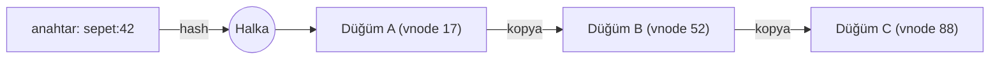
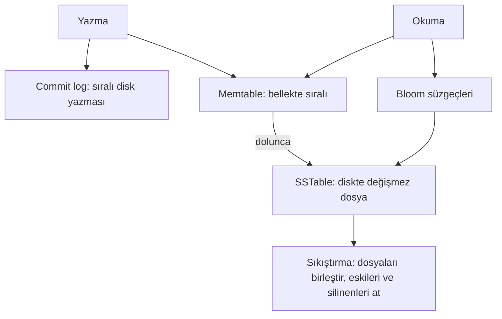

"Dağıtık bir anahtar–değer deposu tasarlayın" sorusu, bir ürün değil bir **altyapı** sorusudur ve dağıtık sistemlerin temel tekniklerini tek bir yerde sınar. Bu derste Amazon'un 2007 tarihli Dynamo makalesinin (DynamoDB'nin değil; Cassandra ve Riak'ın atası olan sistemin) tasarımını adım adım kuruyoruz. Her adımda bir problemi çözüp bir sonrakini doğuruyoruz.

## 1. Gereksinimler

- İşlemler: `put(anahtar, değer)` ve `get(anahtar)`. Değerler küçük (< 1 MB).
- **Her zaman yazılabilir:** alışveriş sepetine ürün ekleme asla reddedilmemeli; ağ bölünmesinde bile. (Bu, bir **AP** tercihidir.)
- Yatay ölçek: düğüm ekleyerek kapasite artmalı, düğümler eşit (lider yok).
- Düşük gecikme: p99.9 < 10 ms.
- Ayarlanabilir tutarlılık.

## 2. Tek düğümden başlayın

Tek bir sunucuda bellek içi hash tablosu + diske önce-günlük (WAL) + periyodik anlık görüntü. Bu, Redis'in temel modelidir. Sınırları: kapasite tek makineyle sınırlı, makine çökerse servis yok. Çözüm: **parçala** ve **kopyala**.

## 3. Parçalama: tutarlı hash

`hash(anahtar) % N` ile dağıtırsak, düğüm eklenip çıkarıldığında anahtarların neredeyse hepsi yer değiştirir. **Tutarlı hash:** hem düğümler hem anahtarlar `0 … 2¹²⁸` aralığındaki bir halkaya hash'lenir; her anahtar, halkada saat yönünde karşılaştığı ilk düğüme aittir. Düğüm eklenince yalnızca komşu aralıktaki anahtarlar taşınır.

**Sanal düğümler:** her fiziksel düğüm halkaya tek bir noktayla değil, yüzlerce noktayla (vnode) yerleştirilir. Böylece:

- Yük daha eşit dağılır (rastgele yerleşimin dengesizliği ortalanır).
- Bir düğüm düşünce yükü **bütün** diğer düğümlere yayılır, tek bir komşuya yığılmaz.
- Güçlü makineye daha çok sanal düğüm verilerek kapasite farkı yansıtılır.



## 4. Kopyalama ve tercih listesi

Her anahtar, halkada kendinden sonraki **N farklı fiziksel düğüme** (genellikle N = 3) kopyalanır. Bu listeye **tercih listesi** denir. Kopyalar farklı raflara ya da erişilebilirlik bölgelerine yerleştirilir ki tek bir arıza bütün kopyaları götürmesin.

Lider yoktur: herhangi bir düğüm bir isteğin **koordinatörü** olabilir. İstemci ya yük dengeleyiciye gider ya da halka bilgisini kendisi tutup doğrudan ilgili düğüme gider (bir ağ atlaması kazanır).

## 5. Ayarlanabilir tutarlılık: quorum

- Yazma: koordinatör N kopyaya gönderir, **W** onay gelince başarılı der.
- Okuma: koordinatör N kopyaya sorar, **R** yanıt gelince en yeni sürümü döndürür.
- `W + R > N` ise okuma ve yazma kümeleri en az bir düğümde kesişir: okuma en son onaylanmış yazmayı görür.

| N, W, R | Davranış |
| --- | --- |
| 3, 2, 2 | Dengeli varsayılan; bir düğüm düşse de okuma ve yazma çalışır |
| 3, 3, 1 | Hızlı okuma; tek düğüm düşerse yazma durur |
| 3, 1, 3 | Hızlı yazma; okuma yavaş |
| 3, 1, 1 | En hızlı ve en erişilebilir; bayat okuma olası |

Not: quorum bile tam doğrusallaştırılabilirlik sağlamaz (eşzamanlı yazma ve okumalarda, yarım kalmış yazmalarda kenar durumlar vardır). Dynamo bunu kabul eder; çünkü hedefi erişilebilirliktir.

## 6. Sürüm çakışmaları

Ağ bölünmesinde iki kullanıcı (ya da aynı kullanıcının iki cihazı) aynı sepeti farklı düğümlerde günceller. Bölünme bitince iki farklı sürüm vardır. Hangisi doğru?

**Son yazan kazanır** (zaman damgasıyla): basit, Cassandra'nın varsayılanı. Ama saatler kaydığı için bir yazma sessizce kaybolabilir.

**Vektör saatleri:** her sürüm `[(düğüm, sayaç), ...]` listesi taşır.

```text
D1: [(A,1)]                    A'da yazıldı
D2: [(A,2)]                    A'da güncellendi       → D1'in torunu, D1 atılabilir
D3: [(A,2), (B,1)]             B'de güncellendi
D4: [(A,2), (C,1)]             bölünmede C'de güncellendi
D3 ve D4: biri diğerinin atası değil → EŞZAMANLI, çakışma
```

Biri diğerini kapsıyorsa eski sürüm atılır. Kapsamıyorsa ikisi de saklanır ve okumada **istemciye** döndürülür; istemci uygulama mantığıyla birleştirir (sepet için iki sepetin birleşimi) ve birleştirilmiş sürümü yazar. Dynamo'nun "silinen ürün sepete geri döndü" ünlü yan etkisi buradan gelir. Modern alternatif **CRDT**'lerdir: birleştirmesi matematiksel olarak tanımlı veri tipleri.

## 7. Geçici arızalar: gevşek quorum ve ipucu bırakma

Kopyalardan biri geçici olarak erişilemezse yazmayı reddetmek "her zaman yazılabilir" hedefini bozar. **Gevşek quorum** (sloppy quorum): yazma, tercih listesindeki erişilebilir ilk N **sağlıklı** düğüme yapılır. Asıl sahibin yerine yazmayı kabul eden düğüm, veriyi bir **ipucuyla** (hint: "bu aslında C'nin") saklar; C geri dönünce veriyi ona aktarır (hinted handoff).

Bedeli: gevşek quorum'da `W + R > N` garantisi geçici olarak kesişmeyi garanti etmez; erişilebilirlik için tutarlılıktan bir ödün daha.

## 8. Kalıcı arızalar: Merkle ağaçlarıyla onarım

İpuçları da kaybolabilir; kopyalar zamanla birbirinden sapar. İki düğüm, paylaştıkları aralıktaki farkları bulmak için milyonlarca anahtarı tek tek karşılaştırmaz. Her aralık için bir **Merkle ağacı** tutulur: yapraklar anahtar gruplarının özetleri, her iç düğüm çocuklarının özetinin özeti.

- Kökler aynıysa aralık özdeştir; hiçbir veri aktarılmaz.
- Farklıysa yalnızca farklı dallara inilir; aktarılan veri farkla orantılıdır.

Ek olarak **okumada onarım:** okuma sırasında eski sürüm döndüren kopyaya yeni sürüm yazılır.

## 9. Üyelik ve arıza tespiti: gossip

Merkezi bir koordinatör yoktur; düğümler halkanın durumunu **dedikodu (gossip) protokolüyle** öğrenir: her düğüm her saniye rastgele bir düğümle bildiği üyelik listesini (her düğüm için kalp atışı sayacıyla) paylaşır. Bilgi, logaritmik sürede bütün kümeye yayılır. Bir düğümün sayacı belirli süredir artmıyorsa diğerleri onu **şüpheli** sayar. Kalıcı ekleme/çıkarma ise operatör kararıyla yapılır; geçici bir ağ sorunu yüzünden veriyi yeniden dağıtmak pahalıdır.

## 10. Yazma ve okuma yolu (tek düğüm içinde)

Cassandra'nın LSM tabanlı motoru:



- **Yazma:** commit log'a ekle (dayanıklılık) + memtable'a yaz. Rastgele disk yazması yok; bu yüzden yazmalar çok hızlı.
- **Okuma:** önce memtable, sonra SSTable'lar (yeniden eskiye). Her SSTable'ın Bloom süzgeci, anahtarı içermeyen dosyaları disk okuması yapmadan eler.
- **Silme:** veri hemen silinmez; bir **mezar taşı** (tombstone) yazılır ve sıkıştırmada temizlenir. Mezar taşları, silmenin geri dönmemesi için onarım süresi boyunca saklanmalıdır.

## 11. Özet tablo

| Problem | Teknik | Kazanç |
| --- | --- | --- |
| Parçalama | Tutarlı hash + sanal düğümler | Artımlı ölçek, eşit yük |
| Yüksek erişilebilirlik | N kopya, lidersiz | Tek hata noktası yok |
| Ayarlanabilir tutarlılık | Quorum (N, W, R) | Gecikme–tutarlılık ödünleşimi istemcide |
| Sürüm çakışması | Vektör saatleri / LWW / CRDT | Çakışmaları tespit ve birleştirme |
| Geçici arıza | Gevşek quorum + ipucu bırakma | Her zaman yazılabilirlik |
| Kalıcı arıza, sapma | Merkle ağaçları + okumada onarım | Ucuz eşitleme |
| Üyelik | Gossip | Merkezi koordinatör yok |
| Yazma hızı | Commit log + memtable + SSTable | Sıralı disk yazması |

Mülakatta bu tabloyu adım adım kurmak, her tekniğin **hangi problemi çözdüğünü** göstermek demektir; ezberden sayılan bir teknik listesinden çok daha güçlüdür.

## CP alternatifi

Gereksinim "her zaman yazılabilir" yerine "her zaman doğru" olsaydı (yapılandırma deposu, kilit servisi), tasarım tamamen değişirdi: aralık başına **Raft grubu**, lider üzerinden doğrusallaştırılabilir okuma ve yazma, bölünmede azınlık tarafı yazma kabul etmez. etcd, TiKV ve CockroachDB bu yolu izler. İki tasarımı karşılaştırabilmek, CAP/PACELC'i gerçekten anladığınızı gösterir.

**Daha fazlası:** [Dynamo: Amazon's Highly Available Key-value Store (SOSP 2007)](https://www.allthingsdistributed.com/files/amazon-dynamo-sosp2007.pdf); [Cassandra mimari belgeleri](https://cassandra.apache.org/doc/latest/cassandra/architecture/overview.html); Alex Xu, *System Design Interview* Cilt 1, Bölüm 6.
