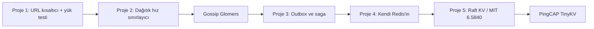

Sistem tasarımı mülakatında "önbellek eklerim" demek kolaydır. Önbelleğin p99 gecikmeyi gerçekten ne kadar düşürdüğünü **ölçmüş**, bir Raft liderinin ağ bölünmesinde nasıl davrandığını **hata ayıklamış**, iki eşzamanlı isteğin aynı koltuğu nasıl çift sattığını **kendi gözünle görmüş** olmak ise bambaşka bir güven verir. Görüşmeciler bu farkı hemen anlar: ezberlenmiş cümle ile yaşanmış deneyim farklı ses verir.

Bu modül iki şey sunar: Zirve'de adım adım yapacağın beş proje ve dünyanın en iyi açık pratik kaynaklarından seçilmiş bir yol haritası.

## Bu modüldeki projeler

| # | Proje | Ne öğretir | Süre | Seviye |
| --- | --- | --- | --- | --- |
| 1 | [Ölçeklenebilir URL kısaltıcı ve yük testi](/tracks/sistem-tasarimi/proje-url-kisaltici-ve-yuk-testi) | Ölçmek: p50/p99, önbellek isabeti, okuma kopyası, darboğaz bulma | 1–2 hafta sonu | Orta |
| 2 | [Dağıtık hız sınırlayıcı](/tracks/sistem-tasarimi/proje-dagitik-hiz-sinirlayici) | Yarış durumları, Redis + Lua ile atomiklik, açık/kapalı başarısızlık | 1 hafta sonu | Orta |
| 3 | [Olay güdümlü sipariş sistemi: outbox ve saga](/tracks/sistem-tasarimi/proje-outbox-ve-saga) | Çift yazma sorunu, en az bir kez teslim, idempotent tüketici, telafi | 2 hafta sonu | İleri |
| 4 | [Kendi Redis'ini yaz](/tracks/sistem-tasarimi/proje-kendi-redisini-yaz) | TCP sunucusu, protokol, TTL, kalıcılık (AOF), kopyalama | 2–3 hafta sonu | İleri |
| 5 | [Raft ile kopyalanan anahtar–değer deposu](/tracks/sistem-tasarimi/proje-raft-anahtar-deger-deposu) | Uzlaşma, lider seçimi, günlük kopyalama, bölünme testleri | 3–4 hafta | İleri |

Projeler sırayla zorlaşır ve her biri önceki derslerin bir bölümünü uygulamaya döker. İlk ikisi iş ilanlarında en sık geçen teknolojilerle (.NET, PostgreSQL, Redis, Docker) yapılır ve doğrudan özgeçmişe ve GitHub profiline konabilir. Son ikisi dağıtık sistemlerin çekirdeğine iner ve senior/staff mülakatlarındaki derinleşme sorularına hazırlar.

## Dışarıdaki en iyi pratik kaynaklar

### Fly.io Gossip Glomers: başlangıç için en iyisi

[fly.io/dist-sys](https://fly.io/dist-sys/) — Jepsen'in yazarı Kyle Kingsbury ile birlikte hazırlanmış, ücretsiz bir dağıtık sistem bulmacaları dizisi. Kodun, **Maelstrom** adlı bir simülatörde çalışır; Maelstrom mesajları geciktirir, ağı böler ve sonunda tutarlılık garantilerini otomatik denetler.

| Bulmaca | Öğrettiği |
| --- | --- |
| Echo | Maelstrom'a ısınma, mesaj protokolü |
| Unique ID Generation | Koordinasyonsuz benzersiz kimlik (Snowflake fikri) |
| Broadcast | Dedikodu (gossip), bölünmede veri kaybetmemek, mesaj sayısı ve gecikme optimizasyonu |
| Grow-Only Counter | CRDT ve nihai tutarlılık |
| Kafka-Style Log | Bölümlü günlük, konum (offset) yönetimi, doğrusallaştırılabilir depo kullanımı |
| Totally-Available Transactions | Transaction izolasyon seviyeleri, erişilebilirlik |

Resmi örnekler Go ile verilir ama herhangi bir dille (C#, TypeScript, Python, Rust) yazılabilir: Maelstrom standart giriş/çıkış üzerinden JSON konuşur. **Önerilen ilk kaynak budur:** küçük, eğlenceli ve geri bildirimi anında.

### MIT 6.5840 (eski adıyla 6.824): altın standart

[pdos.csail.mit.edu/6.824](https://pdos.csail.mit.edu/6.824/) — MIT'nin dağıtık sistemler dersi. Ders notları, video kayıtları, makale soruları ve laboratuvarlar herkese açıktır (2026 bahar dönemi dahil). Laboratuvarlar Go ile, kapsamlı otomatik testlerle gelir:

1. **MapReduce:** koordinatör ve işçilerle dağıtık MapReduce; çöken işçilere dayanıklılık.
2. **Anahtar–değer sunucusu:** tek sunucu, ağ hatalarında tam bir kez semantiği.
3. **Raft:** lider seçimi, günlük kopyalama, kalıcılık, anlık görüntü (snapshot). Dünyanın en çok anılan dağıtık sistem ödevi.
4. **Raft üzerinde hataya dayanıklı anahtar–değer deposu.**
5. **Parçalı anahtar–değer deposu:** parçaların Raft grupları arasında taşınması.

Makale listesi (MapReduce, GFS, Raft, Spanner, Zookeeper, Chain Replication, Aurora, …) başlı başına bir okuma programıdır. Testleri yüzlerce kez çalıştırıp hiç hata almamak, gerçek dağıtık sistem hata ayıklama deneyimidir.

### CodeCrafters: gerçek sistemleri sıfırdan yaz

[codecrafters.io](https://codecrafters.io/) — Redis, Kafka, SQLite, Git, HTTP sunucusu, DNS sunucusu gibi gerçek yazılımların küçük ama çalışan kopyalarını adım adım yazdığın, her adımın otomatik test edildiği platform. C#, TypeScript, Go, Rust ve daha birçok dil desteklenir. Bazı içerikler ücretlidir; her ay farklı bir meydan okuma ücretsiz açılır. Sistem tasarımı için en değerlileri: **Build your own Redis** (kopyalama ve kalıcılık aşamaları dahil) ve **Build your own Kafka**.

İlgili ücretsiz liste: [build-your-own-x](https://github.com/codecrafters-io/build-your-own-x) — veritabanı, ağ yığını, Docker, arama motoru gibi onlarca sistemi sıfırdan yazan rehberlerin derlemesi.

### PingCAP talent-plan: dağıtık veritabanı yolculuğu

[github.com/pingcap/talent-plan](https://github.com/pingcap/talent-plan) — TiDB/TiKV ekibinin eğitim programı. **TinyKV** projesi, Raft tabanlı, bölgelere ayrılmış (multi-raft), dağıtık transaction destekli bir anahtar–değer deposunu Go ile adım adım kurdurur. MIT 6.5840'tan sonra bir sonraki basamaktır.

### Jepsen analizleri: sistemler nasıl kırılır

[jepsen.io/analyses](https://jepsen.io/analyses) — Gerçek veritabanlarının (PostgreSQL, MongoDB, Redis, etcd, Kafka, …) ağ bölünmesi ve saat kayması altında vaat ettikleri garantileri bozduğu durumların ayrıntılı raporları. Proje yazmak kadar öğreticidir: "tutarlı" kelimesinin pratikte ne anlama geldiğini gösterir.

## Önerilen sıra

- **Mülakata 1–2 ay var:** Proje 1 ve 2 + Gossip Glomers'ın ilk dört bulmacası. Bunlar örnek tasarımlardaki derinleşme sorularını doğrudan besler.
- **Senior/staff hedefi ya da altyapı ekibi:** sıranın tamamı. Raft'ı kendin yazmış olmak, uzlaşma sorularında rakipsiz kılar.

## Her proje için çalışma kuralları

1. **Önce tasarla, sonra yaz.** Her projeye bir sayfalık tasarım belgesiyle başla: gereksinimler, kapasite, API, veri modeli, ödünleşimler. Bu, mülakattaki çerçevenin aynısıdır.
2. **Ölç.** "Hızlı" değil, "p99 = 14 ms, 2.000 istek/saniyede". Her optimizasyondan önce ve sonra ölç.
3. **Kır.** Bir bileşeni durdur, ağı yavaşlat, aynı isteği iki kez gönder. Ne olduğunu not et.
4. **Yaz.** Her projenin sonunda README'ye bir "öğrendiklerim ve ödünleşimler" bölümü ekle. Mülakatta "bir şeyi ölçeklendirdiğin bir deneyimi anlat" sorusunun yanıtı burada hazır olur.
