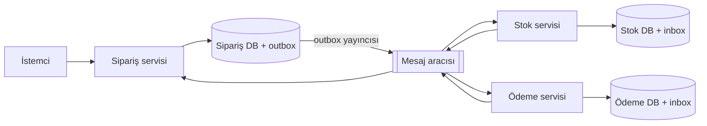
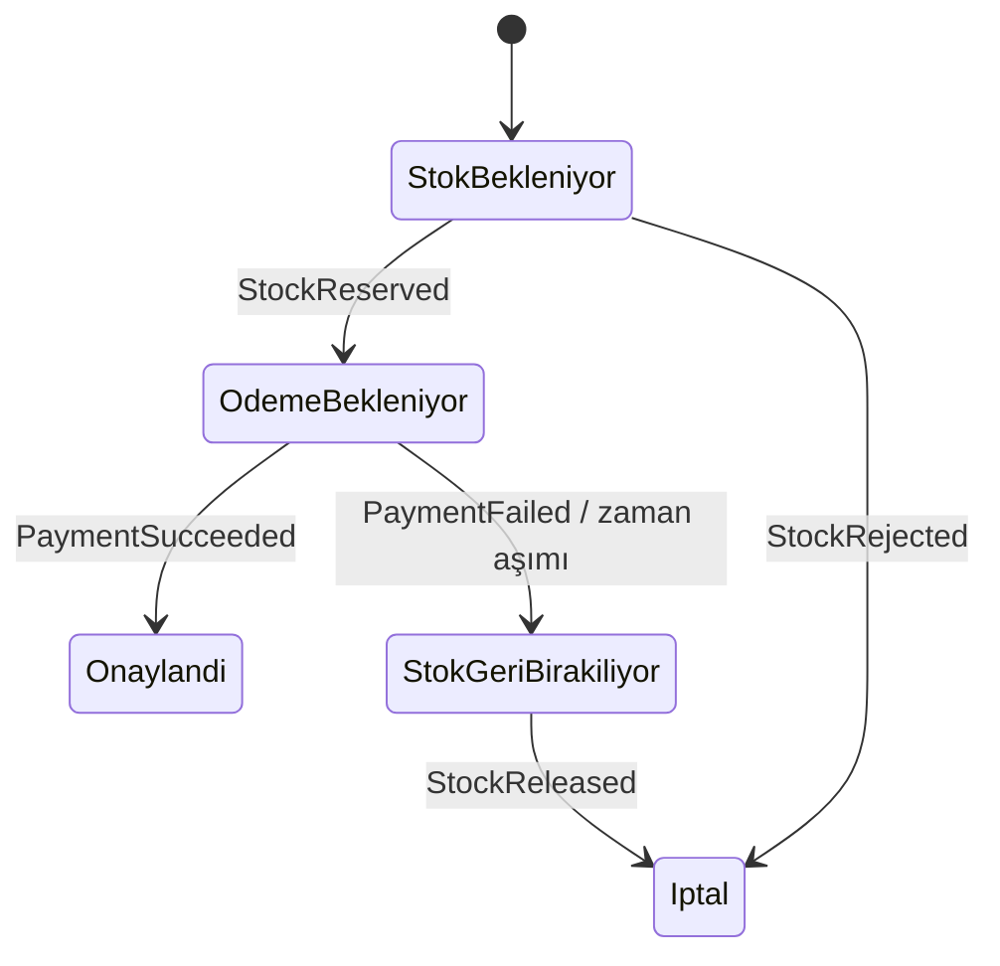

Mikroservis mülakatlarının en sık derinleşme sorusu şudur: "Sipariş oluşturuldu ama ödeme servisi çöktü; ne olur?" Bu projede bu sorunun yanıtını **kodla** vereceksin. [Tutarlılık, Uzlaşma ve Dağıtık İşlemler](/tracks/sistem-tasarimi/tutarlilik-uzlasma-ve-dagitik-islemler) dersindeki outbox, idempotent tüketici ve saga desenlerini uygulayacak, sonra sistemi bilerek kırıp tutarlı kaldığını kanıtlayacaksın.

## Sistem



| Servis | Sorumluluk | Veritabanı |
| --- | --- | --- |
| Sipariş | Siparişi alır, saga'yı yönetir (orkestratör) | PostgreSQL `orders` |
| Stok | Ürün stoğunu ayırır ve geri bırakır | PostgreSQL `inventory` |
| Ödeme | Ödemeyi alır ve iade eder (sahte sağlayıcı) | PostgreSQL `payments` |

Her servisin **kendi** veritabanı (ya da şeması) vardır; servisler birbirinin tablosuna dokunmaz. Mesaj aracısı olarak RabbitMQ ya da Kafka kullan (Redpanda, Kafka uyumlu ve tek ikilili olduğu için yerelde pratiktir).

## Aşama 1: çift yazma sorununu yeniden üret

Sipariş servisini önce saf haliyle yaz:

```csharp
await db.Orders.AddAsync(order);
await db.SaveChangesAsync();
// Tam burada süreç ölürse olay hiç yayınlanmaz.
await publisher.PublishAsync(new OrderCreated(order.Id, order.Items));
```

İki satırın arasına bir hata enjeksiyonu noktası koy (`if (chaos.ShouldCrash("after-save")) Environment.FailFast(...)`) ve %10 olasılıkla çökert. 1.000 sipariş oluştur. Sonra say: kaç sipariş "bekliyor" durumunda sonsuza kadar takıldı? Sırayı ters çevir (önce yayınla, sonra kaydet) ve tersini gözle: var olmayan siparişler için stok ayrıldı.

## Aşama 2: transactional outbox

Olayı iş verisiyle **aynı transaction'da** bir `outbox` tablosuna yaz:

```sql
CREATE TABLE outbox (
    id            uuid PRIMARY KEY,
    aggregate_id  uuid NOT NULL,
    type          text NOT NULL,
    payload       jsonb NOT NULL,
    created_at    timestamptz NOT NULL DEFAULT now(),
    published_at  timestamptz
);
CREATE INDEX outbox_unpublished ON outbox (created_at) WHERE published_at IS NULL;
```

Ayrı bir **yayıncı** (arka plan servisi) yayınlanmamış satırları okur, aracıya gönderir ve işaretler. Birden çok yayıncı örneği çalışacaksa satırları çakışmadan paylaşmak için:

```sql
SELECT * FROM outbox
WHERE published_at IS NULL
ORDER BY created_at
LIMIT 100
FOR UPDATE SKIP LOCKED;
```

`SKIP LOCKED`, başka bir örneğin kilitlediği satırları atlar: iki yayıncı aynı olayı aynı anda göndermez. Yine de yayıncı "gönderdi ama işaretleyemeden çöktü" durumunda olayı **ikinci kez** gönderir: teslim en az bir kezdir.

Aşama 1'deki hata enjeksiyonu testini tekrarla. Artık takılı sipariş kalmamalı.

**Alternatif:** yayıncı yerine CDC (Debezium) ile outbox tablosunun WAL'ını okumak. Bonus olarak dene ve iki yaklaşımı gecikme ve işletim karmaşıklığı açısından karşılaştır.

## Aşama 3: idempotent tüketici (inbox)

Stok servisi aynı `OrderCreated` olayını iki kez alırsa stoğu iki kez düşmemeli:

```csharp
await using var tx = await db.Database.BeginTransactionAsync();

// Olay kimliği birincil anahtar: ikinci kez eklenemez.
var inserted = await db.Database.ExecuteSqlAsync(
    $"INSERT INTO inbox (message_id, received_at) VALUES ({message.Id}, now()) ON CONFLICT DO NOTHING");

if (inserted == 0)
{
    return; // daha önce işlendi
}

await ReserveStockAsync(message);
await tx.CommitAsync();
```

İş ve "işlendi" kaydı aynı transaction'dadır: ya ikisi birden olur ya hiçbiri. Test: aracıdan aynı mesajı bilerek 3 kez gönder; stok bir kez düşmeli.

## Aşama 4: orkestrasyonlu saga

Sipariş servisi saga'nın durumunu tutar ve adımları yönetir:



Kurallar:

- Her durum geçişi ve gönderilecek bir sonraki komut **aynı transaction'da** kaydedilir (yine outbox).
- Geçişler koşullu: `UPDATE orders SET status = 'odeme_bekleniyor' WHERE id = ... AND status = 'stok_bekleniyor'`. Geç ya da yinelenen olay yanlış geçiş yapamaz.
- **Telafi işlemleri** (`ReleaseStock`, `RefundPayment`) da idempotent olmalı.
- **Zaman aşımı:** ödeme servisi hiç yanıt vermezse? Siparişe bir son tarih yaz; arka plan işi süresi dolan saga'ları telafi yoluna soksun.

Saga'nın **izolasyon sağlamadığını** gözlemle: stok ayrılmış ama ödeme bekleniyorken başka bir kullanıcı ürünü "tükendi" görür. Bu kabul edilebilir mi? README'de tartış.

## Aşama 5: hata enjeksiyonu ve değişmezler

Sistemin her noktasına hata enjeksiyonu ekle: tüketici işledikten sonra onaylamadan çöksün, aracı mesajı geciktirsin, ödeme servisi rastgele `500` dönsün ya da 30 saniye beklesin. Ardından bir **değişmez denetleyicisi** yaz ve 10.000 siparişlik bir yük testinden sonra çalıştır:

- Her sipariş sonunda `Onaylandi` ya da `Iptal` durumunda (takılı yok).
- `Onaylandi` siparişlerin her biri için tam bir başarılı ödeme ve bir stok ayırma var.
- `Iptal` siparişler için net ödeme 0 (ödendiyse iade edilmiş) ve stok geri bırakılmış.
- Toplam stok + ayrılmış stok = başlangıç stoğu.

Değişmezler her koşuda tutuyorsa sistemin tutarlıdır. Tutmuyorsa hatayı bul; en öğretici kısım burasıdır.

## Aşama 6: gözlemlenebilirlik

Bir siparişin üç servis ve aracı boyunca yolculuğunu **tek bir iz** olarak gör: OpenTelemetry ile iz bağlamını (`traceparent`) mesaj başlıklarında taşı. Takılan bir saga'yı izden bulmak, günlüklerde aramaktan ne kadar kolay?

## Bonus görevler

- Aynı akışı **koreografi** ile (orkestratörsüz, her servis olaylara tepki verir) yeniden yaz ve karşılaştır: akışı değiştirmek hangisinde kolay?
- Orkestratörü **Temporal** ile yaz (.NET SDK mevcut): zaman aşımları, yeniden denemeler ve durum saklama motorda. Kendi yazdığın durum makinesiyle kod miktarını karşılaştır.
- İstemcinin `POST /orders` isteğine idempotency anahtarı ekle; aynı isteği 5 kez gönderen test yaz.
- Ölü mektup kuyruğu: sürekli hata veren mesajı 5 denemeden sonra ayır; bir yönetim uç noktasından yeniden işlet.

## Teslim ölçütleri

- [ ] Aşama 1'deki çift yazma sorununu gösteren ölçüm ve outbox sonrası düzelme.
- [ ] Yinelenen mesaj testi (inbox) ve telafi akışı testleri.
- [ ] Hata enjeksiyonlu yük testi + değişmez denetleyicisi raporu.
- [ ] README: orkestrasyon ile koreografi, outbox yayıncısı ile CDC ödünleşimleri.
