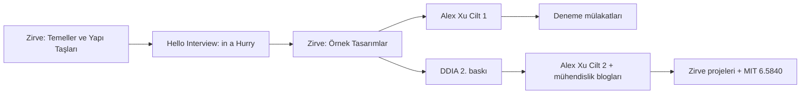

Sistem tasarımı için yüzlerce kaynak var; çoğu birbirini tekrar ediyor. Bu liste, kalitesi kanıtlanmış ve birbirini tamamlayan kaynakları **kullanım amacına göre** sıralar. Her başlıkta önce ücretsiz olanlar gelir.

## Hızlı başlangıç: mülakata 2–4 hafta varsa

| Kaynak | Ne verir | Ücret |
| --- | --- | --- |
| [Hello Interview: System Design in a Hurry](https://www.hellointerview.com/learn/system-design/in-a-hurry/introduction) | Sunum çerçevesi, temel kavramlar, anahtar teknolojiler ve kalıplar; mülakat verisine dayanan, en güncel ve en odaklı ücretsiz rehber | Ücretsiz (ek içerik ücretli) |
| [System Design Primer](https://github.com/donnemartin/system-design-primer) | En kapsamlı açık kaynak derleme: kavramlar, ödünleşimler, örnek sorular, Anki kartları | Ücretsiz |
| [ByteByteGo System Design 101](https://github.com/ByteByteGoHq/system-design-101) | Yüzlerce kavramın tek sayfalık görsel açıklaması; hızlı tekrar için ideal | Ücretsiz |
| Alex Xu, *System Design Interview – An Insider's Guide*, Cilt 1 | Ölçekleme ve çerçeve bölümlerinin ardından 12 klasik sorunun adım adım çözümü (hız sınırlayıcı, tutarlı hash, KV deposu, kimlik üreteci, URL kısaltıcı, tarayıcı, bildirim, akış, sohbet, otomatik tamamlama, YouTube, Google Drive) | Kitap |

Bu dört kaynak ve bu yoldaki dersler, çoğu mid-level mülakat için yeterlidir. Önerilen sıra: Zirve temeller → Hello Interview "in a hurry" → Alex Xu Cilt 1'den 6–8 soru → kendi kendine deneme mülakatı.

## Derinlik: senior ve üstü

| Kaynak | Ne verir |
| --- | --- |
| Martin Kleppmann ve Chris Riccomini, *Designing Data-Intensive Applications*, 2. baskı (O'Reilly, 2026) | Alanın "kutsal kitabı". Depolama motorları, kopyalama, parçalama, transaction'lar, dağıtık sistemlerin sorunları, uzlaşma, toplu ve akış işleme. 2. baskı bulut-yerel mimariler, akış motorları ve veri mevzuatı gibi konularla güncellendi. Senior mülakat için okunması en çok önerilen tek kitap. |
| Alex Xu ve Sahn Lam, *System Design Interview*, Cilt 2 | Daha ileri 13 soru: yakınlık servisi, yakındaki arkadaşlar, Google Maps, dağıtık mesaj kuyruğu, metrik izleme, reklam tıklama toplama, otel rezervasyonu, e-posta, S3 benzeri depo, gerçek zamanlı lider tablosu, ödeme sistemi, dijital cüzdan, borsa |
| Roberto Vitillo, *Understanding Distributed Systems* | DDIA'dan kısa ve pratik bir giriş; iletişim, koordinasyon, ölçeklenebilirlik, dayanıklılık, işletim |
| Alex Petrov, *Database Internals* | B-ağaçları, LSM ağaçları, kopyalama ve uzlaşma algoritmalarının içi |
| Michael Nygard, *Release It!* | Üretimde ayakta kalmak: devre kesici, bölmeler, zaman aşımı; gerçek kesinti hikâyeleri |
| [Google SRE kitapları](https://sre.google/books/) | SLO, hata bütçesi, izleme, olay yönetimi, yük dengeleme ve aşırı yük; üç kitap da çevrimiçi ücretsiz |
| [Amazon Builders' Library](https://aws.amazon.com/builders-library/) | Amazon mühendislerinin zaman aşımı, yeniden deneme, yük atma, önbellek, kuyruk birikmesi ve dağıtım üzerine kısa, çok değerli yazıları; ücretsiz |

## Dersler ve videolar

- [MIT 6.5840 Distributed Systems](https://pdos.csail.mit.edu/6.824/): ders notları, kayıtlar, makale soruları ve laboratuvarlar.
- Martin Kleppmann, Cambridge **Concurrent and Distributed Systems** ders serisi: YouTube'da ücretsiz; mantıksal saatler, kopyalama, uzlaşma ve CRDT'lerin en açık anlatımlarından.
- ByteByteGo ve Hello Interview YouTube kanalları: örnek soruların görsel ve deneme mülakatı biçiminde çözümleri.

## Okunması gereken temel makaleler

Her biri bugün kullandığımız bir sistem ailesinin atasıdır. Mülakatta adlarını ve ana fikirlerini bilmek yeterlidir; okumak ise ayrı bir derinlik kazandırır.

| Makale | Yıl | Ana fikir |
| --- | --- | --- |
| Google File System | 2003 | Büyük dosyalar, tek ana sunucu + parça sunucuları, ucuz donanımda hata toleransı |
| MapReduce | 2004 | Basit programlama modeliyle devasa paralel toplu işleme |
| Bigtable | 2006 | Geniş sütunlu, sıralı, parçalı depo (HBase, Cassandra'nın veri modeli) |
| [Dynamo](https://www.allthingsdistributed.com/files/amazon-dynamo-sosp2007.pdf) | 2007 | Lidersiz, her zaman yazılabilir KV deposu: tutarlı hash, quorum, vektör saatleri |
| Kafka | 2011 | Dağıtık, bölümlü, kalıcı günlük |
| Spanner | 2012 | Küresel ölçekte dış tutarlılık; TrueTime |
| [Scaling Memcache at Facebook](https://www.usenix.org/conference/nsdi13/technical-sessions/presentation/nishtala) | 2013 | Milyarlarca isteğe önbellek: kiralama (lease), bölgeler arası tutarlılık |
| [Raft](https://raft.github.io/raft.pdf) | 2014 | Anlaşılır uzlaşma algoritması |
| Zanzibar | 2019 | Google'ın küresel yetkilendirme sistemi |

## Gerçek dünyadan mimari yazıları

Şirketlerin kendi sistemlerini nasıl ölçeklediklerini anlatan yazılar, mülakatta "gerçekte böyle yapılıyor" diyebilmenizi sağlar:

- Discord: [How Discord stores trillions of messages](https://discord.com/blog/how-discord-stores-trillions-of-messages) — Cassandra'dan ScyllaDB'ye geçiş, sıcak bölümler, istek birleştirme.
- Figma: [How Figma's databases team lived to tell the scale](https://www.figma.com/blog/how-figmas-databases-team-lived-to-tell-the-scale/) — PostgreSQL'i yatay parçalamak.
- Notion: [Sharding Postgres at Notion](https://www.notion.com/blog/sharding-postgres-at-notion) — parçalama anahtarı seçimi ve taşıma.
- Slack: [Real-time messaging](https://slack.engineering/real-time-messaging/) — kanal sunucuları ve ağ geçidi mimarisi.
- Stripe: [Idempotency](https://stripe.com/blog/idempotency) ve [Rate limiters](https://stripe.com/blog/rate-limiters).
- Instagram: [Sharding & IDs at Instagram](https://instagram-engineering.com/sharding-ids-at-instagram-1cf5a71e5a5c) — PostgreSQL ile zamana göre sıralı kimlikler.
- Uber: [H3](https://www.uber.com/blog/h3/) — altıgen coğrafi indeks.
- Cloudflare: [Counting things, a lot of different things](https://blog.cloudflare.com/counting-things-a-lot-of-different-things/) — kayan pencere hız sınırlama.
- [Netflix Tech Blog](https://netflixtechblog.com/) — video dönüştürme, CDN, dayanıklılık, kaos mühendisliği.
- [Jepsen analizleri](https://jepsen.io/analyses) — veritabanlarının vaatleri ile gerçek davranışları arasındaki farklar.

## Başvuru sayfaları

- [Gecikme sayıları (yıllara göre etkileşimli)](https://colin-scott.github.io/personal_website/research/interactive_latency.html)
- [Raft görselleştirmesi](https://raft.github.io/)
- [Awesome Scalability](https://github.com/binhnguyennus/awesome-scalability) — şirketlere ve konulara göre düzenlenmiş mimari yazıları derlemesi.

## Pratik ve deneme mülakatı

Okumak yetmez; tasarımı **sesli anlatmayı** pratik etmek gerekir.

1. **Kendi kendine:** bu yoldaki örnek tasarımlardan birini seç, 45 dakikalık zamanlayıcı kur, Excalidraw'da çiz ve kendini kaydet. Sonra derstekiyle karşılaştır: hangi gereksinimi sormadın, hangi ödünleşimi söylemedin?
2. **Bir arkadaşla:** biri görüşmeci, biri aday; görüşmeci derinleşme sorularını bu yoldaki derslerden seçer.
3. **Profesyonel deneme mülakatı:** Hello Interview, interviewing.io ve Exponent, büyük şirketlerde mülakat yapan mühendislerle ücretli deneme mülakatı sunar. Gerçek mülakattan 1–2 hafta önce bir tane yapmak, geri bildirimin en hızlı yoludur.

## Hangi sırayla?

Üst yol mülakata hazırlık, alt yol ise kalıcı uzmanlık içindir. İkisi birbirini besler: projelerde yaşadığınız her sorun, mülakatta anlatacağınız bir hikâyeye dönüşür.
