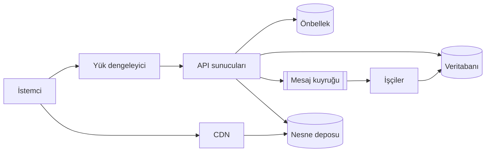

Sistem tasarımı mülakatında "doğru yanıt" yoktur. Görüşmeci şunları ölçer: belirsiz bir problemi netleştirebiliyor musunuz, ödünleşimleri (trade-off) görüp gerekçeli karar verebiliyor musunuz, tasarımınızın nerede kırılacağını biliyor musunuz. En sık hata, soruyu duyar duymaz kutu çizmeye başlamaktır.

Aşağıdaki çerçeve süreyi yönetmenizi sağlar. Dakikalar 45 dakikalık bir görüşme içindir.

## 1. Gereksinimleri netleştirin (5 dk)

"Twitter'ı tasarla" bir gereksinim değildir. Önce kapsamı daraltın.

**İşlevsel gereksinimler:** sistem ne yapar? En önemli iki üç özelliği seçin ve gerisini açıkça kapsam dışı bırakın.

> "Kullanıcılar gönderi paylaşabilsin, başkalarını takip edebilsin ve takip ettiklerinin gönderilerini akışta görebilsin. Arama, bildirim ve mesajlaşmayı kapsam dışı bırakıyorum; uygun mu?"

**İşlevsel olmayan gereksinimler:** sistem bunu nasıl yapar? Tasarımı asıl bunlar belirler.

| Soru | Neden önemli |
| --- | --- |
| Kaç kullanıcı, saniyede kaç istek? | Tek sunucu mu, dağıtık mı |
| Okuma mı ağır, yazma mı? | Önbellek ve kopya stratejisi |
| Gecikme hedefi nedir? | Eşzamanlı mı, kuyrukla mı |
| Tutarlılık ne kadar kritik? | Güçlü mü, nihai tutarlılık mı |
| Erişilebilirlik hedefi? | Yedeklilik düzeyi |
| Veri ne kadar süre saklanır? | Depolama ve arşivleme |

Görüşmeci çoğu zaman "sen karar ver" der. O zaman makul bir varsayım yapın ve **yüksek sesle söyleyin**.

## 2. Kapasiteyi kabaca tahmin edin (3–5 dk)

Amaç kesin sayı değil, **büyüklük mertebesi**dir: tek bir veritabanı yeter mi, parçalama (sharding) gerekir mi?

Örnek: günde 100 milyon etkin kullanıcı, kişi başı günde 2 gönderi ve 50 akış görüntüleme.

- Yazma: 200 milyon / gün ≈ **2.300 / saniye** (bir günde ~86.400 ≈ 10⁵ saniye var).
- Okuma: 5 milyar / gün ≈ **58.000 / saniye**. Okuma/yazma oranı 25:1; sistem okuma ağırlıklı.
- Depolama: gönderi başına ~1 KB → günde 200 GB, beş yılda ~365 TB. Tek makineye sığmaz.

Ezberde tutmaya değer sayılar:

| Büyüklük | Değer |
| --- | --- |
| Bir gündeki saniye | ~86.400 ≈ 10⁵ |
| Günde 1 milyon istek | ~12 istek / saniye |
| Bellekten okuma | ~100 nanosaniye |
| Aynı veri merkezinde ağ gidiş dönüşü | ~0,5 milisaniye |
| SSD'den rastgele okuma | ~0,1 milisaniye |
| Kıtalar arası ağ gidiş dönüşü | ~150 milisaniye |

Zirve (peak) yükü ortalamanın birkaç katı kabul edin. Tahmine fazla zaman harcamayın; tasarım kararını etkilemeyen hesap puan getirmez. Bilinmesi gereken sayıların tamamı ve uygulamalı örnekler [Kapasite Tahmini](/tracks/sistem-tasarimi/kapasite-tahmini) dersinde.

## 3. API'yi tanımlayın (3 dk)

Sistemin dış dünyayla sözleşmesini yazın. Bu, kapsamı somutlaştırır ve veri modeline zemin hazırlar.

```http
POST /v1/posts                    { "text": "..." }        -> 201 { "id": "..." }
GET  /v1/feed?cursor=...&limit=20                           -> { "items": [...], "nextCursor": "..." }
POST /v1/users/{id}/follow                                  -> 204
```

Dikkat çekmeye değer noktalar: sayfalama için **imleç** (cursor) kullanımı, yazma işlemlerinde tekrar gönderime dayanıklılık için **idempotency anahtarı**, kimlik doğrulamanın nerede yapıldığı.

## 4. Veri modelini çizin (3–5 dk)

Ana varlıkları, alanlarını ve **erişim desenlerini** yazın. Veritabanı seçimi erişim desenlerinden çıkar, tersinden değil.

- İlişkisel veri, işlem (transaction) gereksinimi, esnek sorgular → ilişkisel veritabanı (PostgreSQL).
- Çok yüksek yazma hacmi, basit anahtar erişimi, yatay ölçekleme → geniş sütunlu ya da anahtar–değer deposu (Cassandra, DynamoDB).
- Büyük dosyalar (görsel, video) → nesne deposu (S3) ve önünde CDN.

"NoSQL kullanırım çünkü ölçeklenir" yeterli bir gerekçe değildir. Hangi sorguyu, hangi anahtarla, hangi tutarlılıkla yapacağınızı söyleyin.

## 5. Üst düzey tasarımı çizin (10 dk)

İsteğin sistemdeki yolculuğunu baştan sona gösterin. Her kutu bir gereksinime karşılık gelmelidir.



Önce **çalışan en basit tasarımı** kurun, sonra tahmin ettiğiniz yük altında nerede kırılacağını sorgulayın. Görüşmeciye hangi parçaya derinlemesine girmek istediğini sorun; ilgisini çeken yere yönelmek hem iş birliği gösterir hem zamanı doğru kullandırır.

## 6. Derinleşin ve darboğazları giderin (15 dk)

Kıdem seviyesinin belli olduğu bölüm burasıdır. Tipik derinleşme konuları:

- **Sıcak nokta:** çok takipçili bir kullanıcının gönderisi milyonlarca akışa yazılacaksa ne olur? (Yazma anında dağıtma ile okuma anında toplama arasındaki ödünleşim.)
- **Veritabanı ölçekleme:** okuma kopyaları, parçalama anahtarı seçimi, yeniden dengeleme.
- **Önbellek:** neyi, ne kadar süre, nasıl geçersiz kılarak?
- **Tutarlılık:** kullanıcı kendi yazdığını hemen görmeli mi?
- **Hata durumları:** bir bileşen çökerse ne olur? Tekrar denemeler çift yazmaya yol açar mı?

Her kararda **ödünleşimi** söyleyin:

> "Akışı yazma anında önceden hesaplarsam okuma çok hızlı olur ama ünlü hesaplarda yazma maliyeti patlar. Bu yüzden melez gidiyorum: sıradan hesaplar için yazma anında dağıtım, çok takipçili hesaplar için okuma anında birleştirme."

## 7. Toparlayın (2–3 dk)

Tasarımı iki cümleyle özetleyin, bilinen zayıf noktaları ve "daha fazla zamanım olsa" yapacaklarınızı söyleyin: izleme ve alarm, hız sınırlama, çok bölgeli dağıtım, veri saklama politikası.

## Sık yapılan hatalar

- **Gereksinim sormadan çizmeye başlamak.**
- **Moda sözcük yığmak.** "Kafka, Redis, Kubernetes" demek tasarım değildir; her bileşenin neden orada olduğunu açıklayamıyorsanız eklemeyin.
- **Tek bir çözümü savunmak.** En az bir alternatifi ve neden elediğinizi söyleyin.
- **Erken iyileştirme.** Günde bin istek alan sistem için parçalama anlatmak, yükü tahmin etmediğinizi gösterir.
- **Sessiz kalmak.** Düşüncenizi sesli aktarın; görüşmeci ipucu verebilsin.

## Özet

1. Gereksinimler (işlevsel ve işlevsel olmayan) → 2. kapasite → 3. API → 4. veri modeli → 5. üst düzey tasarım → 6. derinleşme → 7. toparlama.
2. Tasarımı gereksinimler ve sayılar yönlendirir; her bileşen bir gerekçeyle eklenir.
3. Puanı getiren çizim değil, ödünleşimleri görüp karar verebilmenizdir.

## Seviyeye göre beklenti

| Seviye | Görüşmecinin beklediği |
| --- | --- |
| Mid-level | Çalışan, makul bir üst düzey tasarım; temel yapı taşlarını doğru yerde kullanmak; görüşmecinin yönlendirmesiyle bir iki konuda derinleşmek |
| Senior | Görüşmeyi **siz** yönetirsiniz; darboğazları kendiniz bulur, alternatifleri karşılaştırır, en az iki konuda derinleşirsiniz (tutarlılık, hata durumları, ölçek) |
| Staff ve üstü | Belirsizliği daraltmak, işletim ve maliyet (izleme, dağıtım, ekip sınırları) ve sistemin yıllar içindeki evrimi; derinleşmede gerçek dünya deneyimi |

## Bu yolda sırada ne var

- Sayılar: [Kapasite Tahmini](/tracks/sistem-tasarimi/kapasite-tahmini) ve [Ağ, İletişim ve API Tasarımı](/tracks/sistem-tasarimi/ag-ve-api-tasarimi).
- Yapı taşları: önbellek, kuyruk, veritabanları, tutarlılık, dayanıklılık, arama ve konum, akış işleme ve hepsini bağlayan [Tekrarlayan Tasarım Kalıpları](/tracks/sistem-tasarimi/tekrarlayan-tasarim-kaliplari).
- Bu çerçeveyle uçtan uca çözülmüş dokuz klasik soru: URL kısaltıcıdan dağıtık anahtar–değer deposuna.
- Kurarak öğrenmek için beş proje: [Proje Yol Haritası](/tracks/sistem-tasarimi/proje-yol-haritasi).
