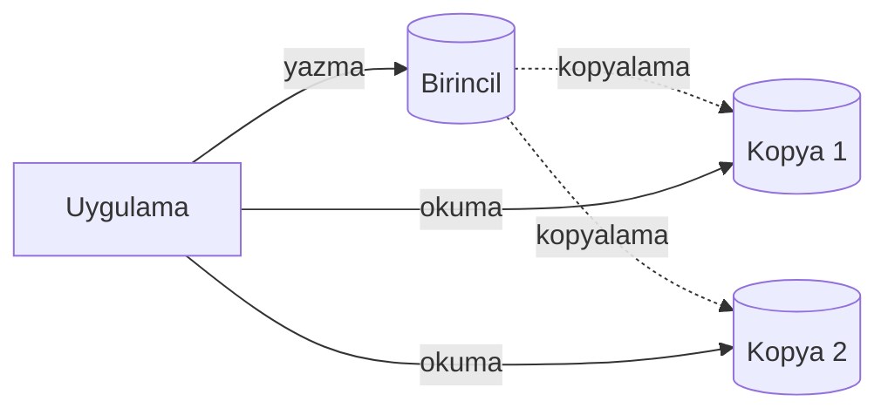

Her büyük sistem tek bir sunucuyla başlar. Ölçekleme, yük arttıkça ortaya çıkan darboğazları **sırayla** gidermektir. Bu dersteki sıra, mülakatta tasarımınızı adım adım büyütürken izleyeceğiniz sıradır.

## Dikey ve yatay ölçekleme

**Dikey ölçekleme:** aynı makineyi büyütmek (daha çok işlemci, bellek). Basittir, kod değişikliği gerektirmez; ama bir tavanı vardır, pahalıdır ve makine tek hata noktası olarak kalır.

**Yatay ölçekleme:** makine eklemek. Kuramsal olarak sınırsızdır ve yedeklilik sağlar; ama sistemin buna uygun tasarlanması gerekir.

Pratik kural: önce dikey büyüyün (ucuz ve basit), tavana ya da erişilebilirlik gereksinimine takıldığınızda yataya geçin. Çoğu sistem, sanıldığından çok daha uzun süre tek bir güçlü veritabanıyla idare eder.

## Durumsuz servisler ve yük dengeleme

Uygulama sunucularını yatay ölçeklemenin ön koşulu **durumsuz** (stateless) olmalarıdır: sunucu, istekler arasında bellekte kullanıcıya özel veri tutmaz. Oturum bilgisi paylaşılan bir depoda (veritabanı, Redis) ya da imzalı bir çerezde durur. Böylece herhangi bir istek herhangi bir sunucuya gidebilir ve sunucular zahmetsizce eklenip çıkarılabilir.

**Yük dengeleyici** gelen istekleri sunuculara dağıtır ve sağlık denetimiyle yanıt vermeyenleri devreden çıkarır.

| Algoritma | Nasıl çalışır | Ne zaman |
| --- | --- | --- |
| Sıralı (round robin) | İstekleri sırayla dağıtır | Sunucular eş, istekler benzer |
| En az bağlantı | En az açık bağlantısı olana yollar | İstek süreleri çok değişken |
| Tutarlı hash | Anahtarın (ör. kullanıcı kimliği) hash'ine göre yollar | Aynı anahtar aynı sunucuya gitmeli (önbellek, parçalama) |

Yük dengeleyicinin kendisi de tek hata noktası olmamalıdır; yedekli çalıştırılır.

## Önbellek ve CDN

Okuma ağırlıklı sistemlerde en ucuz ölçekleme, işi **hiç yapmamaktır**.

- **CDN:** görsel, video, JavaScript gibi statik içeriği kullanıcıya coğrafi olarak yakın sunuculardan verir. Gecikmeyi ve kaynak sunucunun yükünü birlikte düşürür.
- **Uygulama önbelleği** (Redis, Memcached): sık okunan ve seyrek değişen veriyi bellekte tutar; veritabanına giden okumaları büyük oranda azaltır.

Önbelleğin zor kısmı geçersiz kılmadır; bir sonraki derste ayrıntısıyla ele alınır.

## Veritabanını ölçekleme

Uygulama sunucuları durumsuz olduğu için kolay çoğalır; **durum veritabanındadır** ve asıl zorluk oradadır. Adımlar zorluk sırasına göre:

### 1. Sorguları ve indeksleri düzeltin

Ölçeklemeden önce yavaş sorguları bulun. Eksik bir indeks, yüz sunucunun çözemeyeceği sorunu tek satırda çözer.

### 2. Okuma kopyaları (replication)

Yazmalar **birincil** (primary) düğüme gider; değişiklikler **kopyalara** (replica) aktarılır ve okumalar kopyalara dağıtılır. Okuma ağırlıklı yükte kapasiteyi katlar ve birincil çökerse bir kopya yerine geçebilir.

Bedeli **kopyalama gecikmesidir**. Kopyalama çoğunlukla eşzamansızdır; kopya birincilin milisaniyeler ya da saniyeler gerisinde olabilir. Kullanıcı bir şeyi kaydedip hemen ardından eski halini görebilir. Çözümler: kullanıcının **kendi** yazdığını kısa bir süre birincilden okumak, ya da kritik okumaları birincile yönlendirmek.

Kopyalar yazma kapasitesini **artırmaz**; her yazma yine tek bir düğümden geçer.

### 3. Parçalama (sharding)

Veri ya da yazma hacmi tek makineye sığmadığında veri, bir **parçalama anahtarına** göre birden çok veritabanına bölünür. Her parça verinin bir alt kümesini tutar.

Anahtar seçimi en kritik karardır:

- **Eşit dağıtmalı.** Kötü anahtar bir parçayı sıcak noktaya çevirir (ör. ülke koduna göre bölmek).
- **Sık sorguları tek parçada karşılamalı.** Birden çok parçaya dağılan sorgular yavaş ve karmaşıktır.

Parçalamanın bedeli ağırdır: parçalar arası join ve transaction zorlaşır, yeniden dengeleme operasyonel yük getirir, sıcak anahtarlar sorun çıkarır. **Son çare** olarak görün ve mülakatta bunu söyleyin.

### Tutarlı hash

Anahtarları `hash(anahtar) % N` ile dağıtırsanız, sunucu sayısı `N` değiştiğinde neredeyse **bütün** anahtarlar yer değiştirir. Tutarlı hash'te sunucular ve anahtarlar aynı halkaya yerleştirilir; her anahtar halkada kendinden sonraki ilk sunucuya aittir. Bir sunucu eklenince ya da çıkınca yalnızca komşu aralıktaki anahtarlar taşınır (ortalama `1/N`). Dağıtık önbelleklerde ve parçalı veritabanlarında bu yüzden kullanılır.

## CAP teoremi

Dağıtık bir veri deposu, **ağ bölünmesi** (partition) sırasında şu ikisini birlikte sağlayamaz:

- **Tutarlılık (C):** her okuma en son yazılan değeri görür.
- **Erişilebilirlik (A):** her istek (hata olmayan) bir yanıt alır.

Ağ bölünmeleri gerçek dünyada kaçınılmazdır; yani asıl seçim şudur: **bölünme anında tutarlılıktan mı, erişilebilirlikten mi vazgeçeceksiniz?**

| Seçim | Bölünme anında davranış | Örnek kullanım |
| --- | --- | --- |
| CP | Tutarsız yanıt vermektense isteği reddeder | Banka bakiyesi, stok, kilit servisi |
| AP | Eski veri döndürebilir ama yanıt verir | Sosyal akış, beğeni sayısı, alışveriş sepeti |

İki inceliğe dikkat edin: seçim sistemin tamamı için değil, **her veri türü için ayrı** yapılır; ve bölünme yokken asıl ödünleşim tutarlılık ile **gecikme** arasındadır.

**Nihai tutarlılık** (eventual consistency): yazmalar durduğunda bütün kopyalar sonunda aynı değere ulaşır; arada farklı kopyalar farklı yanıt verebilir. Pek çok özellik için kabul edilebilirdir ve büyük ölçekte erişilebilirlik ile hızın bedelidir.

## Tek hata noktalarını kaldırmak

Erişilebilirlik hedefi yedeklilik düzeyini belirler:

| Hedef | Yıllık kesinti |
| --- | --- |
| %99 | ~3,65 gün |
| %99,9 | ~8,8 saat |
| %99,99 | ~53 dakika |
| %99,999 | ~5 dakika |

Seri bağlı bileşenlerin erişilebilirliği **çarpılır**: her biri %99,9 olan üç bileşenden geçen bir istek yaklaşık %99,7 erişilebilirdir. Tasarımınızdaki her kutu için "bu çökerse ne olur?" sorusunu sorun.

## Özet

- Uygulama katmanı: durumsuz servis + yük dengeleyici ile yatay ölçeklenir.
- Okuma yükü: CDN, önbellek ve okuma kopyalarıyla karşılanır; bedeli bayat veri olasılığıdır.
- Yazma yükü ve veri hacmi: parçalama gerektirir; pahalıdır, son çaredir.
- CAP: bölünme anında tutarlılık ile erişilebilirlik arasında, veri türüne göre seçim yaparsınız.
- Her ölçekleme adımı bir karmaşıklık bedeli öder; gereksinim yoksa eklemeyin.
