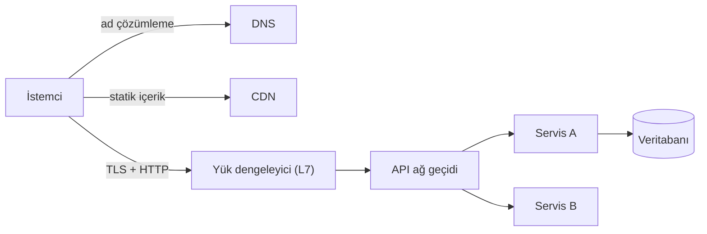

Sistem tasarımında her kutu bir ağ çağrısıyla diğerine bağlanır. Hangi protokolü seçtiğiniz gecikmeyi, ölçeklemeyi ve hata davranışını doğrudan belirler. Bu ders mülakatlarda beklenen ağ bilgisini ve API tasarımının esaslarını toplar.

## Bir isteğin yolculuğu



1. **DNS** alan adını IP adresine çevirir. Yanıtlar TTL süresince önbelleğe alınır; bu yüzden DNS ile yapılan yük dağıtımı ve bölge değiştirme (failover) dakikalar sürebilir. Coğrafi DNS (GeoDNS) ve **anycast**, kullanıcıyı en yakın bölgeye yönlendirir.
2. **CDN** statik içeriği (ve giderek daha çok dinamik içeriği) kullanıcıya yakın kenar sunucularından verir.
3. **TCP + TLS el sıkışması** yeni bir bağlantı için birkaç gidiş dönüş ekler. Bağlantıları açık tutmak (keep-alive, bağlantı havuzu) ve HTTP/2–HTTP/3 kullanmak bu bedeli bir kez öder.
4. **Yük dengeleyici** istekleri sağlıklı sunuculara dağıtır.
5. **API ağ geçidi** kimlik doğrulama, hız sınırlama, yönlendirme ve gözlemlenebilirlik gibi kesişen işleri tek yerde yapar.

## TCP, UDP ve HTTP sürümleri

| | TCP | UDP |
| --- | --- | --- |
| Bağlantı | Var (el sıkışma) | Yok |
| Teslim ve sıra | Garantili | Garanti yok |
| Kullanım | Web, API, veritabanı | Canlı ses/görüntü, oyun, DNS, QUIC'in altı |

- **HTTP/1.1:** bağlantı başına aynı anda tek istek; tarayıcılar bunu birden çok bağlantıyla aşar.
- **HTTP/2:** tek bağlantı üzerinde çoğullama (multiplexing), başlık sıkıştırma. gRPC bunun üzerine kuruludur. TCP katmanında bir paket kaybolursa bütün akışlar bekler (head-of-line blocking).
- **HTTP/3 (QUIC):** UDP üzerinde çalışır; akışlar birbirini bekletmez, bağlantı kurulumu daha hızlıdır ve ağ değiştiren (Wi-Fi → mobil) istemcilerde bağlantı korunur.

## Yük dengeleme: L4 ve L7

| | L4 (taşıma katmanı) | L7 (uygulama katmanı) |
| --- | --- | --- |
| Neye bakar | IP ve port | HTTP yolu, başlıklar, çerezler |
| Hız | Çok hızlı, içeriği okumaz | Daha yavaş, isteği ayrıştırır |
| Yetenek | Basit dağıtım | Yola göre yönlendirme, TLS sonlandırma, yeniden deneme, A/B yönlendirme |
| Örnek | AWS NLB, LVS | AWS ALB, nginx, Envoy, HAProxy |

**Uzun ömürlü bağlantılar** (WebSocket) dağıtımı bozar: bağlantı açıldığı sunucuda kalır. Yeni sunucu eklediğinizde mevcut bağlantılar yerinden oynamaz; bu yüzden gerçek zamanlı sistemlerde bağlantı sayısına göre dağıtım (en az bağlantı) ve bağlantıların kademeli yeniden dengelenmesi gerekir.

## API stilleri

| | REST | gRPC | GraphQL |
| --- | --- | --- | --- |
| Biçim | JSON, HTTP fiilleri | Protobuf (ikili), HTTP/2 | JSON, tek uç nokta |
| Sözleşme | OpenAPI (isteğe bağlı) | `.proto` dosyası (zorunlu, tipli) | Şema (zorunlu, tipli) |
| Güçlü yanı | Basit, her yerde çalışır, HTTP önbelleğiyle uyumlu | Hızlı, küçük yük, akış (streaming), kod üretimi | İstemci ihtiyacı kadar veri çeker, tek istekte birleşik veri |
| Zayıf yanı | Fazla/eksik veri çekme, çok sayıda istek | Tarayıcı desteği sınırlı, insan okuyamaz | Önbellek zor, maliyetli sorgular, N+1 riski |
| Tipik kullanım | Dışa açık API | Servisler arası iç iletişim | Zengin istemciler (mobil, web) |

Mülakatta güvenli varsayılan: **dış API için REST, iç servisler arası yüksek hacimli iletişim için gRPC.** GraphQL'i ancak istemci çeşitliliği gerçekten gerektiriyorsa önerin.

## Gerçek zamanlı iletişim

Sunucunun istemciye **kendiliğinden** veri göndermesi gerektiğinde (sohbet, bildirim, canlı skor, konum takibi) dört seçenek vardır:

| Yöntem | Nasıl | Artı | Eksi |
| --- | --- | --- | --- |
| Kısa yoklama | İstemci her N saniyede sorar | En basiti | Boş isteklerle israf, N kadar gecikme |
| Uzun yoklama | Sunucu, veri olana kadar yanıtı bekletir | Neredeyse anlık, sıradan HTTP | Her mesajdan sonra yeni istek, bağlantı yükü |
| **SSE** (Server-Sent Events) | Tek yönlü, sunucudan istemciye akan HTTP yanıtı | Basit, otomatik yeniden bağlanma, HTTP altyapısıyla uyumlu | Yalnızca sunucu → istemci, metin |
| **WebSocket** | Çift yönlü, kalıcı TCP bağlantısı | Düşük gecikme, iki yönlü | Durumlu bağlantı: ölçekleme, yük dengeleme ve yeniden bağlanma sizin işiniz |

Seçim kuralı:

- Güncellemeler seyrek ve gecikme toleransı yüksekse → **yoklama** yeter (ör. sipariş durumu).
- Akış tek yönlüyse (bildirim, canlı skor, LLM yanıt akışı) → **SSE**.
- İki yönlü ve sık mesajlaşma varsa (sohbet, çok oyunculu oyun, ortak düzenleme) → **WebSocket**.
- Ses ve görüntü → **WebRTC** (eşler arası, UDP tabanlı).

WebSocket ile ölçeklemenin anahtarı, **bağlantıyı tutan sunucu** ile **mesajın üretildiği sunucunun** farklı olmasıdır. Yaygın çözüm: her bağlantı sunucusu bir yayın/abone (pub/sub) kanalına (Redis Pub/Sub, Kafka) abone olur; mesaj, alıcının bağlı olduğu sunucuya bu kanal üzerinden ulaşır. Ayrıntısı [sohbet uygulaması](/tracks/sistem-tasarimi/sohbet-uygulamasi) dersinde.

## REST API tasarımının esasları

### Kaynak odaklı uç noktalar

```http
GET    /v1/users/42/orders?status=paid&limit=20   # listele
POST   /v1/orders                                 # oluştur
GET    /v1/orders/981                             # oku
PATCH  /v1/orders/981                             # kısmi güncelle
DELETE /v1/orders/981                             # sil
POST   /v1/orders/981/cancel                      # durum değiştiren eylem
```

İsimler çoğul ve isim (fiil değil); eylemler gerektiğinde alt kaynak olarak yazılır. Durum kodları anlamlı olmalı: `201` oluşturuldu, `204` içerik yok, `400` geçersiz istek, `401` kimlik yok, `403` yetki yok, `404` bulunamadı, `409` çakışma, `422` doğrulama hatası, `429` hız sınırı, `503` geçici olarak hizmet dışı.

### Sayfalama

| Yöntem | Nasıl | Sorun |
| --- | --- | --- |
| Ofset | `?offset=40&limit=20` | Büyük ofsetlerde yavaş (veritabanı atlanan satırları da okur); araya kayıt girerse tekrar ya da atlama |
| **İmleç** (cursor) | `?cursor=eyJpZCI6OTgxfQ&limit=20` | Rastgele sayfaya atlanamaz |

İmleç, son görülen kaydın sıralama anahtarını (ör. `(created_at, id)`) taşır ve sorgu `WHERE (created_at, id) < (:c, :i) ORDER BY created_at DESC, id DESC LIMIT 20` olur. İndeksle sabit sürede çalışır ve sonsuz kaydırma (feed) için doğru seçimdir.

### Idempotency

Ağ hatasında istemci isteği tekrarlar. `GET`, `PUT`, `DELETE` tanım gereği idempotenttir; `POST` değildir. Para ya da sipariş oluşturan `POST` istekleri için istemci bir **idempotency anahtarı** gönderir:

```http
POST /v1/payments
Idempotency-Key: 5f1c2a9e-7b3d-4e0a-9c11-2d6f8e4b7a10
```

Sunucu anahtarı ve sonucunu saklar; aynı anahtar yeniden gelirse işlemi tekrarlamadan **ilk yanıtı** döndürür. Anahtar, işlemle aynı veritabanı transaction'ında kaydedilmelidir; aksi halde işlem yapılıp anahtar yazılamadan çökme, çift işleme yol açar.

### Sürümleme ve uyumluluk

- Yol ile (`/v1/...`) en yaygın ve en görünür yöntemdir; başlıkla (`Accept: application/vnd.api.v2+json`) daha temizdir ama keşfi zordur.
- **Geriye uyumlu değişiklikler** (yeni isteğe bağlı alan, yeni uç nokta) sürüm gerektirmez. Alan silmek ya da anlamını değiştirmek gerektirir.
- İstemciler bilinmeyen alanları yok saymalıdır; gRPC/Protobuf'ta alan numaraları asla yeniden kullanılmaz.

### Kimlik doğrulama ve güvenlik

- Tarayıcı oturumları için `HttpOnly` + `Secure` + `SameSite` çerezler; servisler ve mobil istemciler için kısa ömürlü erişim belirteci (JWT/opaque) + yenileme belirteci.
- Üçüncü taraf erişimi için OAuth 2.0; servisler arası iletişimde karşılıklı TLS (mTLS).
- Kimlik doğrulama ve hız sınırlama ağ geçidinde, **yetkilendirme** (bu kullanıcı bu kaydı görebilir mi?) servisin içinde yapılır.

## API ağ geçidi, servis ağı ve servis keşfi

- **API ağ geçidi** (Kong, Envoy, AWS API Gateway): dış dünyaya tek giriş noktası; kimlik doğrulama, hız sınırlama, istek dönüştürme, yönlendirme.
- **BFF** (Backend for Frontend): her istemci türü (web, mobil) için ayrı, ona özel yanıt birleştiren ince katman.
- **Servis keşfi:** servisler birbirini sabit IP ile değil, bir kayıt defteri (DNS, Consul, Kubernetes Service) üzerinden bulur.
- **Servis ağı** (service mesh: Istio, Linkerd): servisler arası trafikte mTLS, yeniden deneme, zaman aşımı ve izlemeyi her servisin yanına konan bir vekil (sidecar) ile kod yazmadan sağlar.

## Eşzamanlı ve eşzamansız iletişim

| | Eşzamanlı (HTTP/gRPC çağrısı) | Eşzamansız (kuyruk, olay) |
| --- | --- | --- |
| Çağıran bekler mi | Evet | Hayır |
| Bağlılık | Zamansal bağlılık: karşı taraf ayakta olmalı | Gevşek: karşı taraf sonra işleyebilir |
| Hata yayılımı | Zincirleme hata riski | Kuyruk tampon olur |
| Tutarlılık | Anında | Nihai |
| Ne zaman | Kullanıcının yanıtı beklediği okuma ve kısa işlemler | Uzun süren işler, yan etkiler (e-posta, bildirim, analitik) |

Kural: kullanıcının yanıt için **gerçekten** beklemesi gereken işi eşzamanlı yapın, gerisini olaylara bırakın.

## Özet

- DNS → CDN → yük dengeleyici → API ağ geçidi → servis: her katmanın görevini bilin.
- Dış API için REST, iç iletişim için gRPC, gerçek zamanlı akış için SSE ya da WebSocket.
- Sonsuz liste için imleçle sayfalama; para ve sipariş için idempotency anahtarı.
- Uzun ömürlü bağlantılar durumludur: pub/sub ile mesajı doğru sunucuya taşıyın.
