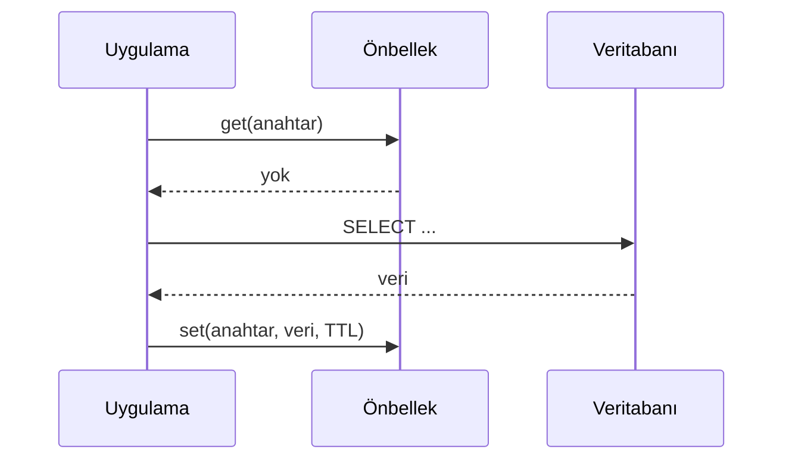
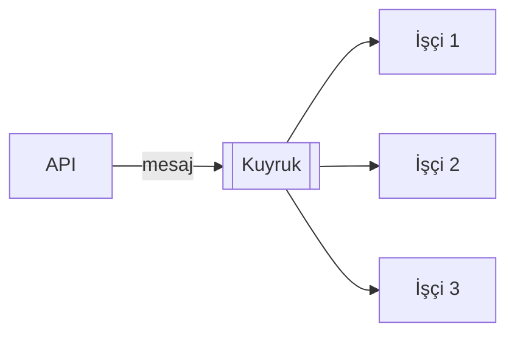

## Önbellek

Önbellek, pahalı bir işlemin sonucunu saklayıp tekrar kullanmaktır. Bellekten okuma mikrosaniyeler, veritabanı sorgusu milisaniyeler sürer; iyi kurulmuş bir önbellek hem gecikmeyi hem veritabanı yükünü büyük oranda düşürür.

Önbelleğe uygun veri: **sık okunan, seyrek değişen** ve bir süre bayat kalması kabul edilebilir veri. Her okumada farklı olan ya da hiçbir bayatlığa tahammülü olmayan veri (ör. hesap bakiyesi) uygun değildir.

### Okuma stratejisi: cache-aside

En yaygın desen. Uygulama önce önbelleğe bakar; yoksa veritabanından okur ve önbelleğe yazar.



```csharp
async Task<Product?> GetProductAsync(int id)
{
    var key = $"product:{id}";

    var cached = await cache.GetAsync<Product>(key);
    if (cached is not null) return cached;

    var product = await db.Products.FindAsync(id);
    if (product is not null)
    {
        await cache.SetAsync(key, product, TimeSpan.FromMinutes(10));
    }

    return product;
}
```

Önbellek çökerse sistem yavaşlar ama çalışmaya devam eder; bu desenin en büyük artısıdır.

### Veri değiştiğinde ne olur

"Bilgisayar biliminde iki zor şey vardır: önbelleği geçersiz kılmak ve adlandırma." Seçenekler:

| Yöntem | Nasıl | Ödünleşim |
| --- | --- | --- |
| **TTL** (yaşam süresi) | Kayıt belirli süre sonra kendiliğinden düşer | En basiti; süre boyunca bayat veri |
| **Yazınca sil** | Veritabanını güncelle, sonra önbellek anahtarını **sil** | Bir sonraki okuma tazesini yükler; yaygın tercih |
| **Yazınca güncelle** (write-through) | Veritabanıyla birlikte önbelleği de yaz | Önbellek hep güncel; yazma yavaşlar, yarış durumuna açık |
| **Sonradan yaz** (write-behind) | Önce önbelleğe yaz, veritabanına toplu ve gecikmeli aktar | Çok hızlı yazma; önbellek çökerse veri kaybı |

Pratik öneri: **yazınca sil + makul bir TTL**. Silme, güncellemeye göre yarış durumlarına karşı daha güvenlidir (iki eşzamanlı yazmada eski değerin önbellekte kalma olasılığı düşer); TTL ise silmenin başarısız olduğu durumlar için emniyet ağıdır.

### Bellek dolduğunda: çıkarma politikaları

- **LRU** (en uzun süredir kullanılmayan): genel amaçlı varsayılan.
- **LFU** (en az sıklıkla kullanılan): erişim sıklığı çarpık dağıldığında daha iyi.
- **FIFO / TTL:** yalnızca yaşa göre.

LRU önbelleği tasarlamak klasik bir kodlama sorusudur: hash tablosu + çift yönlü bağlı liste ile `get` ve `put` O(1)'de yapılır.

### Üç klasik sorun

- **Önbellek seli** (stampede): çok okunan bir anahtarın süresi dolar ve aynı anda binlerce istek veritabanına gider. Çözüm: anahtar başına tek isteğin yeniden hesaplamasına izin veren kilit, ya da süresi dolmadan arka planda yenileme.
- **Toplu süre dolması:** aynı anda yazılmış binlerce anahtar aynı anda düşer. Çözüm: TTL'e rastgele bir pay eklemek (jitter).
- **Var olmayan anahtar saldırısı:** veritabanında olmayan kimlikler sorgulanır; önbellek hiç dolmaz ve her istek veritabanına iner. Çözüm: "yok" sonucunu da kısa süreli önbelleğe almak ya da Bloom süzgeci.

Önbellek katmanları: tarayıcı → CDN → uygulama içi bellek → dağıtık önbellek (Redis) → veritabanının kendi önbelleği. Mülakatta "önbellek ekliyorum" demek yetmez: **neyi**, **hangi anahtarla**, **ne kadar süre** ve **nasıl geçersiz kılarak** sakladığınızı söyleyin.

## Mesaj kuyrukları

Kuyruk, işi üreten (producer) ile işi yapan (consumer) arasına girer. Üretici mesajı bırakır ve beklemeden devam eder; tüketici mesajı kendi hızında işler.



Ne kazandırır:

- **Yanıt süresi.** Kullanıcı, e-posta gönderimi ya da video dönüştürme bitene kadar beklemez.
- **Ani yükü yumuşatma.** Kuyruk tampon görevi görür; işçiler taşmaz, iş birikir ve sonra erir.
- **Ayrıştırma.** Üretici, tüketicinin ayakta olup olmadığını ya da kaç tane olduğunu bilmek zorunda değildir.
- **Dayanıklılık.** İşçi çökerse mesaj kaybolmaz; yeniden işlenir.

Bedeli: sistem **nihai tutarlı** hale gelir, hata ayıklama zorlaşır ve "iş bitti mi?" sorusunu yanıtlamak için ayrı bir mekanizma gerekir.

### Kuyruk ve günlük (log)

| | Mesaj kuyruğu (RabbitMQ, SQS) | Dağıtık günlük (Kafka) |
| --- | --- | --- |
| Mesajın ömrü | İşlenip onaylanınca silinir | Saklama süresi boyunca kalır |
| Tüketim | Her mesaj bir işçiye gider | Her tüketici grubu kendi konumundan okur |
| Yeniden oynatma | Yok | Var |
| Sıra garantisi | Genellikle zayıf | Bölüm (partition) içinde kesin |
| Tipik kullanım | Arka plan işleri, iş dağıtımı | Olay akışı, çok sayıda bağımsız tüketici, analitik |

### Teslim garantileri

| Garanti | Anlamı | Sonucu |
| --- | --- | --- |
| En fazla bir kez | Mesaj kaybolabilir, asla yinelenmez | Kayıp kabul edilebiliyorsa (ör. metrik) |
| **En az bir kez** | Mesaj kaybolmaz, **yinelenebilir** | Pratikteki varsayılan |
| Tam bir kez | Ne kaybolur ne yinelenir | Uçtan uca sağlamak çok zor ve pahalıdır |

Ağda "tam bir kez" teslimi garanti etmek genel durumda mümkün değildir: işçi mesajı işleyip onayı gönderemeden çökerse mesaj yeniden teslim edilir. Bu yüzden gerçek sistemler **en az bir kez teslim + idempotent tüketici** ile tasarlanır.

### Idempotency

Bir işlem, bir kez de yüz kez de uygulansa aynı sonucu veriyorsa **idempotent**tir. `bakiye = 100` idempotenttir; `bakiye += 100` değildir.

İşlemi idempotent yapmanın yolları:

- Her mesaja benzersiz bir kimlik verin ve işlenen kimlikleri saklayın; aynı kimlik ikinci kez gelirse atlayın.
- Veritabanında benzersizlik kısıtı kullanın (ör. `(siparis_id, islem_turu)`).
- İşlemi doğal olarak idempotent yazın: "durumu ÖDENDİ yap" gibi.

Aynı fikir API'ler için de geçerlidir: istemci bir **idempotency anahtarı** gönderir; ağ hatasında isteği tekrarladığında sunucu ikinci kez ödeme almaz.

### Zehirli mesajlar

Her denemede hata veren bir mesaj kuyruğu tıkayabilir. Çözüm: sınırlı sayıda (ve giderek artan aralıklarla) yeniden deneme, ardından mesajı incelenmek üzere **ölü mektup kuyruğuna** (dead-letter queue) taşıma.

## Özet

- Önbellek sık okunan, seyrek değişen veri içindir. Varsayılan desen: cache-aside, yazınca sil, TTL.
- Önbellek seli, toplu süre dolması ve var olmayan anahtar sorunlarını ve çözümlerini bilin.
- Kuyruk; yanıt süresini kısaltır, yükü yumuşatır ve bileşenleri ayrıştırır; karşılığında nihai tutarlılık getirir.
- En az bir kez teslimi varsayın ve tüketicileri idempotent yazın.

Kuyrukların birden çok servise yayılan işlemlerdeki rolü (outbox, saga) [Tutarlılık, Uzlaşma ve Dağıtık İşlemler](/tracks/sistem-tasarimi/tutarlilik-uzlasma-ve-dagitik-islemler) dersinde; Kafka ile akış işleme [Toplu ve Akış İşleme](/tracks/sistem-tasarimi/akis-isleme-ve-olasiliksal-yapilar) dersinde. Önbelleği ve kalıcılığı içeriden görmek için: [Proje 4: Kendi Redis'ini Yaz](/tracks/sistem-tasarimi/proje-kendi-redisini-yaz).
