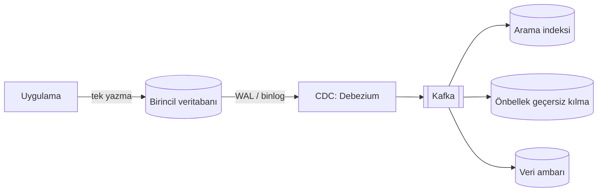

Sistem tasarımındaki en kalıcı karar veri katmanıdır: uygulama sunucularını bir öğleden sonrada değiştirirsiniz, veritabanını yıllarca taşırsınız. Bu ders, [Ölçekleme Temelleri](/tracks/sistem-tasarimi/olcekleme-temelleri) dersinin bıraktığı yerden devam eder ve Martin Kleppmann'ın *Designing Data-Intensive Applications* kitabının ilk yarısındaki fikirlerin mülakatta kullanılacak özetidir.

## Veritabanını erişim desenine göre seçin

Seçimi teknolojinin ününe göre değil, şu sorulara göre yapın:

1. Veriye **hangi anahtarla** erişeceğim? Tek kayıt mı, aralık mı, serbest sorgu mu?
2. Varlıklar arasında **ilişki** ve join var mı?
3. Birden çok kaydı **atomik** güncellemem gerekiyor mu?
4. Yazma hacmi ve veri büyüklüğü tek makineye sığıyor mu?
5. Tutarlılık mı, erişilebilirlik ve gecikme mi öncelikli?

| Tür | Örnekler | Güçlü olduğu yer | Zayıf olduğu yer |
| --- | --- | --- | --- |
| İlişkisel | PostgreSQL, MySQL | Transaction, join, esnek sorgu, kısıtlar | Yatay ölçekleme zahmetli |
| Dağıtık SQL (NewSQL) | Spanner, CockroachDB, YugabyteDB | SQL + transaction + yatay ölçek | Gecikme, maliyet, işletim karmaşıklığı |
| Anahtar–değer | Redis, DynamoDB | Anahtarla çok hızlı erişim, kolay ölçek | Anahtar dışı sorgu yok ya da sınırlı |
| Geniş sütunlu | Cassandra, ScyllaDB, Bigtable | Çok yüksek yazma hacmi, zaman serisi, bölüm içi sıralı okuma | Join yok, sorgular tabloya göre önceden tasarlanır |
| Belge | MongoDB, DynamoDB | Esnek şema, iç içe veri, tek belge atomikliği | Belgeler arası ilişki ve join zayıf |
| Graf | Neo4j | Çok adımlı ilişki sorguları (arkadaşın arkadaşı) | Genel amaçlı yük |
| Arama | Elasticsearch, OpenSearch | Tam metin arama, filtreleme, toplama | Birincil kayıt deposu olarak güvenilmez |
| Zaman serisi | TimescaleDB, InfluxDB, Prometheus | Metrik, sensör verisi, zamana göre toplama | Genel amaçlı sorgu |
| Nesne deposu | S3, GCS, Azure Blob | Sınırsız büyük dosya, ucuz | Dosya içinde sorgu yok, gecikme yüksek |

Mülakatta güvenli varsayılan **PostgreSQL**'dir: transaction, indeks, JSON sütunu, tam metin arama ve coğrafi uzantı (PostGIS) sunar ve sanıldığından çok daha büyük ölçekte çalışır. Başka bir depoya geçiyorsanız, PostgreSQL'in hangi gereksinimi karşılayamadığını söyleyin.

## Depolama motorları: B-ağacı ve LSM ağacı

| | B-ağacı | LSM ağacı |
| --- | --- | --- |
| Kim kullanır | PostgreSQL, MySQL/InnoDB, SQL Server | Cassandra, RocksDB, ScyllaDB, LevelDB |
| Yazma | Sayfayı yerinde günceller (rastgele G/Ç) | Önce bellekteki tabloya ve günlüğe ekler, diske sıralı dosya olarak döker |
| Okuma | Tek ağaçta arama, öngörülebilir | Birden çok dosyaya bakabilir; Bloom süzgeçleri yardım eder |
| Arka plan işi | Az | Sıkıştırma (compaction) sürekli çalışır |
| Uygun yük | Okuma ağırlıklı, karışık | Yazma ağırlıklı, yüksek hacimli ekleme |

Fikir: **sıralı yazma rastgele yazmadan çok hızlıdır.** LSM ağaçları yazmaları sıralı hale getirerek yazma hacmini katlar; bedelini okuma ve sıkıştırma maliyetiyle öder.

Her iki modelde de **önce günlüğe yaz** (write-ahead log, WAL) ilkesi vardır: değişiklik önce sıralı bir günlüğe yazılır; çökme sonrası durum bu günlükten yeniden kurulur. Kopyalama ve değişiklik verisi yakalama (CDC) da bu günlüğü okur.

## İndeksler

- İndeks okumayı hızlandırır, **her yazmayı yavaşlatır** (her indeks de güncellenir) ve yer kaplar.
- Bileşik indekste sütun sırası önemlidir: `(user_id, created_at)` indeksi "bir kullanıcının son gönderileri" sorgusunu karşılar, "son bir saatin bütün gönderileri" sorgusunu karşılamaz.
- Kapsayan (covering) indeks, sorgunun bütün sütunlarını içerirse tabloya hiç gidilmez.
- Parçalı sistemlerde **ikincil indeks** iki türlüdür: her parçanın kendi yerel indeksi (yazma kolay, okuma bütün parçalara sorar: *scatter-gather*) ya da anahtara göre parçalanmış küresel indeks (okuma tek parçaya gider, yazma birden çok parçayı günceller ve genellikle eşzamansızdır).

## Kopyalama (replication)

Kopyalamanın üç amacı vardır: erişilebilirlik (bir düğüm çökerse diğeri hizmet verir), okuma ölçeklemesi ve gecikme (veriyi kullanıcıya yaklaştırmak).

### Tek liderli

Bütün yazmalar lidere gider; takipçiler değişiklik günlüğünü uygular. PostgreSQL, MySQL, MongoDB ve Kafka bölümleri bu modeli kullanır.

- **Eşzamanlı kopyalama:** lider, en az bir takipçi onaylayana kadar yazmayı onaylamaz. Veri kaybı olmaz, yazma gecikmesi artar.
- **Eşzamansız kopyalama:** lider hemen onaylar. Hızlıdır; lider çökerse son yazmalar kaybolabilir.
- **Yarı eşzamanlı:** bir takipçi eşzamanlı, gerisi eşzamansız; yaygın ödünleşim.

**Lider değişimi (failover)** zor kısımdır: liderin gerçekten öldüğüne kim karar verir? Eski lider geri dönüp kendini hâlâ lider sanırsa iki lider oluşur (**split brain**). Bu yüzden lider seçimi uzlaşma algoritmalarıyla (Raft) ya da harici bir koordinatörle (etcd, ZooKeeper) yapılır.

### Kopyalama gecikmesinin yol açtığı sorunlar

| Sorun | Belirti | Çözüm |
| --- | --- | --- |
| Kendi yazdığını okuyamama | Kullanıcı profili günceller, sayfa yenilenince eskisini görür | Kullanıcının kendi verisini bir süre liderden oku |
| Zamanda geriye gitme | İki yenilemede farklı kopyalara gidilir; yeni yorum görünüp kaybolur | Kullanıcıyı hep aynı kopyaya yönlendir (monotonik okuma) |
| Sebep–sonuç karışması | Yanıt, sorusundan önce görünür | İlişkili yazmaları aynı bölüme koy, nedensel sıralama |

### Çok liderli

Her bölgede bir lider yazma kabul eder ve liderler birbirine kopyalar. Bölgeler arası gecikmeyi düşürür ve bir bölge düşerse diğerleri yazmaya devam eder. Bedeli **yazma çakışmalarıdır**: aynı kayıt iki bölgede aynı anda değişirse hangisi kazanır?

- **Son yazan kazanır** (last-write-wins): basit ama veri kaybeder; saatler senkron değildir.
- **Birleştirme:** uygulamaya özel kural ya da **CRDT** (çakışmasız kopyalanan veri tipleri: sayaç, küme, metin). Ortak düzenleme araçları ve çevrimdışı çalışan uygulamalar bunu kullanır.

### Lidersiz (Dynamo tarzı)

Amazon'un Dynamo makalesinden doğan model: Cassandra, ScyllaDB, Riak. İstemci (ya da koordinatör düğüm) yazmayı **N** kopyanın hepsine gönderir; **W** tanesi onaylayınca yazma başarılıdır. Okuma **R** kopyaya sorulur ve en yeni sürüm seçilir.

**Quorum koşulu:** `W + R > N` ise okunan kopyalardan en az biri en son yazmayı içerir. Tipik ayar: `N = 3, W = 2, R = 2`.

| Ayar | Etkisi |
| --- | --- |
| `W = N, R = 1` | Okuma çok hızlı, tek düğüm düşse yazma durur |
| `W = 1, R = N` | Yazma çok hızlı, okuma yavaş |
| `W = 1, R = 1` | En hızlı ve en erişilebilir; bayat okuma olasılığı yüksek |

Kopyaları eşitlemek için: **okumada onarım** (read repair: eski kopya okuma sırasında güncellenir), **arka plan eşitlemesi** (anti-entropy, Merkle ağaçlarıyla farkları bulma) ve **ipucu bırakma** (hinted handoff: düşen düğümün yazmalarını geçici olarak başka düğüm tutar).

## Parçalama (partitioning / sharding)

| Strateji | Nasıl | Artı | Eksi |
| --- | --- | --- | --- |
| Aralığa göre | `A–F` bir parçaya, `G–M` diğerine | Aralık sorguları verimli | Sıcak nokta riski (zaman damgası anahtarı → bütün yazmalar son parçaya) |
| Hash'e göre | `hash(anahtar)` aralıkları | Eşit dağılım | Aralık sorguları bütün parçalara gider |
| Bileşik | Hash ile bölüm anahtarı + bölüm içinde sıralı anahtar | İkisinin iyi yanı | Tasarımı erişim desenine bağlar |
| Dizine göre | Ayrı bir arama tablosu hangi anahtarın nerede olduğunu tutar | Esnek, taşıma kolay | Arama tablosu darboğaz ve tek hata noktası olabilir |

Bileşik anahtar Cassandra ve DynamoDB'nin modelidir: `PRIMARY KEY ((channel_id), message_id)`. Bir kanalın bütün mesajları aynı bölümde, mesaj kimliğine göre sıralı durur; "kanalın son 50 mesajı" tek bölümden sıralı okumadır. Discord, mesajlarını bu modelle trilyonlarca kayda ölçeklemiştir.

### Yeniden dengeleme

- `hash % N` kullanmayın: `N` değişince neredeyse her şey taşınır.
- **Sabit sayıda sanal parça:** baştan çok sayıda (ör. 1.024) mantıksal parça oluşturup düğümlere dağıtın; düğüm eklenince yalnızca bazı parçalar taşınır. Elasticsearch, Cassandra (vnode) ve Redis Cluster (16.384 slot) bu fikri kullanır.
- **Tutarlı hash:** halka üzerinde anahtarlar yalnızca komşu düğüme taşınır.

### Sıcak anahtarlar

Eşit dağıtan bir hash bile tek bir ünlü anahtarı (milyonlarca takipçili hesap, viral ürün) kurtaramaz. Çözümler:

- **Anahtarı tuzlamak:** `urun:42` yerine `urun:42:0` … `urun:42:9`; yazmalar 10 parçaya dağılır, okuma 10 parçayı birleştirir. Yalnızca bilinen sıcak anahtarlara uygulanır.
- Sıcak okumaları **önbellekle** ve hatta uygulama içi belleğe yakın tutmak.
- Sayaçlar gibi birikimli değerleri **toplu yazmak**: her artışı ayrı yazmak yerine bellekte biriktirip saniyede bir yazmak.

## Dağıtık kimlik üretimi

Parçalı sistemde `AUTO_INCREMENT` kullanılamaz: her parçanın sayacı ayrıdır. Seçenekler:

| Yöntem | Boyut | Sıralanabilir mi | Koordinasyon | Not |
| --- | --- | --- | --- | --- |
| UUID v4 | 128 bit | Hayır | Yok | B-ağacı indeksine rastgele ekleme, yer kaplar |
| **UUID v7** | 128 bit | Zamana göre | Yok | Zaman önekli; indeks dostu modern varsayılan |
| **Snowflake** | 64 bit | Zamana göre | Makine kimliği ataması | Twitter'ın yöntemi |
| Aralık dağıtan sayaç | 64 bit | Kabaca | Aralık bitince | [URL kısaltıcı](/tracks/sistem-tasarimi/url-kisaltici) dersinde |
| Veritabanı dizisi, farklı adım | 64 bit | Kabaca | Yok | Parça 1: 1, 3, 5…; parça 2: 2, 4, 6… |

Snowflake kimliğinin yapısı:

```text
| 1 bit işaret | 41 bit milisaniye zaman damgası | 10 bit makine kimliği | 12 bit sıra numarası |
```

41 bit zaman damgası özel bir başlangıç anından itibaren ~69 yıl yeter; 10 bit 1.024 makine; 12 bit her makinede milisaniyede 4.096 kimlik demektir. Kimlikler **zamana göre kabaca sıralıdır**, bu da "en yeni N kayıt" sorgularını ve imleçli sayfalamayı kolaylaştırır. Dikkat: saat geri giderse (NTP düzeltmesi) yinelenen kimlik üretilebilir; üreteç saatin geri gittiğini görürse beklemelidir.

## Değişiklik verisi yakalama (CDC) ve türetilmiş veri

Bir kaydı aynı anda veritabanına, önbelleğe ve arama indeksine **uygulama kodundan** yazmak tutarsızlığa açıktır: biri başarılı olur, diğeri olmaz. Daha sağlam desen:



Birincil veritabanı **tek doğru kaynaktır**; arama indeksi, önbellek ve analitik depo ondan türetilir ve gerekirse baştan yeniden kurulabilir.

## Özet

- Veritabanını erişim desenine göre seçin; varsayılan PostgreSQL, sapma gerekçeli olsun.
- B-ağacı okuma, LSM ağacı yazma ağırlıklı yüklerde öne çıkar.
- Tek liderli kopyalama basit ve yaygındır; çok liderli ve lidersiz modeller erişilebilirlik kazandırır, çakışma çözümü gerektirir.
- Quorum: `W + R > N`.
- Parçalama anahtarı eşit dağıtmalı ve sık sorguyu tek parçada karşılamalı; sıcak anahtarlar için tuzlama ve önbellek.
- Dağıtık kimlik: UUID v7 ya da Snowflake.

**Daha fazlası:** *Designing Data-Intensive Applications* (2. baskı, 2026) bölüm 4–7; [Dynamo makalesi](https://www.allthingsdistributed.com/files/amazon-dynamo-sosp2007.pdf); [Discord trilyonlarca mesajı nasıl saklıyor](https://discord.com/blog/how-discord-stores-trillions-of-messages); [Figma veritabanı ölçekleme](https://www.figma.com/blog/how-figmas-databases-team-lived-to-tell-the-scale/); [Notion'da PostgreSQL parçalama](https://www.notion.com/blog/sharding-postgres-at-notion).
