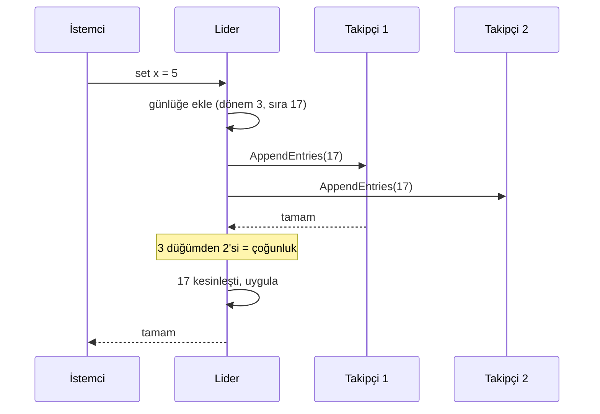
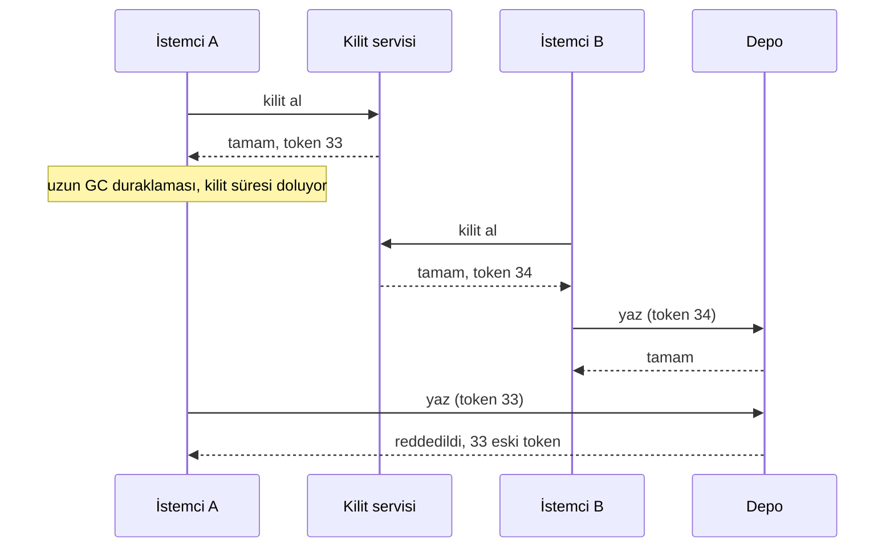

Tek makinede "önce bu oldu, sonra şu" demek kolaydır. Birden çok makinede ise ağ mesajları gecikir, kaybolur, sırası değişir; saatler birbirinden kayar; düğümler sessizce ölür ya da uzun bir çöp toplama duraklamasından sonra hiçbir şey olmamış gibi geri döner. Bu ders, mülakatta "peki bu tutarlı mı?" sorusuna güvenle yanıt verebilmeniz için gereken kavramları toplar.

## Dağıtık sistemlerin sekiz yanılgısı

Yeni başlayanların sessizce varsaydığı ve sistemi bozan sekiz varsayım: ağ güvenilirdir, gecikme sıfırdır, bant genişliği sınırsızdır, ağ güvenlidir, topoloji değişmez, tek bir yönetici vardır, taşıma maliyeti sıfırdır, ağ homojendir. Tasarımınızdaki her ok için "bu mesaj kaybolursa, geç gelirse ya da iki kez gelirse ne olur?" diye sorun.

Bir isteğe yanıt alamadığınızda **ne olduğunu bilemezsiniz**: istek hiç ulaşmamış olabilir, karşı taraf işleyip yanıtı kaybetmiş olabilir ya da hâlâ işliyor olabilir. Zaman aşımı yalnızca "bilmiyorum" demektir. Bu yüzden yeniden denemeler idempotent olmalıdır.

## Tutarlılık modelleri

Güçlüden zayıfa:

| Model | Garanti | Örnek ihtiyaç |
| --- | --- | --- |
| **Doğrusallaştırılabilirlik** (linearizability) | Sistem tek bir kopya varmış gibi davranır; bir yazma tamamlandıktan sonra her okuma onu görür | Kilit, lider seçimi, benzersiz kullanıcı adı, stok son adedi |
| Sıralı tutarlılık | Herkes işlemleri aynı sırada görür, ama gerçek zamanla örtüşmeyebilir | |
| **Nedensel tutarlılık** | Sebep, sonuçtan önce görülür (yanıt sorudan önce görünmez) | Yorum dizileri, sohbet |
| Kendi yazdığını okuma | Kullanıcı kendi yazmasını hemen görür | Profil güncelleme |
| Monotonik okuma | Zamanda geri gidilmez | Akış yenileme |
| **Nihai tutarlılık** | Yazmalar durursa kopyalar sonunda aynılaşır | Beğeni sayısı, akış, analitik |

Güçlü tutarlılık **koordinasyon** gerektirir (quorum, uzlaşma, kilit); koordinasyon da gecikme ve bölünme anında erişilemezlik demektir. İyi bir tasarım, tutarlılığı veri türü başına seçer: ödeme ve stok güçlü, beğeni ve görüntülenme sayısı nihai.

## CAP'ten PACELC'e

CAP yalnızca ağ bölünmesi anını anlatır. **PACELC** resmi tamamlar:

> Bölünme (**P**) varsa **A**vailability ile **C**onsistency arasında seçim yap; **E**lse (normal çalışmada) **L**atency ile **C**onsistency arasında seçim yap.

| Sistem | Bölünmede | Normalde | Not |
| --- | --- | --- | --- |
| DynamoDB, Cassandra (varsayılan) | A | L | Hızlı, nihai tutarlı; istenirse güçlü okuma |
| Spanner, CockroachDB | C | C | Her yazma uzlaşmadan geçer; gecikmeyi kabul eder |
| PostgreSQL (eşzamansız kopya) | — | L | Kopyadan okuma bayat olabilir |

Mülakatta "CP mi AP mi?" sorusunu, normal çalışmadaki **gecikme bedeliyle** birlikte yanıtlamak kıdem gösterir.

## Saatler ve sıralama

Farklı makinelerin saatleri milisaniyelerden saniyelere kadar kayabilir ve NTP düzeltmesiyle **geri bile gidebilir**. Bu yüzden:

- "Son yazan kazanır" kuralı duvar saatine dayanıyorsa veri sessizce kaybolabilir.
- Zaman aşımı ve süre ölçümü için **monotonik saat** kullanılır (`Stopwatch`, `performance.now()`), duvar saati değil.

Olayları saat kullanmadan sıralamak için mantıksal saatler:

- **Lamport saati:** her düğüm bir sayaç tutar, her olayda artırır ve mesajla gönderir; alıcı `max(kendi, gelen) + 1` alır. Nedensel sırayı korur ama eşzamanlı olayları ayırt edemez.
- **Vektör saati:** her düğüm için bir sayaç. İki olayın sebep–sonuç ilişkisinde mi yoksa **eşzamanlı** (çakışan) mı olduğunu söyler; Dynamo tarzı depolar çakışmaları böyle tespit eder.
- **Hibrit mantıksal saat (HLC):** fiziksel zamana yakın ama nedenselliği koruyan zaman damgaları; CockroachDB kullanır.
- Google **Spanner** ise atomik saat ve GPS ile saat belirsizliğini sınırlar (TrueTime) ve commit'te bu belirsizlik kadar bekler.

## Uzlaşma (consensus) ve Raft

Uzlaşma, bir grup düğümün çökmelere rağmen **tek bir değer** üzerinde anlaşmasıdır: kim lider, bu günlük girdisi kesinleşti mi, bu kilit kimin? Lider seçimi, doğrusallaştırılabilir depolama, dağıtık kilit ve yapılandırma yönetimi hep uzlaşmaya dayanır. Kendiniz yazmazsınız; **etcd, ZooKeeper, Consul** gibi hazır servisler ya da Raft gömülü sistemler (CockroachDB, TiKV, Kafka KRaft) kullanırsınız. Ama nasıl çalıştığını anlatabilmeniz beklenir.

**Raft'ın özü:**

1. Düğümler üç durumdan birindedir: **takipçi**, **aday**, **lider**. Zamanın dönemleri (**term**) vardır.
2. **Lider seçimi:** takipçi, belirli (rastgele) bir süre liderden haber alamazsa aday olur, dönemi artırır ve oy ister. Çoğunluğun oyunu alan lider olur. Rastgele süreler, adayların sürekli çakışmasını önler.
3. **Günlük kopyalama:** istemci isteği lidere gelir; lider girdiyi kendi günlüğüne ekler ve takipçilere gönderir. **Çoğunluk** girdiyi kaydedince girdi kesinleşir (committed) ve durum makinesine uygulanır.
4. **Güvenlik:** yalnızca bütün kesinleşmiş girdileri içeren bir düğüm lider seçilebilir; eski dönemin lideri, daha yüksek dönemli bir mesaj görünce hemen takipçiye döner.



**Neden tek sayıda düğüm?** 2f + 1 düğüm, f düğümün çökmesine dayanır: 3 düğüm 1, 5 düğüm 2 çökmeye. 4 düğüm, 3 düğümden daha fazla çökmeye dayanmaz ama çoğunluk için daha çok onay bekler.

**Bedel:** her yazma çoğunluğa gidip gelir; bölgeler arası Raft kümesinde bu, yazma başına onlarca–yüzlerce milisaniyedir. Azınlıkta kalan taraf (bölünmede) yazma kabul edemez: Raft bir **CP** sistemidir.

## Dağıtık kilitler ve fencing token

Bir işi aynı anda yalnızca bir işçinin yapması gerektiğinde (zamanlanmış görev, bir kaynağa tekil erişim) dağıtık kilit kullanılır. Basit Redis kilidi:

```text
SET kilit:rapor <rastgele-değer> NX PX 30000
```

`NX` yalnızca yoksa yazar, `PX` 30 saniye sonra kilidi kendiliğinden düşürür. Bırakırken değerin hâlâ sizin değeriniz olduğunu atomik olarak (Lua betiğiyle) denetlemelisiniz; yoksa süresi dolup başkasına geçmiş kilidi silersiniz.

**Asıl tehlike:** kilidi alan işlem uzun bir çöp toplama duraklamasına girer, kilidin süresi dolar, başka bir işlem kilidi alır ve **ikisi birden** yazar. Kilit servisi bunu önleyemez; çünkü ilk işlem süresinin dolduğundan habersizdir.

Çözüm **fencing token**: kilit servisi her verişte artan bir sayı döndürür (33, 34, …). Korunan depo, her yazmada token'ı denetler ve **gördüğü en büyükten küçük** token'lı yazmaları reddeder. Duraklamadan dönen eski sahip (33), yeni sahip 34 ile yazdıktan sonra reddedilir.



Doğruluk gerçekten önemliyse kilidi uzlaşma tabanlı bir servisten (etcd, ZooKeeper) alın ve fencing token kullanın. Kilit yalnızca verimlilik içinse (aynı işi iki kez yapmak sadece israfsa) basit Redis kilidi yeterlidir.

Çoğu zaman kilit yerine daha basit araçlar yeter:

- **İyimser eşzamanlılık:** `UPDATE ... SET stok = stok - 1, surum = surum + 1 WHERE id = 42 AND surum = 7` — etkilenen satır yoksa başkası araya girmiştir, yeniden dene.
- **Koşullu atomik güncelleme:** `UPDATE koltuk SET durum = 'ayrildi' WHERE id = 12 AND durum = 'bos'`.
- **Benzersizlik kısıtı:** iki ekleme yarışırsa biri kısıt hatası alır.

## Birden çok servise yayılan işlemler

Bir sipariş: stok düşülür, ödeme alınır, kargo oluşturulur. Her biri farklı servis ve veritabanındaysa tek bir veritabanı transaction'ı yoktur.

### İki aşamalı commit (2PC)

Bir koordinatör önce bütün katılımcılara "hazır mısın?" diye sorar (prepare); hepsi evet derse "commit" der, biri hayır derse hepsine "geri al" der.

- Artı: atomiklik.
- Eksi: koordinatör "hazır" ile "commit" arasında çökerse katılımcılar kilitleri tutarak **bekler** (blocking); her işlem en yavaş katılımcı kadar yavaştır; bütün katılımcılar 2PC desteklemelidir. Mikroservisler arasında nadiren kullanılır; tek bir dağıtık veritabanının içinde (Spanner, CockroachDB) uzlaşmayla birlikte kullanılır.

### Saga

Uzun işlem, her biri kendi yerel transaction'ı olan adımlara bölünür. Bir adım başarısız olursa önceki adımlar **telafi işlemleriyle** (compensating transaction) geri alınır: ödeme iadesi, stok geri ekleme.

| | Koreografi | Orkestrasyon |
| --- | --- | --- |
| Nasıl | Her servis olay yayınlar, diğerleri dinleyip tepki verir | Merkezi bir orkestratör adımları sırayla çağırır |
| Artı | Merkezi bileşen yok, gevşek bağlı | Akış tek yerde görünür, hata yönetimi kolay |
| Eksi | Akışı izlemek ve değiştirmek zor | Orkestratör ek bileşen |
| Araç | Kafka, mesaj kuyruğu | Temporal, AWS Step Functions, Durable Functions |

Saga'lar **izolasyon sağlamaz**: ara durumlar başkalarına görünür (stok düşülmüş ama ödeme alınmamış). Bunu "bekliyor" gibi ara durumlarla ve anlamsal kilitlerle yönetirsiniz. Telafi işlemleri de idempotent olmalıdır.

### Transactional outbox

Klasik hata: veritabanına yaz, sonra Kafka'ya olay gönder. İkisinin arasında çökerseniz olay hiç yayınlanmaz; sıra tersse olay yayınlanır ama kayıt yoktur (**çift yazma sorunu**).

Çözüm: olayı, iş verisiyle **aynı transaction'da** bir `outbox` tablosuna yazın. Ayrı bir yayıncı (ya da CDC) bu tabloyu okuyup kuyruğa gönderir ve gönderileni işaretler.

```sql
BEGIN;
INSERT INTO orders (id, user_id, total) VALUES (981, 42, 250.00);
INSERT INTO outbox (id, aggregate_id, type, payload)
VALUES (gen_random_uuid(), 981, 'OrderCreated', '{"orderId": 981, "total": 250.00}');
COMMIT;
```

Yayıncı en az bir kez gönderir; tüketiciler olay kimliğiyle **idempotent** olmalıdır (gelen kutusu / inbox tablosu). Outbox + idempotent tüketici + saga, mikroservislerde tutarlılığın standart reçetesidir.

## Özet

- Zaman aşımı "bilmiyorum" demektir; yeniden denemeler idempotent olmalı.
- Tutarlılığı veri türü başına seçin; güçlü tutarlılık koordinasyon ve gecikme demektir (PACELC).
- Duvar saatine güvenmeyin; sıralama için mantıksal saat ya da uzlaşma.
- Raft: rastgele zaman aşımlı lider seçimi, çoğunlukla kesinleşen günlük; 2f + 1 düğüm f çökmeye dayanır.
- Kilit doğruluk içinse fencing token şarttır; çoğu zaman iyimser eşzamanlılık ya da koşullu güncelleme yeter.
- Servisler arası işlem: 2PC yerine saga; olay yayınlamak için outbox.

**Daha fazlası:** [Raft görselleştirmesi ve makalesi](https://raft.github.io/); Martin Kleppmann, [How to do distributed locking](https://martin.kleppmann.com/2016/02/08/how-to-do-distributed-locking.html); [Jepsen analizleri](https://jepsen.io/analyses); *Designing Data-Intensive Applications* bölüm 8–10.
