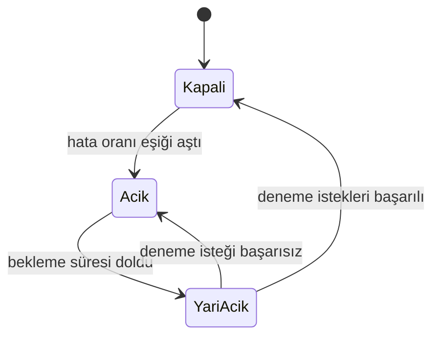

Büyük ölçekte bir şeyin bozuk olması istisna değil, **normal durumdur**: binlerce makineden her gün birkaçı ölür, ağ anlık olarak kopar, bir bağımlılık yavaşlar. Dayanıklı bir sistem hataları önlemeye değil, **sınırlamaya** çalışır: tek bir yavaş servis bütün sistemi düşürmemelidir. Mülakatın derinleşme bölümünde "bu servis yavaşlarsa ne olur?" sorusu neredeyse her zaman gelir.

## Zincirleme hata nasıl oluşur

Ödeme servisi yavaşlar ve yanıt süresi 50 ms'den 5 saniyeye çıkar. Onu çağıran sipariş servisinin iş parçacıkları ve bağlantıları yanıt beklerken tükenir; sipariş servisi artık hiçbir isteğe, ödemeyle ilgisiz olanlara bile yanıt veremez. Onu çağıran ağ geçidi de tıkanır. Tek bir yavaş bağımlılık, **bütün sistemi** düşürmüştür.

Aşağıdaki desenlerin hepsi bu yayılımı kesmek içindir.

## Zaman aşımı

Her ağ çağrısının bir zaman aşımı olmalıdır. Varsayılan "sonsuz" ya da 100 saniye olan istemciler zincirleme hatanın birinci sebebidir.

- Zaman aşımını bağımlılığın **p99 gecikmesinin biraz üstüne** koyun, ortalamaya göre değil.
- **Son tarih yayılımı** (deadline propagation): kullanıcı isteğinin 2 saniyelik bütçesi varsa ve 1,5 saniyesi harcandıysa, alt servise 500 ms'den fazla süre vermenin anlamı yoktur. gRPC bunu yerleşik olarak taşır.

## Yeniden deneme: üstel geri çekilme ve jitter

Geçici hatalar (ağ kesintisi, `503`, zaman aşımı) yeniden denemeyle çoğunlukla geçer. Ama kötü yazılmış yeniden deneme, zorlanan bir servisi **bitirir**: her istemci hemen ve defalarca denerse yük katlanır (retry storm).

Kurallar:

1. Yalnızca **geçici** ve **idempotent** işlemleri yeniden deneyin (`400 Bad Request` yeniden denenmez).
2. Bekleme süresini üstel artırın: 100 ms, 200 ms, 400 ms, 800 ms…
3. Bekleme süresine **rastgelelik (jitter)** ekleyin; yoksa bütün istemciler aynı anda yeniden dener.
4. Deneme sayısını ve toplam süreyi sınırlayın.
5. Katmanlar arasında çarpılmaya dikkat edin: üç katmanın her biri 3 kez denerse en alttaki servis 27 kat istek görür. Yeniden denemeyi tek bir katmanda yapın ya da bir **yeniden deneme bütçesi** tutun (ör. isteklerin en fazla %10'u yeniden deneme olabilir).

```typescript
async function withRetry<T>(op: () => Promise<T>, maxAttempts = 4, baseMs = 100, capMs = 2_000): Promise<T> {
  for (let attempt = 1; ; attempt++) {
    try {
      return await op();
    } catch (error) {
      if (attempt >= maxAttempts || !isTransient(error)) throw error;

      // "Tam jitter": 0 ile üstel sınır arasında rastgele bekle.
      const ceiling = Math.min(capMs, baseMs * 2 ** (attempt - 1));
      await sleep(Math.random() * ceiling);
    }
  }
}
```

.NET'te bunu elle yazmak yerine `Microsoft.Extensions.Http.Resilience` (Polly tabanlı) standart dayanıklılık hattını kullanırsınız: zaman aşımı, yeniden deneme, devre kesici ve eşzamanlılık sınırı tek satırda gelir.

## Devre kesici (circuit breaker)

Bağımlılık açıkça çökmüşse her isteği zaman aşımına kadar bekletmek kaynak israfıdır. Devre kesici, hata oranı eşiği aşınca çağrıları **hiç yapmadan** hemen başarısız sayar ve bağımlılığa toparlanma fırsatı verir.



- **Kapalı:** istekler geçer, hatalar sayılır.
- **Açık:** istekler anında reddedilir (ya da yedek yanıt döner).
- **Yarı açık:** birkaç deneme isteği geçirilir; başarılıysa devre kapanır.

## Bölmeler (bulkhead)

Geminin su geçirmez bölmeleri gibi: her bağımlılığa **ayrı** ve sınırlı bir kaynak havuzu (iş parçacığı, bağlantı, eşzamanlı istek kotası) verin. Ödeme servisi yavaşlarsa yalnızca ödeme havuzu dolar; ürün listeleme etkilenmez. Aynı fikir kiracılar (tenant) için de geçerlidir: gürültülü bir müşteri diğerlerinin kaynağını tüketmemelidir.

## Yük atma, geri basınç ve kademeli bozulma

- **Yük atma** (load shedding): sunucu kapasitesini aştığında fazlasını hızlıca `503` ile reddeder. Yavaşça herkese hizmet verip zaman aşımına düşmektense bir kısmına hızlı hizmet vermek iyidir. Önceliğe göre atın: ödeme isteği, öneri isteğinden önce gelir.
- **Geri basınç** (backpressure): tüketici yetişemiyorsa üreticiyi yavaşlatın. Sınırsız kuyruk yoktur; sınırsız gibi görünen kuyruk, bellek tükenene kadar gecikmeyi büyüten bir bombadır. Kuyrukları sınırlayın ve dolduğunda ne olacağına karar verin.
- **Kademeli bozulma** (graceful degradation): öneri servisi çöktüyse ana sayfa popüler ürünlerin önbellekteki listesini gösterir; yorumlar yüklenemiyorsa ürün sayfası yorumsuz açılır. Kritik yol, kritik olmayan bağımlılıklar yüzünden düşmemelidir.
- **Hız sınırlama:** kötüye kullanımı ve tek bir istemcinin bütün kapasiteyi tüketmesini önler. Algoritmaları [Hız Sınırlayıcı](/tracks/sistem-tasarimi/hiz-sinirlayici) dersinde.

## Sağlık denetimleri ve dağıtım

- **Canlılık** (liveness) denetimi: süreç yaşıyor mu? Başarısızsa süreç yeniden başlatılır. Bağımlılıkları denetlemeyin; veritabanı yavaşladı diye bütün sunucuları yeniden başlatmak felakettir.
- **Hazırlık** (readiness) denetimi: istek almaya hazır mı? Başarısızsa yük dengeleyici trafiği keser.
- **Kanarya dağıtımı:** yeni sürüm önce trafiğin %1–5'ine açılır; hata oranı ve gecikme izlenir, sorun yoksa kademeli olarak artırılır.
- **Mavi–yeşil dağıtım:** iki özdeş ortam; trafik tek adımda yenisine geçer, sorun olursa tek adımda geri döner.
- **Özellik bayrakları:** kodu dağıtmak ile özelliği açmak ayrılır; sorunlu özellik dağıtım yapmadan kapatılır.

Büyük kesintilerin önemli bir kısmı **değişiklikten** (dağıtım, yapılandırma) kaynaklanır; kademeli açılış ve hızlı geri alma en etkili dayanıklılık önlemleridir.

## Gözlemlenebilirlik

Görmediğiniz sistemi işletemezsiniz. Üç temel sinyal:

| Sinyal | Ne söyler | Araç |
| --- | --- | --- |
| **Metrik** | Ne kadar? Sayısal, ucuz, zaman serisi: istek sayısı, hata oranı, gecikme yüzdelikleri | Prometheus, Grafana |
| **Günlük** (log) | Ne oldu? Olay başına ayrıntı; yapılandırılmış (JSON) ve istek kimliği içermeli | Loki, Elasticsearch |
| **İz** (trace) | Nerede? Bir isteğin servisler arasındaki yolculuğu ve her adımın süresi | OpenTelemetry, Jaeger, Tempo |

İzlenecek temel metrikler:

- **RED** (istek tabanlı servisler için): **R**ate (istek hızı), **E**rrors (hata oranı), **D**uration (gecikme).
- **USE** (kaynaklar için): **U**tilization (kullanım), **S**aturation (doygunluk, kuyruk uzunluğu), **E**rrors.
- Google'ın **dört altın sinyali:** gecikme, trafik, hata, doygunluk.

**Ortalama gecikme yalan söyler.** Yüzdelik kullanın: p50, p95, **p99**. Bir sayfa 50 arka uç çağrısı yapıyorsa, her çağrının p99'u o sayfadaki isteklerin büyük kısmında hissedilir (kuyruk gecikmesi, *tail latency*). Kuyruk gecikmesini düşürmek için yaygın teknik: belirli süre içinde yanıt gelmezse aynı isteği ikinci bir kopyaya da göndermek (**hedged request**).

## SLI, SLO ve hata bütçesi

- **SLI** (gösterge): ölçülen değer. "Başarılı ve 300 ms altında yanıtlanan isteklerin oranı."
- **SLO** (hedef): o değer için iç hedef. "30 günlük pencerede %99,9."
- **SLA** (anlaşma): müşteriye verilen, ihlalinde yaptırımı olan söz; SLO'dan gevşek tutulur.
- **Hata bütçesi:** %99,9 SLO, ayda ~43 dakikalık hataya izin verir. Bütçe varken hızlı yayın yapılır; bütçe tükenince ekip yeni özellik yerine güvenilirliğe odaklanır.

Alarmlar **belirtiye** (kullanıcının yaşadığı hata ve gecikme) göre kurulmalı, nedene (CPU %80) göre değil; aksi halde ekip gürültüye alışır ve gerçek alarmı kaçırır.

## Mülakatta nasıl kullanılır

Tasarımınızın her oku için şunları söyleyin:

1. Zaman aşımı ve yeniden deneme politikası (idempotent mi?).
2. Bağımlılık çökerse kullanıcı ne görür (kademeli bozulma)?
3. Ani yükte ne olur (kuyruk, yük atma, hız sınırı)?
4. Bunu nasıl fark ederim (hangi metrik, hangi SLO)?

## Özet

- Her çağrıya zaman aşımı; yeniden denemeye üstel geri çekilme, jitter ve bütçe.
- Devre kesici çökmüş bağımlılığı, bölmeler yavaş bağımlılığı yalıtır.
- Kapasite aşıldığında yük atın; kuyrukları sınırlayın; kritik olmayanı feda edin.
- Metrik, günlük ve iz; ortalamaya değil p99'a bakın; SLO ve hata bütçesiyle yönetin.

**Daha fazlası:** [Amazon Builders' Library](https://aws.amazon.com/builders-library/) (özellikle "Timeouts, retries, and backoff with jitter" ve "Using load shedding to avoid overload"); [Google SRE kitapları](https://sre.google/books/) (ücretsiz); Michael Nygard, *Release It!*
