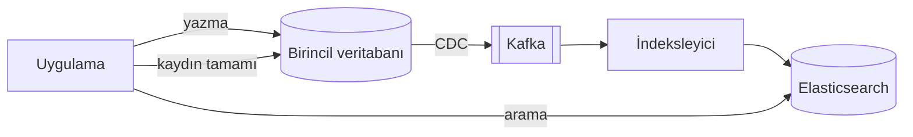
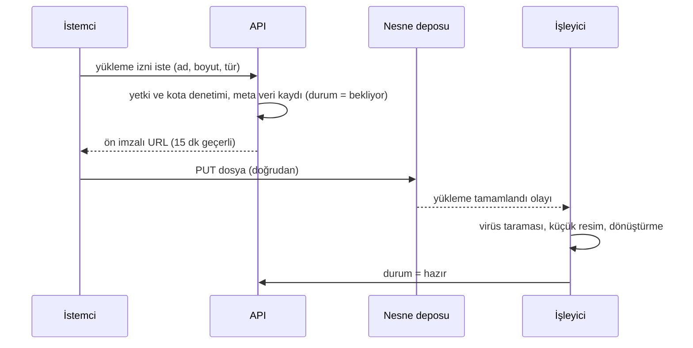

Pek çok tasarım sorusu, genel amaçlı bir veritabanının iyi yapamadığı bir işe dayanır: "metinde ara", "yakınımdaki sürücüleri bul", "2 GB'lık videoyu yükle". Bu ders bu üç işin standart çözümlerini anlatır.

## Tam metin arama

`WHERE baslik LIKE '%kulaklık%'` bütün tabloyu tarar, kökleri (kulaklık / kulaklıklar) tanımaz ve sonuçları alakaya göre sıralamaz.

### Ters indeks

Arama motorları **ters indeks** (inverted index) kullanır: her terimden, onu içeren belgelerin listesine bir eşleme.

```text
"kablosuz"  → [doc 3, doc 8, doc 21]
"kulaklık"  → [doc 3, doc 5, doc 8]
"bluetooth" → [doc 8, doc 13]

"kablosuz kulaklık" araması = [3, 8, 21] ∩ [3, 5, 8] = [3, 8]
```

İndekslemeden önce metin **çözümlenir** (analyze): küçük harfe çevirme, sözcüklere bölme, durak sözcükleri (ve, ile) atma, **kök bulma** (stemming: "kulaklıklar" → "kulaklık"), eş anlamlılar. Türkçe gibi eklemeli dillerde kök bulma alakayı büyük ölçüde etkiler.

Sonuçlar **alaka puanına** göre sıralanır (BM25: terim belgede ne sık geçiyor, bütün belgelerde ne kadar nadir), ardından iş kurallarıyla (popülerlik, tazelik, kişiselleştirme) yeniden sıralanır.

### Mimari



- Birincil veritabanı tek doğru kaynaktır; arama indeksi ondan **türetilir** ve gerektiğinde baştan kurulabilir.
- İndeks CDC ya da olaylarla eşzamansız güncellenir; yeni bir kaydın aramada görünmesi saniyeler sürebilir (Elasticsearch'te bir saniyelik yenileme aralığı varsayılandır). Bunu mülakatta söyleyin.
- Elasticsearch indeksleri parçalara (shard) bölünür; arama bütün parçalara gider (scatter-gather), sonuçlar birleştirilir.
- Küçük ve orta ölçekte PostgreSQL'in kendi tam metin araması (`tsvector`, GIN indeksi) ayrı bir küme işletmekten daha iyi bir seçim olabilir.

### Otomatik tamamlama (typeahead)

Her tuş vuruşunda sonuç gereken durumlarda tam metin araması yerine **önek** yapıları kullanılır: trie (önek ağacı) ya da önceden hesaplanmış "önek → en popüler 10 sorgu" tablosu. Popülerlik çevrimdışı (saatlik/günlük) hesaplanır, sonuçlar istemci ve CDN düzeyinde agresif biçimde önbelleğe alınır, istekler istemcide **debounce** ile seyreltilir.

### Vektör arama

Anlamsal arama ve öneri için metin ya da görsel bir **gömme vektörüne** (embedding) çevrilir; arama "bu vektöre en yakın k vektör" sorgusudur. Tam arama pahalı olduğundan **yaklaşık en yakın komşu** indeksleri (HNSW, IVF) kullanılır: pgvector, Elasticsearch/OpenSearch, ayrı vektör veritabanları. Çoğu üretim sistemi anahtar sözcük araması ile vektör aramasını birleştirir (hibrit arama).

## Konum: yakınlık sorguları

"5 km içindeki restoranlar" sorgusu iki boyutludur; enlem ve boylam üzerindeki iki ayrı B-ağacı indeksi bunu verimli karşılayamaz (biri bütün enlem şeridini, diğeri bütün boylam şeridini getirir). Çözüm, iki boyutu **tek bir indekslenebilir değere** indirgemek ya da uzamsal indeks kullanmaktır.

### Geohash

Dünya yinelemeli olarak ikiye bölünür ve konum, base32 bir dizgiye kodlanır. **Ortak öneki uzun olan noktalar birbirine yakındır.**

| Uzunluk | Hücre boyutu (yaklaşık) |
| --- | --- |
| 4 | 39 km × 20 km |
| 5 | 4,9 km × 4,9 km |
| 6 | 1,2 km × 0,6 km |
| 7 | 153 m × 153 m |

Sorgu: kullanıcının hücresini ve **8 komşu hücreyi** bul (nokta hücre kenarındaysa en yakın yer komşu hücrede olabilir), bu hücrelerdeki noktaları getir, gerçek mesafeye göre süz ve sırala. Geohash sıradan bir dizgi olduğu için herhangi bir veritabanında ya da Redis'te (`GEOADD`, `GEOSEARCH`) indekslenebilir.

### Quadtree

Harita, bir hücrede belirli sayıdan (ör. 100) fazla nokta olunca dörde bölünür. Yoğun şehir merkezleri küçük hücrelere, boş bölgeler büyük hücrelere düşer; bu, sabit boyutlu geohash'e göre yoğunluğa **uyum sağlar**. Genellikle bellekte tutulur ve az değişen veri (restoranlar, işletmeler) için uygundur.

### H3 ve S2

- **H3** (Uber): dünyayı hiyerarşik **altıgenlere** böler. Altıgenin bütün komşuları merkezden eşit uzaklıktadır; bu, talep/arz yoğunluğu ve fiyatlandırma gibi hesaplarda karelerin köşe sorununu ortadan kaldırır.
- **S2** (Google): küreyi hiyerarşik hücrelere bölüp Hilbert eğrisiyle tek boyuta indirger.

### Hangi durumda hangisi

| Veri | Öneri |
| --- | --- |
| Az değişen noktalar (restoran, otel) | PostGIS ya da Elasticsearch geo sorguları; yoğunluk farkı büyükse quadtree |
| Saniyede binlerce kez güncellenen noktalar (sürücüler) | Bellekte geohash/H3 hücre → nokta kümesi (Redis GEO), kalıcı depoya yazma yok ya da seyrek |
| Bölge bazında toplama (talep yoğunluğu) | H3 hücreleri |

Yüksek frekanslı konum güncellemesinin ayrıntısı [Yakındaki Sürücüler](/tracks/sistem-tasarimi/yakindaki-suruculer) dersinde.

## Büyük dosyalar: nesne deposu

Görsel, video, belge, yedek gibi büyük ikili veriler veritabanına konmaz: veritabanını şişirir, yedeklemeyi ve kopyalamayı yavaşlatır, pahalıdır. Yerine **nesne deposu** (S3, GCS, Azure Blob) kullanılır: düz bir anahtar → nesne alanı, neredeyse sınırsız kapasite, yüksek dayanıklılık (S3 için %99,999999999) ve düşük maliyet. Veritabanında yalnızca **meta veri** (sahip, boyut, tür, nesne anahtarı, durum) tutulur.

### Ön imzalı URL ile doğrudan yükleme

Dosyayı uygulama sunucusu üzerinden geçirmek, sunucunun bant genişliğini ve belleğini boşa harcar. Bunun yerine:



Ön imzalı URL, belirli bir nesneye belirli bir süre boyunca belirli bir işlemi (PUT ya da GET) yapma izni veren imzalı bir bağlantıdır. Özel dosyaların indirilmesi de aynı yöntemle yapılır.

### Parçalı ve sürdürülebilir yükleme

Büyük dosyalar **parçalar** halinde (ör. 5–100 MB) yüklenir (multipart upload):

- Parçalar paralel yüklenir; toplam süre kısalır.
- Bağlantı koparsa yalnızca eksik parçalar yeniden yüklenir; istemci hangi parçaların tamamlandığını sorabilir.
- Bütün parçalar bitince "tamamla" çağrısı nesneyi birleştirir.

Dosya senkronizasyon servisleri (Dropbox, Google Drive) bir adım ileri gider: dosyayı bloklara (Dropbox'ta 4 MB'lık) böler, her bloğun özetini (hash) alır ve yalnızca **değişen blokları** yükler. Aynı özete sahip blok zaten varsa hiç yüklenmez (tekilleştirme).

### CDN ile dağıtım

Okuma yolunda dosyalar CDN üzerinden verilir: kullanıcıya en yakın kenar sunucusu dosyayı önbellekte tutar, kaynak (origin) yalnızca önbellekte yoksa çağrılır. Dikkat edilecekler:

- Değişen dosyalar için **içerik özetli adlar** (`logo.3f9a1c.png`) kullanın; böylece geçersiz kılma gerekmez, sonsuza yakın TTL verilebilir.
- Özel içerik için imzalı CDN URL'leri ya da imzalı çerezler.
- Video gibi büyük ve popüler içerikte CDN maliyeti ve isabet oranı tasarımın merkezindedir; Netflix kendi CDN'ini (Open Connect) internet servis sağlayıcılarının içine yerleştirir.

## Özet

- Tam metin arama: ters indeks, çözümleme, BM25; indeks birincil veritabanından CDC ile türetilir ve nihai tutarlıdır.
- Otomatik tamamlama: trie ya da önceden hesaplanmış önek tabloları ve agresif önbellek.
- Yakınlık: geohash (+ 8 komşu), quadtree, H3; sık güncellenen konumlar bellekte.
- Büyük dosyalar: nesne deposu + veritabanında meta veri; ön imzalı URL ile doğrudan, parçalı yükleme; dağıtım CDN'den.
