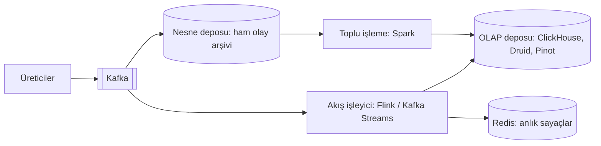

"Son bir saatte en çok izlenen 10 video", "reklam tıklamalarını dakika bazında topla", "bugün kaç farklı kullanıcı geldi?" Bu sorular tek bir kayda erişmekle değil, **milyarlarca olayı özetlemekle** ilgilidir. Bu ders, bu tür soruların arkasındaki işleme modellerini ve belleği yüzlerce kat azaltan olasılıksal yapıları anlatır.

## Toplu işleme (batch)

Sınırlı bir veri kümesini (dünün günlükleri) baştan sona işleyip sonuç üretir. Klasik model Google'ın **MapReduce**'udur:

1. **Map:** her kayıt `(anahtar, değer)` çiftlerine dönüştürülür: `("video:42", 1)`.
2. **Shuffle:** aynı anahtarlı çiftler aynı makinede toplanır.
3. **Reduce:** her anahtar için değerler birleştirilir: `("video:42", 18_204)`.

Bugün aynı fikir **Spark** gibi bellekte çalışan motorlarla ve veri ambarlarında (BigQuery, Snowflake) SQL ile uygulanır. Toplu işleme basit, doğru ve yeniden çalıştırılabilirdir; ama sonuçlar saatler gecikir.

## Akış işleme (stream)

Sınırsız bir olay akışını **geldikçe** işler; sonuçlar saniyeler içinde güncellenir. Tipik zincir:

Kafka'nın burada iki rolü vardır: olayları **dayanıklı** biçimde saklar (işleyici çökerse kaldığı konumdan devam eder) ve aynı akışı birden çok bağımsız tüketiciye verir. Ham olayların arşivlenmesi, hatalı bir hesaplama sonradan fark edildiğinde geçmişin **yeniden işlenebilmesini** sağlar.

### Lambda ve Kappa mimarileri

- **Lambda:** hızlı ama yaklaşık sonuç veren akış katmanı + yavaş ama kesin sonuç veren toplu katman; sorgu ikisini birleştirir. Bedeli aynı mantığı iki kez yazmaktır.
- **Kappa:** yalnızca akış katmanı; yeniden işlemek gerektiğinde akış baştan oynatılır. Modern akış motorlarının tam bir kez garantileriyle giderek daha yaygındır.

### Pencereler

Sonsuz bir akışta "toplam" ancak bir **zaman penceresi** için anlamlıdır:

| Pencere | Tanım | Örnek |
| --- | --- | --- |
| Sabit (tumbling) | Örtüşmeyen, eşit aralıklar | Dakika başına tıklama sayısı |
| Kayan (sliding/hopping) | Örtüşen aralıklar | Son 5 dakika, her dakika güncellenir |
| Oturum (session) | Hareketsizlik boşluğuyla ayrılan aralıklar | Bir kullanıcının ziyaret süresi |

### Olay zamanı ve geç gelen olaylar

Bir tıklamanın **olay zamanı** (kullanıcının tıkladığı an) ile **işlenme zamanı** (sunucuya ulaştığı an) farklıdır: telefon tünelde çevrimdışı kalır, olay 10 dakika sonra gelir. Doğru toplama olay zamanına göre yapılır. Akış işleyiciler bunun için **filigran** (watermark) kullanır: "12:05 filigranı, 12:05'ten önceki olayların büyük ölçüde geldiği anlamına gelir." Pencere filigran geçince kapatılır; daha geç gelen olaylar ya atılır ya da düzeltme olarak ayrıca işlenir.

### Tam bir kez işleme

Akış işleyici çökerse ve son kontrol noktasından (checkpoint) yeniden başlarsa bazı olayları **ikinci kez** işler. "Tam bir kez" etkisini elde etmenin yolları:

- İşleyicinin durumu ve Kafka konumu birlikte, atomik kontrol noktalarına kaydedilir (Flink).
- Çıktı **idempotent** yazılır: `UPSERT (reklam_id, dakika) = sayı` gibi; aynı pencere ikinci kez yazılırsa sonuç değişmez.
- Ya da çıktı transaction'lı yazılır (Kafka transaction'ları).

Faturalama gibi para işlerinde akış sonuçları genellikle toplu işlemeyle **mutabakat** (reconciliation) için yeniden hesaplanır.

## Olasılıksal veri yapıları

Kesin cevap, bellek ve zaman açısından çok pahalı olabilir. Küçük ve bilinen bir hata payını kabul ederseniz bellek yüzlerce kat azalır.

### Bloom süzgeci: "bu eleman kümede var mı?"

`m` bitlik bir dizi ve `k` hash fonksiyonu. Eleman eklerken `k` bit 1 yapılır; sorgularken `k` bitin hepsi 1 ise "**muhtemelen var**", biri bile 0 ise "**kesinlikle yok**".

- Yanlış pozitif olabilir, **yanlış negatif olamaz**.
- Eleman başına ~10 bit ile ~%1 yanlış pozitif oranı.
- Silme desteklemez (sayaçlı varyantı destekler).

Kullanım: LSM ağaçlarında "bu dosyada bu anahtar var mı?" (gereksiz disk okumasını önler), web tarayıcıda "bu URL'yi gördüm mü?", önbellekte var olmayan anahtar saldırısını engellemek, "bu parola sızdırılmış listede mi?".

### HyperLogLog: "kaç farklı eleman var?"

Bir günde kaç **farklı** kullanıcı geldi? Kesin cevap bütün kimlikleri bir kümede tutmayı gerektirir: 100 milyon kullanıcı × 16 bayt ≈ 1,6 GB. HyperLogLog, hash değerlerinin baştaki sıfır sayısından yola çıkarak **~12 KB** ile ~%0,8 hatayla tahmin eder.

- Birleştirilebilir: saatlik HLL'ler birleştirilerek günlük tekil sayı bulunur.
- Redis'te `PFADD` ve `PFCOUNT` ile yerleşik gelir.

### Count-Min Sketch: "bu eleman kaç kez görüldü?"

`d` satır × `w` sütunluk bir sayaç tablosu ve `d` hash fonksiyonu. Her olay her satırda bir sayacı artırır; tahmin, `d` sayacın **en küçüğüdür**. Çakışmalar yüzünden tahmin gerçek değerden büyük olabilir, **asla küçük olamaz**. Sabit bellekle milyonlarca farklı elemanın sıklığını tahmin eder.

### Top-K (en popüler K eleman)

"Son bir saatin en çok aranan 10 terimi" sorusu için:

- **Kesin yol:** her terim için sayaç + K boyutlu min-heap. Farklı terim sayısı çok büyükse bellek sorun olur.
- **Yaklaşık yol:** Count-Min Sketch ile sıklık tahmini + K boyutlu heap; ya da Space-Saving gibi ağır vuruşçu (heavy hitter) algoritmaları.
- **Dağıtık:** her işleyici kendi bölümündeki top-K'yı hesaplar, bir birleştirici bunları birleştirir. Dikkat: yerel top-K'ların birleşimi, küresel top-K'yı **tam** vermeyebilir; her işleyiciden K yerine daha fazlasını (ör. 10K) istemek hatayı azaltır. Aynı anahtarı aynı işleyiciye yönlendirmek (anahtara göre bölümleme) birleştirmeyi kesin yapar.

Kısa pencere (son 1 dakika) için yaklaşık akış sonucu, uzun pencere (dün) için kesin toplu işleme sonucu yaygın bir ödünleşimdir.

## Örnek: reklam tıklama toplama

Gereksinim: saniyede 1 milyon tıklama, reklamveren paneli için dakika bazında tıklama sayısı, faturalamada kesinlik.

1. Tıklamalar idempotent bir kimlikle Kafka'ya yazılır (`reklam_id`'ye göre bölümlenmiş).
2. Flink, olay zamanına göre 1 dakikalık sabit pencerelerde `reklam_id` başına sayar; tekrar eden tıklama kimliklerini kısa süreli bir durumla ayıklar.
3. Sonuçlar OLAP deposuna `(reklam_id, dakika)` anahtarıyla **upsert** edilir; panel buradan okur.
4. Ham olaylar nesne deposuna arşivlenir; gece çalışan toplu iş aynı hesabı kesin olarak yapar ve faturalama bu sonucu kullanır. Fark çıkarsa alarm verilir.
5. Sıcak reklamlar için (tek bir reklam saniyede 100.000 tıklama) anahtar tuzlanır ve iki aşamalı toplanır.

## Özet

- Toplu işleme: kesin, basit, gecikmeli. Akış işleme: hızlı, karmaşık.
- Olay zamanına göre pencerele; geç gelen olaylar için filigran.
- Tam bir kez etkisi: kontrol noktası + idempotent ya da transaction'lı çıktı.
- Bloom: üyelik (yanlış negatif yok). HyperLogLog: tekil sayım (~12 KB). Count-Min: sıklık (asla eksik değil). Top-K: sayaç + heap ya da sketch + heap.
