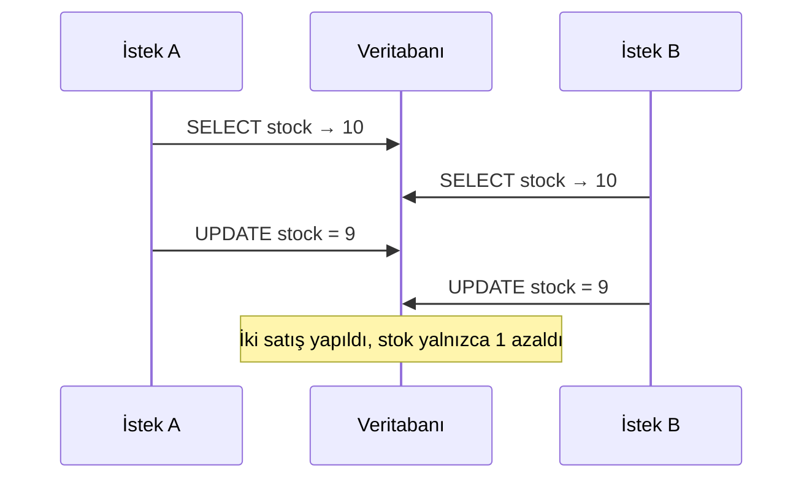

Tek kullanıcılı bir uygulamada veritabanı basittir. Zorluk, aynı satıra aynı anda iki isteğin dokunduğu anda başlar: iki kişi son ürünü aynı anda satın alır, iki transfer aynı hesaptan aynı anda para çeker. Bu ders, bu durumları tanımayı ve doğru aracı seçmeyi anlatır.

## Transaction

Transaction, birlikte başarılı olması ya da birlikte geri alınması gereken işlemler grubudur.

```sql
BEGIN;
UPDATE accounts SET balance = balance - 100 WHERE id = 1;
UPDATE accounts SET balance = balance + 100 WHERE id = 2;
COMMIT;   -- ya da bir hata olursa ROLLBACK
```

İlk `UPDATE`'ten sonra sunucu çökerse para havada kaybolmaz: transaction onaylanmadığı için ilk değişiklik de geçersizdir.

## ACID

| Harf | Anlamı | Nasıl sağlanır |
| --- | --- | --- |
| **A**tomicity (bölünmezlik) | Ya hepsi ya hiçbiri | Değişiklikler önce günlüğe (WAL) yazılır; onaylanmayan transaction'ın etkisi görünmez |
| **C**onsistency (tutarlılık) | Transaction veritabanını geçerli bir durumdan başka bir geçerli duruma taşır | Kısıtlar (`NOT NULL`, `UNIQUE`, `CHECK`, yabancı anahtar) **ve** uygulamanın kendi kuralları |
| **I**solation (yalıtım) | Eşzamanlı transaction'lar birbirinin yarım kalmış işini görmez | İzolasyon seviyeleri, MVCC, kilitler |
| **D**urability (kalıcılık) | Onaylanan veri çökmede kaybolmaz | `COMMIT` dönmeden önce WAL diske yazılır (`fsync`) |

İki incelik mülakatta fark yaratır:

- ACID'deki "C", CAP teoremindeki "C" ile **aynı şey değildir**. CAP'teki tutarlılık, dağıtık kopyaların aynı veriyi göstermesidir; ACID'deki ise iş kurallarının korunmasıdır.
- "I" bir açma kapama düğmesi değil, bir **seviyedir**. Varsayılan seviyede bile bazı anomaliler mümkündür.

## Eşzamanlılık anomalileri

| Anomali | Ne olur |
| --- | --- |
| **Kirli okuma** (dirty read) | Başka bir transaction'ın henüz onaylanmamış (belki geri alınacak) değişikliği okunur |
| **Tekrarlanamayan okuma** (non-repeatable read) | Aynı satır iki kez okunur, arada başkası değiştirip onayladığı için farklı değer gelir |
| **Hayalet okuma** (phantom read) | Aynı koşulla iki kez sorgu yapılır, arada eklenen ya da silinen satırlar yüzünden farklı **küme** gelir |
| **Kayıp güncelleme** (lost update) | İki transaction aynı değeri okur, ikisi de üzerine yazar; birinin değişikliği kaybolur |
| **Yazma çarpıklığı** (write skew) | İki transaction aynı kuralı okur, **farklı** satırları değiştirir; tek tek doğru olan iki değişiklik birlikte kuralı bozar |

### Kayıp güncelleme

En sık karşılaşılan ve en sinsi olanıdır. Uygulama değeri okur, bellekte hesaplar ve geri yazar:



Varsayılan izolasyon seviyesi bunu **engellemez**.

### Yazma çarpıklığı

Kural: nöbette en az bir doktor kalmalı. Şu anda iki doktor nöbette ve ikisi aynı anda izin istiyor:

```sql
-- Her iki doktor için aynı anda çalışıyor (biri id = 1, diğeri id = 2)
BEGIN;
SELECT count(*) FROM doctors WHERE on_call;          -- 2 görür, "ayrılabilirim" der
UPDATE doctors SET on_call = false WHERE id = 1;
COMMIT;
```

İki transaction farklı satırları değiştirdiği için birbirini kilitlemez; sonuçta nöbette hiç doktor kalmaz. Benzer örnekler: aynı kullanıcı adını iki kişinin aynı anda alması (benzersizlik kısıtı yoksa), aynı toplantı odasının aynı saate iki kez ayrılması.

## İzolasyon seviyeleri

SQL standardı dört seviye tanımlar ve her birinin hangi anomaliye **izin verdiğini** söyler:

| Seviye | Kirli okuma | Tekrarlanamayan okuma | Hayalet okuma |
| --- | --- | --- | --- |
| Read Uncommitted | Olabilir | Olabilir | Olabilir |
| Read Committed | Olmaz | Olabilir | Olabilir |
| Repeatable Read | Olmaz | Olmaz | Olabilir |
| Serializable | Olmaz | Olmaz | Olmaz |

Standart yalnızca bir alt sınır koyar; veritabanları daha güçlüsünü sunabilir. PostgreSQL'in gerçek davranışı:

| Seviye | PostgreSQL'de |
| --- | --- |
| Read Uncommitted | Read Committed gibi davranır; PostgreSQL'de kirli okuma hiç olmaz |
| **Read Committed** (varsayılan) | Her **komut**, o komut başladığı andaki onaylanmış verinin anlık görüntüsünü görür. Kayıp güncelleme ve yazma çarpıklığı mümkündür |
| Repeatable Read | Bütün transaction, **ilk sorgusundaki** anlık görüntüyü görür (snapshot isolation). Hayalet okuma da olmaz. Aynı satırı eşzamanlı güncellemeye çalışan transaction hata alır; kayıp güncelleme engellenir. Yazma çarpıklığı **hâlâ mümkündür** |
| Serializable | Sonuç, transaction'lar sırayla çalışmış gibi olur. Yazma çarpıklığı da engellenir; çakışma sezilirse transaction'lardan biri hata alır |

Diğer veritabanlarının varsayılanları: SQL Server ve Oracle'da Read Committed, MySQL (InnoDB) için Repeatable Read. "Varsayılan seviyem beni korur" varsayımı bu yüzden tehlikelidir.

Daha yüksek seviyenin bedeli: daha çok transaction **serileştirme hatasıyla** (`SQLSTATE 40001`) iptal edilir ve uygulamanın bu transaction'ı **baştan tekrar çalıştırması** gerekir. Serializable kullanan bir uygulama yeniden deneme mantığı olmadan doğru çalışmaz.

## MVCC: okuyanlar yazanları beklemez

PostgreSQL (ve Oracle, MySQL InnoDB) çoklu sürüm eşzamanlılık denetimi (MVCC) kullanır:

- `UPDATE` satırı yerinde değiştirmez; satırın **yeni bir sürümünü** yazar. Eski sürüm, onu görmesi gereken transaction'lar bitene kadar durur.
- Her transaction, başladığı ana (ya da komutun başladığı ana) ait bir **anlık görüntü** görür. Okuma için kilit gerekmez.
- Sonuç: **okuyanlar yazanları, yazanlar okuyanları engellemez.** Yalnızca aynı satıra yazan iki transaction birbirini bekler.

Bedeli: eski satır sürümleri birikir. `VACUUM` (ve otomatik çalışan autovacuum) artık hiçbir transaction'ın göremeyeceği sürümleri temizler. Saatlerce açık kalan bir transaction bu temizliği engeller ve tablolar şişer (bloat). Bu, transaction'ları kısa tutmanın bir başka sebebidir.

## Kayıp güncellemeye karşı üç çözüm

### 1. Hesabı veritabanına yaptırın (atomik güncelleme)

```sql
UPDATE products
SET stock = stock - 1
WHERE id = 7 AND stock > 0;
```

Okuma ve yazma tek komuttadır; veritabanı satırı kilitleyerek uygular. Etkilenen satır sayısı 0 ise stok bitmiştir. Mümkün olduğunda **ilk tercih** budur.

### 2. Kötümser kilit: SELECT … FOR UPDATE

Hesap uygulamada yapılmak zorundaysa, satır okunurken kilitlenir:

```sql
BEGIN;
SELECT stock FROM products WHERE id = 7 FOR UPDATE;   -- aynı satırı kilitlemek isteyen diğerleri bekler
-- uygulama hesap yapar
UPDATE products SET stock = 9 WHERE id = 7;
COMMIT;                                                -- kilit burada bırakılır
```

Basit ve kesindir; ama kilit süresince diğer istekler bekler. Çakışma sık olduğunda uygundur. Kuyruk benzeri işlerde `FOR UPDATE SKIP LOCKED`, kilitli satırları atlayarak birden çok işçinin aynı tablodan iş almasını sağlar.

### 3. İyimser eşzamanlılık: sürüm sütunu

Kilit tutulmaz; yazarken "okuduğumdan beri değişmedi mi?" diye kontrol edilir:

```sql
-- Okurken: SELECT stock, version FROM products WHERE id = 7;   → 10, 3
UPDATE products
SET stock = 9, version = version + 1
WHERE id = 7 AND version = 3;
-- 0 satır etkilendiyse başkası araya girdi: yeniden oku ve tekrar dene (ya da kullanıcıya bildir)
```

Çakışmanın seyrek olduğu ya da okuma ile yazma arasında kullanıcının düşündüğü uzun bir aralık bulunan senaryolar (ör. bir formu düzenlemek) için idealdir. EF Core'daki eşzamanlılık belirteci (concurrency token) bunu otomatik yapar ve çakışmada `DbUpdateConcurrencyException` fırlatır.

| Yöntem | Ne zaman |
| --- | --- |
| Atomik `UPDATE` | Değişiklik tek bir SQL ifadesiyle yazılabiliyorsa |
| `SELECT … FOR UPDATE` | Çakışma sık, transaction kısa |
| Sürüm sütunu | Çakışma seyrek, ya da okuma ile yazma arasında kullanıcı etkileşimi var |

Yazma çarpıklığı için ise ya kuralı okuyan sorgunun satırlarını `FOR UPDATE` ile kilitlemek, ya kuralı bir kısıtla ifade etmek (benzersizlik, `EXCLUDE` kısıtı) ya da Serializable seviyesini kullanmak gerekir.

## Deadlock

İki transaction birbirinin tuttuğu kilidi bekler:

```text
A: hesap 1'i kilitler  →  hesap 2'yi bekler
B: hesap 2'yi kilitler →  hesap 1'i bekler
```

Veritabanı bu döngüyü sezer ve transaction'lardan birini `deadlock detected` hatasıyla (`SQLSTATE 40P01`) iptal eder. Önlemek için:

- Kilitleri **her zaman aynı sırayla** alın: transferde önce küçük kimlikli hesap.
- Transaction'ları kısa tutun; ne kadar az süre kilit tutulursa çakışma o kadar azdır.
- İptal edilen transaction'ı yeniden deneyin; deadlock ara sıra yine de olabilir.

## Pratik kurallar

1. **Transaction'ları kısa tutun.** İçinde HTTP çağrısı, e-posta gönderimi ya da kullanıcı girdisi beklemek olmaz. Dış çağrı yavaşlarsa kilitler ve bağlantılar boşuna tutulur.
2. **Serileştirme hatalarını ve deadlock'ları yeniden deneyin**; deneme sınırlı ve aralıklı olsun. Yeniden denenecek iş idempotent olmalıdır.
3. **Kuralları veritabanına emanet edin.** "Önce var mı diye bak, yoksa ekle" iki eşzamanlı istekte ikisini de ekler. Benzersizlik kısıtı ekleyip ihlal hatasını yakalamak doğru yöntemdir.
4. **Transaction tek bir veritabanı içindir.** Veritabanına yazıp ardından bir kuyruğa mesaj göndermek atomik değildir; aradaki çökme ikisinden birini kaybettirir. Bunun için outbox gibi desenler gerekir.

## Özet

- ACID: bölünmezlik, tutarlılık, yalıtım, kalıcılık. Yalıtım bir seviyedir, mutlak değildir.
- PostgreSQL'in varsayılanı Read Committed'dir; kayıp güncelleme ve yazma çarpıklığını engellemez.
- MVCC sayesinde okuyanlar ile yazanlar birbirini beklemez; uzun transaction'lar ise temizliği engeller.
- Kayıp güncellemeye karşı: atomik `UPDATE`, `SELECT … FOR UPDATE` ya da sürüm sütunu.
- Kilitleri tutarlı sırayla alın, transaction'ları kısa tutun, serileştirme hatası ve deadlock'ta yeniden deneyin.
