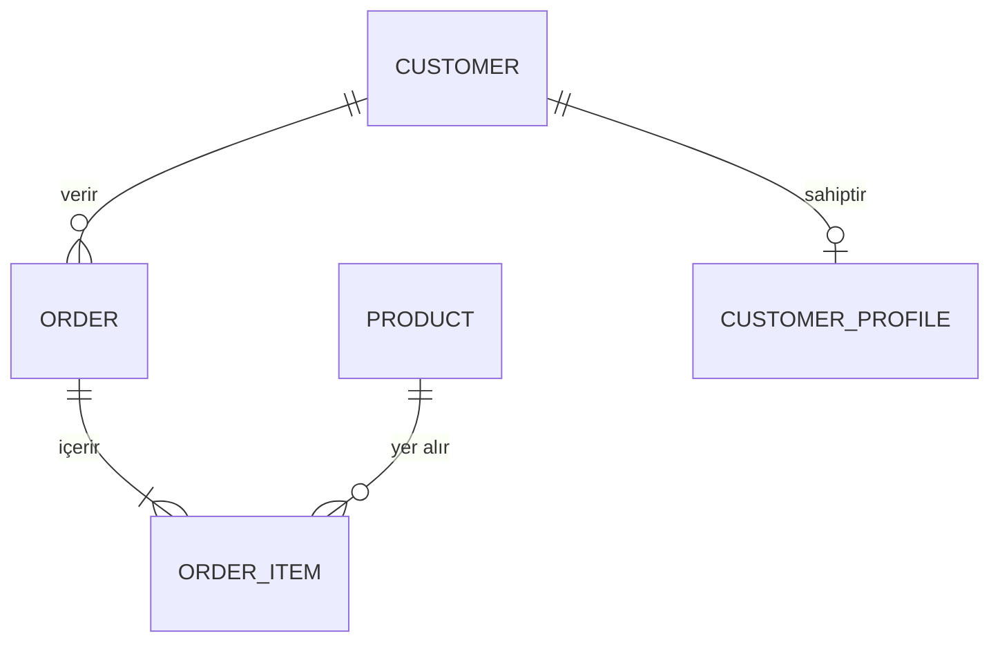

Sistem tasarımı mülakatlarında "veri modelini çizelim" adımı hemen her zaman gelir. İyi bir model hem bugünkü sorguları hızlı yanıtlar hem de yarın değişen gereksinimlerde çökmez. Bu ders, bir şemayı nasıl kurduğunuzu ve kararlarınızı nasıl gerekçelendireceğinizi anlatır.

## Önce erişim kalıpları

Tablo çizmeye başlamadan önce iki soru sorun:

1. **Hangi varlıklar var ve aralarındaki ilişkiler ne?** (müşteri, sipariş, ürün)
2. **En sık hangi sorgular çalışacak?** ("Bir kullanıcının son 20 siparişi", "bir ürünün stok durumu")

İlişkisel modelde ilk soru şemayı, ikinci soru indeksleri belirler. NoSQL modellerinde ise ikinci soru şemanın kendisini belirler; bu farka aşağıda döneceğiz.

## İlişki türleri

Bir e-ticaret şeması:



| İlişki | Örnek | Nasıl kurulur |
| --- | --- | --- |
| Bire-bir | Müşteri – profil | Yabancı anahtar + `UNIQUE`; çoğu zaman aynı tabloda tutmak yeterlidir |
| Bire-çok | Müşteri – sipariş | "Çok" tarafına yabancı anahtar: `orders.customer_id` |
| Çoka-çok | Sipariş – ürün | Ara tablo: `order_items (order_id, product_id, quantity, unit_price)` |

Çoka-çok ilişkideki ara tablo çoğu zaman kendi başına bir varlıktır ve kendi sütunları vardır: sipariş kaleminin adedi ve **o andaki** birim fiyatı gibi.

```sql
CREATE TABLE order_items (
    order_id   bigint NOT NULL REFERENCES orders (id) ON DELETE CASCADE,
    product_id bigint NOT NULL REFERENCES products (id),
    quantity   int    NOT NULL CHECK (quantity > 0),
    unit_price numeric(12, 2) NOT NULL,
    PRIMARY KEY (order_id, product_id)
);

-- PostgreSQL yabancı anahtar sütununa kendiliğinden indeks açmaz
CREATE INDEX order_items_product_idx ON order_items (product_id);
```

Yabancı anahtarlar için indeks unutulursa, üst tablodan satır silmek ya da "bu ürünün geçtiği siparişler" sorgusu bütün tabloyu tarar.

## Anahtar seçimi

| | Doğal anahtar | Vekil anahtar |
| --- | --- | --- |
| Örnek | E-posta, ISBN, T.C. kimlik no | `bigint` sayaç, UUID |
| Artısı | Anlamlıdır, ek sütun gerekmez | Hiç değişmez, küçüktür, iş kurallarından bağımsızdır |
| Eksisi | Değişebilir (e-posta değişir), bazen büyüktür, gizli olabilir | Anlamsızdır; doğal benzersizlik için ayrıca `UNIQUE` gerekir |

Pratik yaklaşım: birincil anahtar olarak **vekil anahtar**, doğal benzersizlik için ayrıca **benzersizlik kısıtı**.

Vekil anahtarın türü:

- **`bigint` kimlik sütunu:** küçük, hızlı, sıralı. Dışarıya açıldığında kayıt sayısını ve sırasını ele verir (`/orders/1042` → "1041 sipariş daha var").
- **UUID:** tahmin edilemez, veritabanına sormadan istemcide üretilebilir, birleştirilen sistemlerde çakışmaz. Ama 16 bayttır ve rastgele UUID (v4) her eklemede B-ağacının rastgele bir sayfasına yazar; büyük tablolarda indeks önbellekten taşar. **Zaman sıralı UUIDv7** bu sorunu çözer: yeni değerler indeksin sonuna eklenir. PostgreSQL 18 bunun için yerleşik `uuidv7()` fonksiyonunu sunar.

## Normalizasyon

Normalizasyonun amacı: **her bilgi tek bir yerde dursun.** Aynı bilgi birden çok yerde durursa üç tür anomali oluşur:

- **Güncelleme anomalisi:** müşterinin adresi 50 sipariş satırında tekrarlanıyorsa adres değiştiğinde 50 satırı da güncellemeniz gerekir; birini kaçırırsanız veri çelişir.
- **Ekleme anomalisi:** henüz siparişi olmayan bir müşteriyi kaydedemezsiniz.
- **Silme anomalisi:** müşterinin son siparişini silince müşterinin kendisi de kaybolur.

Kötü tasarlanmış bir tablo:

| order_id | customer_name | customer_city | products |
| --- | --- | --- | --- |
| 1 | Ada | İzmir | Klavye, Fare |
| 2 | Ada | İzmir | Monitör |

Normal formlar bu sorunları adım adım giderir:

| Form | Kural | Bu tablodaki ihlal |
| --- | --- | --- |
| **1NF** | Her hücre tek bir değer; tekrarlayan gruplar yok | `products` sütununda virgülle ayrılmış liste |
| **2NF** | Anahtar olmayan her sütun anahtarın **tamamına** bağlı | `(order_id, product_id)` anahtarlı bir tabloda ürün adı yalnızca `product_id`'ye bağlıdır |
| **3NF** | Anahtar olmayan sütun, başka bir anahtar olmayan sütuna bağlı değil | `customer_city` sipariş anahtarına değil müşteriye bağlı |

Akılda kalan özet: **anahtar olmayan her sütun, anahtara, anahtarın tamamına ve anahtardan başka hiçbir şeye bağlı olmamalıdır.** Çoğu uygulama için 3NF hedeflenir.

Düzeltilmiş hali, yukarıdaki şemadır: `customers`, `orders`, `products`, `order_items`.

## Bilinçli denormalizasyon

Normalizasyon yazmaları güvenli kılar; okumalar ise daha çok join gerektirir. Okuma ağırlıklı sistemlerde bazı bilgileri **bilerek** tekrarlamak mantıklıdır:

- **Sayaçlar:** her gönderi için `comment_count` tutmak, her gösterimde `COUNT(*)` çalıştırmaktan ucuzdur.
- **Özet tablolar ve materyalize görünümler:** günlük satış raporları.
- **Okuma modelleri:** arama indeksi ya da önbellek, birincil veritabanından türetilmiş bir kopyadır.

Bedeli: kopyaları **tutarlı tutmak** artık sizin işinizdir. Seçenekler: aynı transaction içinde güncellemek, tetikleyici (trigger), ya da olaylarla eşzamansız güncelleyip kısa süreli tutarsızlığı kabul etmek. Mülakatta denormalizasyon önerirken bu bedeli ve seçtiğiniz yöntemi mutlaka söyleyin.

Bir incelik: `order_items.unit_price` bir denormalizasyon **değildir**. Ürünün bugünkü fiyatı ile sipariş anındaki fiyatı farklı bilgilerdir; sipariş anındaki fiyatı saklamak zorunludur. Aynı şey teslimat adresi için de geçerlidir: müşteri adresini değiştirdiğinde eski siparişlerin adresi değişmemelidir.

## Kısıtlar: kuralları veritabanı korusun

Uygulama kodundaki doğrulama gereklidir ama yeterli değildir. İki eşzamanlı istek, "bu e-posta kayıtlı mı?" kontrolünü aynı anda geçer ve ikisi de kaydolur. Kuralı yalnızca veritabanı **atomik** olarak uygulayabilir.

```sql
CREATE TABLE users (
    id         bigint GENERATED ALWAYS AS IDENTITY PRIMARY KEY,
    email      text NOT NULL,
    balance    numeric(12, 2) NOT NULL DEFAULT 0 CHECK (balance >= 0),
    created_at timestamptz NOT NULL DEFAULT now()
);

CREATE UNIQUE INDEX users_email_key ON users (lower(email));
```

| Kısıt | Korur |
| --- | --- |
| `NOT NULL` | Zorunlu alanlar |
| `UNIQUE` | Benzersizlik; eşzamanlı eklemelerde bile |
| `CHECK` | Satır düzeyinde kurallar (`quantity > 0`) |
| `FOREIGN KEY` | Var olmayan bir kayda başvurulmaması; `ON DELETE CASCADE / RESTRICT / SET NULL` ile silme davranışı |

## Doğru veri tipi

| Veri | Kullanın | Kaçının |
| --- | --- | --- |
| Para | `numeric(12, 2)` ya da en küçük birimde tamsayı (kuruş) | `float`, `double`: `0.1 + 0.2` tam olarak `0.3` etmez |
| Zaman damgası | `timestamptz` (UTC olarak saklanır) | Saat dilimsiz `timestamp`: hangi dilimde olduğu belirsiz kalır |
| Metin | PostgreSQL'de `text`; gerekiyorsa `CHECK (length(x) <= n)` | Keyfî `varchar(255)`: PostgreSQL'de performans farkı yoktur |
| Durum | `text` + `CHECK`, ya da ayrı bir arama tablosu | Anlamı belgelenmemiş sihirli sayılar |
| Yarı yapılandırılmış veri | `jsonb` (gerekirse GIN indeksiyle) | Her şeyi `jsonb`'ye koymak; sorgulanan ve kısıt gereken alanlar sütun olmalı |

## Silme stratejisi

- **Kalıcı silme** (`DELETE`): basit; ama geri alınamaz ve geçmiş kaybolur.
- **Yumuşak silme** (`deleted_at timestamptz`): geri alınabilir, denetim izi kalır. Bedeli: **her** sorgu `WHERE deleted_at IS NULL` içermelidir (unutulursa silinmiş veri görünür) ve benzersizlik kısıtları kısmi indeksle yazılmalıdır: `CREATE UNIQUE INDEX ... ON users (email) WHERE deleted_at IS NULL`.

Kişisel verilerde yasal silme yükümlülükleri (KVKK, GDPR) yumuşak silmeyi tek başına yeterli kılmaz; veri gerçekten silinmeli ya da anonimleştirilmelidir.

## İlişkisel mi, NoSQL mi?

| Tür | Örnekler | Güçlü yanı | Zayıf yanı |
| --- | --- | --- | --- |
| **İlişkisel** | PostgreSQL, MySQL, SQL Server | Esnek sorgular, join, transaction, kısıtlar | Yatay ölçekleme (parçalama) zahmetli |
| **Doküman** | MongoDB | İç içe veri tek okumada gelir, şema esnek | Dokümanlar arası ilişkiler ve join zayıf |
| **Anahtar-değer** | Redis, DynamoDB | Anahtarla çok hızlı erişim, kolay ölçekleme | Anahtar dışında sorgu yok ya da kısıtlı |
| **Geniş sütun** | Cassandra, ScyllaDB | Çok yüksek yazma hacmi, çok bölgeli | Sorgular önceden tasarlanmalı; join yok |
| **Graf** | Neo4j | Çok adımlı ilişki sorguları ("arkadaşın arkadaşı") | Genel amaçlı iş yükleri için uygun değil |

Mülakatta savunulabilir varsayılan: **ilişkisel bir veritabanıyla başlayın.** Tek bir PostgreSQL örneği, iyi indekslerle ve okuma kopyalarıyla çok büyük yükleri taşır. NoSQL'e geçişi somut bir gerekçeyle yapın:

- Yazma hacmi tek bir düğümün kapasitesini aşıyor ve erişim kalıbı basit (ör. her şey `user_id` ile okunuyor).
- Veri doğal olarak bir doküman ya da graf.
- Çok bölgeli, düşük gecikmeli yazma şart ve nihai tutarlılık kabul edilebilir.

NoSQL modellemede düşünce tersine döner: önce **sorgular** listelenir, sonra her sorguyu tek okumada yanıtlayacak biçimde veri (gerekirse tekrar edilerek) yerleştirilir. Yeni bir sorgu çoğu zaman yeni bir tablo ya da indeks demektir.

## Özet

- Modellemeye varlıklar ve en sık sorgularla başlayın.
- Bire-çokta yabancı anahtar "çok" tarafına, çoka-çokta ara tabloya konur; yabancı anahtarlara indeks ekleyin.
- Vekil birincil anahtar + doğal benzersizlik kısıtı. Büyük tablolarda UUID gerekiyorsa UUIDv7.
- 3NF ile her bilgiyi tek yerde tutun; okuma performansı için bilinçli denormalizasyon yapın ve tutarlılığı nasıl koruyacağınızı söyleyin.
- Kuralları kısıtlarla veritabanına uygulatın; para için `numeric`, zaman için `timestamptz`.
- Varsayılan ilişkisel; NoSQL'i somut bir ölçek ya da erişim kalıbı gerekçesiyle seçin.
