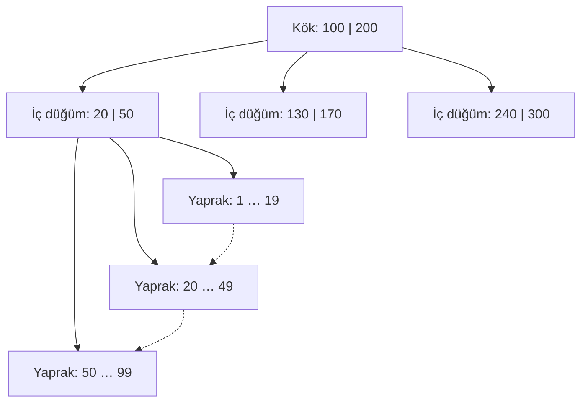

"Sorgu yavaş, ne yaparsın?" sorusunun ilk yanıtı genellikle "indeks eklerim" olur. Mülakatçının asıl merak ettiği ise sonraki cümledir: **hangi sütunlara, hangi sırayla, ve bunun bedeli ne?** Bu ders o sorunun yanıtını verir. Örnekler PostgreSQL ile yazılmıştır; kavramlar bütün ilişkisel veritabanlarında aynıdır.

## İndeks olmadan

İndeks yoksa `WHERE customer_id = 42` sorgusu tablonun **bütün satırlarını** okur (sequential scan): O(n). Bir milyon satırlık tabloda eşleşen 12 satırı bulmak için 999.988 satır boşuna okunur.

İndeks, sütun değerlerini **sıralı** tutan ve her değerin tablodaki yerini gösteren ayrı bir veri yapısıdır. Kitabın sonundaki dizin gibi: konuyu alfabetik listede bulur, sayfaya doğrudan gidersiniz.

## B-ağacı

İlişkisel veritabanlarında varsayılan indeks türü B-ağacıdır (PostgreSQL'de B+ ağacının bir çeşidi). Dengeli, geniş ve sığ bir ağaçtır:



- Her düğüm bir disk sayfasıdır (PostgreSQL'de 8 KB) ve yüzlerce anahtar tutar. Bu yüzden milyonlarca satır için bile ağacın yüksekliği genellikle **3–4**'tür; arama birkaç sayfa okumayla biter: O(log n).
- Yapraklar sıralıdır ve birbirine bağlıdır. Bu sayede B-ağacı yalnızca eşitliği değil **aralıkları** da destekler: `=`, `<`, `>`, `BETWEEN`, `IN`, `ORDER BY` ve `IS NULL`.
- Yaprak, satırın kendisini değil tablodaki **konumunu** tutar. İndeksle bulunan her satır için tabloya ayrıca gidilir (PostgreSQL'de "heap fetch").

## İndeksin bedeli

İndeks bedava değildir:

- **Yazma yavaşlar.** Her `INSERT` tablodaki **bütün** indekslere yeni bir giriş ekler; indeksli bir sütunu değiştiren `UPDATE` de indeksleri günceller. On indeksli bir tabloya yazmak, tek indeksliye göre belirgin biçimde pahalıdır.
- **Yer kaplar.** İndeksler diskte ve bellekte (önbellekte) yer tutar; büyük indeksler sıcak verinin bellekten taşmasına yol açar.
- **Kullanılmayan indeks saf zarardır.** PostgreSQL'de `pg_stat_user_indexes` görünümündeki `idx_scan` sütunu hiç kullanılmayan indeksleri gösterir.

Kural: **sorgulara göre** indeks ekleyin, sütunlara göre değil. "Her sütuna bir indeks" bir tasarım değildir.

## Bileşik indeks ve sütun sırası

Birden fazla sütun üzerindeki indeks, değerleri **ilk sütuna, eşitlikte ikinci sütuna** göre sıralar; telefon rehberinin önce soyada sonra ada göre sıralanması gibi.

```sql
CREATE INDEX orders_customer_created_idx ON orders (customer_id, created_at);
```

| Sorgu koşulu | İndeks verimli kullanılır mı |
| --- | --- |
| `customer_id = 42` | Evet (soldaki önek) |
| `customer_id = 42 AND created_at > '2026-01-01'` | Evet, iki sütunla da |
| `customer_id = 42 ORDER BY created_at DESC` | Evet; sıralama da indeksten gelir, ayrı `Sort` yok |
| `created_at > '2026-01-01'` | Genellikle hayır |
| `customer_id > 40 AND created_at = '2026-01-01'` | Kısmen: arama yalnızca `customer_id` aralığıyla yapılır, `created_at` her satırda ayrıca süzülür |

Rehberde "adı Ada olan herkesi" bulmak için bütün rehberi taramanız gerekir; bileşik indeks de aynıdır. Buna **en soldaki önek kuralı** denir. (PostgreSQL 18 ile gelen "skip scan", ilk sütunda koşul olmadığında bile bileşik indeksi kullanabilir; ama yalnızca ilk sütunun farklı değer sayısı azsa verimlidir. Tasarımınızı buna güvenerek yapmayın.)

Sütun sırası için pratik kural:

1. **Eşitlikle** sorgulanan sütunlar önce,
2. sonra **aralıkla** sorgulanan ya da **sıralanan** sütun.

Bir sütunda aralık koşulu başladığında, sonraki sütunlar artık arama için değil yalnızca süzme için kullanılabilir.

## Kapsayan indeks

Sorgunun ihtiyaç duyduğu bütün sütunlar indeksin içindeyse veritabanı tabloya hiç gitmeden yanıt verebilir (PostgreSQL'de **index-only scan**):

```sql
CREATE INDEX orders_customer_created_total_idx
    ON orders (customer_id, created_at) INCLUDE (total);

-- Tabloya gitmeden yanıtlanabilir
SELECT created_at, total FROM orders WHERE customer_id = 42;
```

`INCLUDE` ile eklenen sütunlar aramada kullanılmaz, yalnızca yaprakta taşınır. PostgreSQL'de index-only scan, tablonun görünürlük haritası güncel olduğunda (yani `VACUUM` düzenli çalıştığında) gerçekten tabloya uğramaz.

## İndeks neden kullanılmıyor

İndeks var ama plan hâlâ `Seq Scan` gösteriyorsa sebep genellikle şunlardan biridir:

| Sebep | Örnek | Çözüm |
| --- | --- | --- |
| Sütun bir fonksiyona sokulmuş | `WHERE lower(email) = 'ada@ornek.com'` | İfade indeksi: `CREATE INDEX ON users (lower(email))` |
| Baştan joker karakter | `WHERE name LIKE '%can'` | Trigram indeksi (`pg_trgm` + GIN) ya da tam metin arama |
| Tarih fonksiyonu | `WHERE date(created_at) = '2026-11-15'` | Aralık yazın: `created_at >= '2026-11-15' AND created_at < '2026-11-16'` |
| Seçicilik düşük | `WHERE status = 'active'` ve satırların %90'ı aktif | Doğru davranış; tablonun çoğunu okumak tam taramayla daha ucuz |
| İstatistik eski | Toplu yüklemeden sonra planlayıcı satır sayısını yanlış tahmin ediyor | `ANALYZE orders` |
| Bileşik indekste ilk sütun yok | `(customer_id, created_at)` indeksi, yalnızca `created_at` koşulu | Sorguya uygun ayrı indeks |

Seçicilik maddesi önemlidir: indeksle her satıra ayrı ayrı gitmek **rastgele** okuma demektir. Sonuç tablonun büyük bir bölümüyse, tabloyu baştan sona **sıralı** okumak daha hızlıdır. Planlayıcı bu kararı tablo istatistiklerine bakarak verir. İki uç arasında **bitmap scan** vardır: önce indeksten eşleşen satırların sayfaları toplanır, sonra sayfalar disk sırasıyla okunur.

## Diğer indeks türleri

| Tür | Ne için |
| --- | --- |
| **B-tree** | Varsayılan; eşitlik, aralık, sıralama |
| **Hash** | Yalnızca eşitlik; B-tree çoğu zaman yeterlidir |
| **GIN** | Bir satırda birden çok değer: `jsonb`, diziler, tam metin arama |
| **GiST** | Geometri, aralık tipleri, en yakın komşu |
| **BRIN** | Fiziksel sırası doğal olarak düzenli çok büyük tablolar (zaman serisi); çok küçük |

İki kullanışlı biçim daha:

```sql
-- Kısmi indeks: yalnızca silinmemiş kayıtlar; küçük ve hızlı
CREATE INDEX users_active_email_idx ON users (email) WHERE deleted_at IS NULL;

-- Benzersiz indeks: kuralı veritabanı uygular
CREATE UNIQUE INDEX users_email_key ON users (lower(email));
```

## EXPLAIN ANALYZE okumak

`EXPLAIN` planlayıcının **tahminini**, `EXPLAIN ANALYZE` sorguyu **gerçekten çalıştırıp** ölçülen değerleri gösterir. (`ANALYZE`, `UPDATE` ve `DELETE` sorgularını da gerçekten çalıştırır; denerken bir transaction içinde yapıp geri alın.)

```sql
EXPLAIN ANALYZE SELECT * FROM orders WHERE customer_id = 42;
```

İndeks yokken (çıktı kısaltılmıştır):

```text
Seq Scan on orders  (cost=0.00..21846.00 rows=10 width=48) (actual time=0.51..61.20 rows=12 loops=1)
  Filter: (customer_id = 42)
  Rows Removed by Filter: 999988
Execution Time: 61.23 ms
```

`CREATE INDEX ON orders (customer_id);` sonrasında:

```text
Index Scan using orders_customer_id_idx on orders  (cost=0.42..44.61 rows=10 width=48) (actual time=0.03..0.05 rows=12 loops=1)
  Index Cond: (customer_id = 42)
Execution Time: 0.07 ms
```

Nasıl okunur:

- **Düğüm türü:** `Seq Scan`, `Index Scan`, `Index Only Scan`, `Bitmap Heap Scan`, `Sort`, `Hash Join`… Plan bir ağaçtır; en içteki (en çok girintili) düğümler önce çalışır.
- **`cost=başlangıç..toplam`:** planlayıcının birimsiz maliyet tahmini. Milisaniye değildir; yalnızca planları karşılaştırmaya yarar.
- **`rows` (tahmin) ve `actual … rows` (gerçek):** aralarında büyük fark varsa (10 tahmin, 100.000 gerçek) planlayıcı yanlış bilgiyle karar veriyordur. İlk şüpheli eski istatistiklerdir.
- **`Rows Removed by Filter`:** okunup atılan satırlar. Büyükse indeks eksik ya da yanlış.
- **`loops`:** düğümün kaç kez çalıştığı. Süre ve satır değerleri döngü başınadır; `loops=10000` olan bir iç düğüm, tek başına hızlı görünse de toplamda yavaş olabilir.

### Join algoritmaları

| Algoritma | Nasıl | Ne zaman iyi |
| --- | --- | --- |
| **Nested Loop** | Dıştaki her satır için içte arama | Dış taraf küçük ve iç tarafta indeks var |
| **Hash Join** | Küçük tarafla bellekte hash tablosu kurulur, büyük taraf taranır | Büyük, sırasız kümeler; eşitlik koşulu |
| **Merge Join** | İki taraf sıralı halde fermuar gibi birleştirilir | İki taraf da zaten sıralı (ör. indeksten) |

## Sayfalama: OFFSET tuzağı

```sql
SELECT * FROM orders ORDER BY created_at DESC LIMIT 20 OFFSET 100000;
```

`OFFSET 100000`, veritabanının 100.020 satırı bulup ilk 100.000'ini **atması** demektir; sayfa ilerledikçe sorgu yavaşlar. Ayrıca sayfalar arasında yeni kayıt eklenirse satırlar kayar, aynı kayıt iki sayfada görünür.

Çözüm **anahtar kümesi** (keyset, "seek") sayfalamadır: bir önceki sayfanın son satırından devam edilir.

```sql
SELECT * FROM orders
WHERE (created_at, id) < ('2026-11-14 18:30:00+00', 812345)
ORDER BY created_at DESC, id DESC
LIMIT 20;
```

`(created_at, id)` üzerindeki bir indeksle her sayfa aynı hızda gelir. Bedeli: "47. sayfaya atla" yapılamaz; yalnızca ileri ve geri gidilir. Sonsuz kaydırma ve API sayfalaması için idealdir. `id` eşitlikleri bozmak için eklenmiştir; aynı zaman damgasına sahip iki satır kaybolmaz.

## Mülakatta yavaş sorgu sorusu

1. **Ölç:** `EXPLAIN ANALYZE` ile planı alın; tahmin ve gerçek satır sayılarını karşılaştırın.
2. **Darboğazı bul:** en çok süren düğüm hangisi? Çok satır okuyup atan bir tarama mı, büyük bir sıralama mı, binlerce kez dönen bir döngü mü?
3. **Sorguya uygun indeks:** eşitlik sütunları önce, aralık ya da sıralama sütunu sonra; gerekirse `INCLUDE`.
4. **Sorguyu düzelt:** sütunu fonksiyona sokmayın, `SELECT *` yerine gereken sütunları alın, `OFFSET` yerine anahtar kümesi kullanın.
5. **Bedeli söyle:** yeni indeksin yazma maliyetini ve kaplayacağı yeri belirtin.

## Özet

- B-ağacı indeksi sıralıdır ve sığdır: eşitlik, aralık ve sıralamayı O(log n)'de karşılar.
- Her indeks yazmaları yavaşlatır ve yer kaplar; sorgulara göre indeks ekleyin.
- Bileşik indekste en soldaki önek kuralı geçerlidir: eşitlik sütunları önce, aralık sütunu sonra.
- Sütunu fonksiyona sokmak, baştan joker karakter ve düşük seçicilik indeks kullanımını engeller.
- `EXPLAIN ANALYZE`'da tahmin ile gerçek satır sayısını karşılaştırın; büyük fark eski istatistik demektir.
- Derin sayfalamada `OFFSET` yerine anahtar kümesi sayfalama kullanın.
